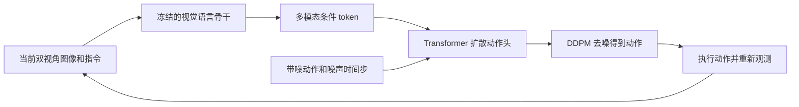

# Diffusion Head

面向无人机视觉语言导航的 **Diffusion Policy 与动作扩散头设计研究**。本项目基于 AeroVLA，使用前视图、下视图和导航指令生成 `[fwd, down, yaw, land]`，重点研究动作头结构、条件注入、动作序列建模和滚动执行。

课程实验固定 **DDPM、100 个训练噪声步、10 步推理去噪**；不比较扩散步数，也不开展 DDPM / DDIM 对比。动作预测长度 `H` 和执行长度 `E` 属于控制策略变量，不是扩散步数。

## 从这里开始

| 内容 | 文档 |
| --- | --- |
| 安装、数据准备、训练和评估 | [运行指南](docs/guides/training_and_evaluation.md) |
| 方法原理、当前实现与设计边界 | [动作扩散头设计](docs/design/diffusion_action_head.md) |
| 三人分工、文件归属和交付顺序 | [团队分工](docs/team/README.md) |
| 实验编号、控制变量、指标与统计 | [实验协议](docs/experiments/protocol.md) |
| 张量、检查点和评估交付接口 | [接口约定](docs/design/interfaces.md) |
| 全部文档与历史证据 | [文档导航](docs/README.md) |

## 当前可运行的功能

- 冻结 OpenVLA 骨干及合并后的原 AeroVLA adapter，只训练 Transformer 扩散动作头。
- 单步动作监督与执行：`H=1, E=1`；默认 hidden 256、4 层、8 个注意力头。
- 轨迹隔离的 train / val、训练中验证、独立重载、离线动作指标与 AirSim 闭环评估。
- 数据与监督审计、训练监控、单元测试。

历史状态输入和联合 LoRA 实现仍保留，见[扩展入口](docs/guides/extensions.md)，但课程主实验关闭它们。直接回归头、MLP 头、池化条件 Transformer、多步数据与滚动执行均是 **待实现任务**。课程配置清单不是这些功能的实现，也不是已完成结果。



## 三人独立工作线

| 成员 | 负责内容 | 独立工作区 |
| --- | --- | --- |
| A | 单步回归 / 扩散头、MLP / Transformer、条件注入；训练共同基准 A0 | [成员 A](docs/team/member_a.md)、`src/course_heads/` |
| B | 序列数据、H / E、因果 / 双向动作注意力；从现有头出发 | [成员 B](docs/team/member_b.md)、`src/course_sequence/` |
| C | 统一评估、原 AeroVLA 参考基线、正式闭环、配对统计与作图 | [成员 C](docs/team/member_c.md)、`evaluation/course/` |

A 和 B 从同一个已有 Transformer 基准出发；B 不等待 A 选出最佳结构。C 从项目开始建设评估流程。A0 与 B0 是同一基准，不重复训练。

## 快速开始

先按[指南](docs/guides/training_and_evaluation.md)安装环境并准备本地模型与数据。仓库不分发 7B 权重、原 adapter、训练图像、仿真场景或训练产物。

```bash
git clone https://github.com/xiyang-666/diffusion-head.git
cd diffusion-head
conda activate aero_vla
export PYTHON=python

# 校验轨迹划分并预处理首批数据，不加载 7B 权重
bash scripts/train_diffusion_head.sh --check-data --history-length 0

# 两步训练、保存和独立重载检查；使用不存在或为空的输出目录
CUDA_VISIBLE_DEVICES=0 HISTORY_LENGTH=0 SMOKE_OUTPUT_DIR=./checkpoints/course_smoke bash scripts/smoke_diffusion_pipeline.sh

# A0 基准，训练预算必须与其他课程模型按协议保持一致
CUDA_VISIBLE_DEVICES=0 bash scripts/train_diffusion_head.sh   --output-dir ./checkpoints/course_A0_seed42   --history-length 0 --num-train-timesteps 100 --num-inference-steps 10   --epochs 5 --batch-size 2 --gradient-accumulation-steps 8 --seed 42

CUDA_VISIBLE_DEVICES=0 bash scripts/eval_diffusion_head.sh   --checkpoint ./checkpoints/course_A0_seed42   --output ./eval_results/course_A0_seed42/offline.json
```

主对照使用固定训练预算的最终权重；`best/` 是 noise MSE 最低的检查点，不能把只有扩散模型才有的 noise MSE 当作所有模型的共同选择标准。完整训练之前先用 smoke 验证环境。

## 项目结构

```text
src/model_wrapper/       已有模型、扩散头与在线 wrapper
src/course_heads/        A 的扩展区域，当前仅定义归属与接口
src/course_sequence/     B 的扩展区域，当前仅定义归属与接口
src/vlnce_src/           已有闭环评估与环境
scripts/                 已有训练、评估、审计与监控入口
configs/course/          固定协议与 A/B/C 实验规格，不是训练程序
evaluation/course/      C 的评估扩展区域与运行记录模板
data/                   划分、闭环任务和场景元数据
airsim_plugin/          模拟器管理服务与客户端
tools/visualization/    原有视频、点云与轨迹辅助工具
third_party/            原项目携带的 RPC 修复包
tests/                  已有回归测试
docs/                   课程设计、分工、指南、历史归档与证据
```

`dataset_raw/`、`openvla-7b/`、`checkpoints/`、`envs/`、`eval_results/`、`logs/` 和缓存均为本地资源。训练清单 `data/aerovla_train_dataset.json` 也需另行准备；当前默认清单有 train 369,274 帧 / 6,850 条轨迹，val 41,176 帧 / 761 条轨迹。

## 历史结果与课程结果

历史 NYC seen 281 条任务中，原扩散 best 的 SR 为 58.36%、OSR 为 62.28%、原协议 SPL 为 52.07%。这些是已有检查点的结果，**不是新课程实验 A0–B4 的结果**。原 adapter 的数据重叠、任务提示和指标定义都需要说明。统计范围见[历史证据索引](docs/archive/README.md)。

## 来源与许可

基于 [AeroVLA](https://github.com/XuPeng23/AeroVLA)，动作扩散设计参考 [NavDP](https://github.com/InternRobotics/NavDP) 与 [Diffusion Policy](https://diffusion-policy.cs.columbia.edu/)。保留上游作者署名、Git 历史及 [Apache License 2.0](LICENSE)。模型、数据和第三方资源遵循各自来源条款。课程报告应分别列出上游方法、课程前已有实现和本次新增工作。
