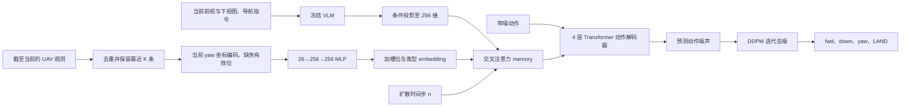

# 扩散动作头架构与数据合同

> 历史归档：保留原统计日期和实验范围；不代表本课程实验已完成。入口见 [归档说明](../README.md)。

[返回文档首页](../../README.md)

> **已实现的架构。** 下方首次交付与数据核验记录均保留其历史语境；数据缺失、split 未接入等问题已在后续解决。实际训练/评估请使用[运行指南](../../guides/training_and_evaluation.md)。

阅读定位：[架构与损失](#已实现的架构) · [UAV 状态与历史](#uav-history) · [动作与数据格式](#数据合同) · [历史数据就绪检查](#data-readiness)。

日期：2026-10-10。

**后续实现更新：** 轨迹 split、训练中验证和独立离线动作评估现已接入，最新运行方式见[训练与评估指南](../../guides/training_and_evaluation.md)。本报告保留首次架构交付的设计和历史验证结果；下文关于数据缺失、人工标签 smoke 和旧命令的描述不代表当前状态。

## 已实现的架构

```text
前视图 + 下视图 → 原 OpenVLA 视觉骨干 → 原 projector
                                            ↓
导航指令 + Action: → token embedding → 多模态 Llama decoder
                                            ↓ 冻结的最终层隐状态
高斯噪声动作 + 扩散时间步 → Transformer 动作扩散头 → 连续动作 + LAND
```

加载本地 OpenVLA 权重，可合并已有 AeroVLA LoRA 和其 `modules_to_save` projector；随后删除 `language_model.lm_head`，直接调用 Llama decoder 取得最终层隐状态。新训练和推理路径不生成词表 logits，不调用 `generate()`，不把动作标签输入语言模型。

第一阶段（`train_diffusion_head.py`）中，视觉骨干、projector、token embedding、Llama 及合并后的 LoRA **全部冻结**。该模式的 `train()` 把骨干保持在 `eval()`，特征提取关闭梯度，AdamW 仅包含 `diffusion_head` 参数，训练时另检查上游无梯度。扩散头中的条件投影属于可训练头的一部分。

2026-11-03 新增第二阶段 `train_diffusion_joint.py`：从已有动作头检查点初始化，视觉与 Llama 使用新增 LoRA，projector 和动作头完整训练，动作损失可经过 Llama 回传到视觉。基座原参数保持冻结。联合权重使用 v2 格式保存，v1 仍兼容；具体配置、状态与验证范围见[联合训练记录](../experiments/joint_lora_20261103.md)。这项改动没有把数值状态/历史移入 Llama，输入接口仍由初始化检查点决定。

<a id="uav-history"></a>

## 2026-10-12：可选 UAV 状态与因果短历史

在前序[调研方案 A](../research/history_pose_20261012.md#方案-a状态直接进入扩散头llama-接收简短可读的历史摘要)基础上，首先实现数值状态进入动作头的部分。`--history-length 4` 表示最近四个决策观测，包含当前帧；`0` 保留原模型，`1` 可用于仅当前状态的消融。历史长度与未来动作 horizon 无关，动作标签仍为一步。

```text
当前图像＋指令 → 冻结 VLM → 原条件投影 ───────────┐
过去＋当前 UAV 状态 → 共用坐标编码 → 两层 MLP ────┼→ 动作扩散头 → fwd/down/yaw/LAND
                                  ＋时间槽位编码 ┘
```

设计参考与边界：

- [Diffusion Policy（RSS 2023 / IJRR 2024）](https://diffusion-policy.cs.columbia.edu/)及其[官方低维 Transformer policy](https://github.com/real-stanford/diffusion_policy/blob/main/diffusion_policy/policy/diffusion_transformer_lowdim_policy.py)：短观测窗口作为扩散条件。这里只借鉴因果观测条件，未移植其多步动作执行协议。
- [π0 论文](https://arxiv.org/html/2410.24164v4)及 [openpi 的 `embed_suffix`](https://github.com/Physical-Intelligence/openpi/blob/main/src/openpi/models/pi0.py)：状态可直接进入动作专家。本项目仍使用 DDPM，没有改成 flow matching。
- [OpenVLA-OFT](https://arxiv.org/html/2502.19645v1)及[官方 `ProprioProjector`](https://github.com/moojink/openvla-oft/blob/main/prismatic/models/projectors.py)：连续状态的两层 MLP 映射。OFT 将状态送入 Llama 且训练 LoRA；本实现将投影放入动作头，不能把 OFT 结果当成本项目收益证明。

<a id="history-sources"></a>

### 逐项设计来源：论文、代码与工程判断

2026-10-12 补充核验。当前实现组合了已有的条件策略设计和本项目的数据处理约束；没有一篇论文完整给出这里的 26 维 UAV 特征、K=4 历史和冻结 OpenVLA＋DDPM 组合。下表区分直接参考、通用经验和本地证据，避免把来源论文的效果当作本项目已验证的收益。

| 本项目设计 | 参考来源与具体位置 | 实际借鉴范围及本项目选择 |
| --- | --- | --- |
| 最近 K 个观测作为扩散条件 | Diffusion Policy；官方 `diffusion_transformer_lowdim_policy.py` 的 `predict_action()` / `compute_loss()`，`cond = nobs[:, :To]` | 借鉴短观测窗口条件化。这里将窗口具体化为 UAV 数值状态，K=4 是初始实验配置；未移植多步动作执行协议。 |
| 状态直接进入动作模块 | π0；openpi `pi0.py` 的 `state_proj` / `embed_suffix()`，仅 `not self.pi05` 分支 | 借鉴动作侧接收连续状态的路由。π0 使用 flow matching 和动作专家；本实现向已有 DDPM decoder memory 追加状态 token，结构与训练范围并不相同。 |
| 每帧数值经两层 MLP 变为 token | OpenVLA-OFT；`projectors.py::ProprioProjector` 的 `Linear → GELU → Linear` | 借鉴连续状态投影器。OFT 投影到 Llama 维度；这里为 `26 → 256 → 256`，投影器在历史帧之间共享，并位于动作头内。OFT 论文 Tables IV/V 明确没有观测历史，历史扩展属于本项目选择。 |
| 动作 query 对条件 memory 做 cross-attention，保留噪声预测损失 | [NavDP 论文](https://arxiv.org/html/2505.08712v3)与[官方仓库](https://github.com/InternRobotics/NavDP)；本地兄弟仓库 `../NavDP/baselines/navdp/policy_network.py` 的 `predict_noise()` | 这是前序扩散头的主要代码参考：动作投影、Transformer decoder、时间与位置编码、DDPM 去噪。本次复用这个头并追加状态条件；没有移植 NavDP critic、深度条件或其轨迹动作语义。 |
| 相对朝向的 sin/cos、历史槽位与类型编码 | [HAMT，NeurIPS 2021，§3.1](https://papers.nips.cc/paper/2021/file/2e5c2cb8d13e8fba78d95211440ba326-Paper.pdf)提供相对 heading/elevation 的 sin/cos，以及历史步和类型 embedding 的先例；也属于常见 Transformer 表示方法 | 借鉴角度周期性与顺序/类型区分。这里的 roll/pitch/相对 yaw、K 个可学习槽位和状态类型向量是适配选择；未实现 HAMT 的分层全景历史 Transformer。 |
| 所有历史位置统一转换到当前 yaw 对齐的重力坐标系 | 机器人刚体坐标变换的一般几何方法；本项目 [UAV 表示设计](../research/history_pose_20261012.md#6-推荐的状态与历史表示) | `Rz(yaw_t)^T(p_i-p_t)` 是针对水平前进、偏航与升降语义的工程选择，不是从上述论文原样移植。它区别于随 roll/pitch 倾斜的完整机体系；既有控制器的 Euler 差异仍需保留说明。 |
| 13 个数值＋13 个有效位；20 m / 5 m/s / 10 s 尺度 | 本项目 [源数据抽查](../../reports/history_state_20261012/source_audit.json)与传感器字段定义 | 26 维特征、尺度、裁剪和 K=4 均由本项目设定，尚无最优性证据。抽查 128 条中仅 10 条有速度/时间，故必须显式区分缺失与真实零；该比例不是全量覆盖率。 |
| 字段 mask、窗口 padding mask、观测去重与因果窗口 | 通用缺失数据/序列建模及避免数据泄露的工程方法；本地 `AirVLNSimulatorClientTool_AeroVLA.py` 每次动作结束后把同一次末态追加五份 | 字段有效位和 padding mask 处理不同问题；按观测标识去重，不能把五份末态当成五次独立观测。先划分轨迹再建历史，在线只用实际发生的路径，属于数据正确性要求。 |
| 冻结 VLM，仅训练含状态投影的动作头；兼容旧 checkpoint | 本项目既有训练边界、参数审计及检查点合同 | 选择动作侧入口可保持现有 `encode_condition()` 的 `no_grad`。这不是 π0/OFT 已证明最优的训练策略；旧模型的 K=0 回退是软件兼容设计。 |
| K=0/1/4 与“重复当前帧占满相同槽位”的消融 | [How Should Vision-Language-Action Models Use Proprioceptive State?，2026-08 v1，§5.2 / Table 2](https://arxiv.org/html/2608.03052v1) | 借鉴等槽位实验，区分真实时间变化与增加 token 数的作用。该工作是机器人操作预印本、全量微调 π0.5；这里的对照仍是后续实验建议，不能据其结果宣称冻结 UAV 模型已获得相同收益。 |

研究文档中的另一入口“状态 token 进入 Llama”主要对应 OpenVLA-OFT；当前尚未实现。地标/拓扑长期记忆参考 MapGPT，视觉历史编码参考 HAMT/NaVid，详见[前序调研](../research/history_pose_20261012.md)；这些与目前仅输入短期数值状态的版本应分别评测。

本次重新读取了上述 Diffusion Policy、openpi、OpenVLA-OFT 官方 `main` 代码与本地 NavDP 实现。官方 `main` 链接可能变化，本文记录的是核验当日的方法对应关系，不声明固定提交的完整复现。

### 数据与坐标合同

共享实现为 [uav_history.py](../../../src/uav_history.py)，训练与在线 wrapper 调用同一编码器。`state_history` 为 `[B,K,26]`，前 13 维为数值，后 13 维为逐字段有效位；`state_history_mask` 为 `[B,K]`，True 表示真实观测。不足窗口左侧补零，当前观测位于最后一槽。

| 数值维度 | 定义 | 固定归一化 |
| --- | --- | --- |
| 0–2 | `Rz(yaw_t)^T (p_i - p_t)`，统一在当前 yaw 对齐、竖直轴保持重力方向的坐标系 | 除以 20 m |
| 3–6 | 历史/当前 roll、pitch 的 sin/cos | 原值 |
| 7–8 | `sin(yaw_i-yaw_t), cos(yaw_i-yaw_t)` | 原值 |
| 9–11 | 有实测字段时，将 NED 线速度旋转到当前 yaw 坐标系 | 除以 5 m/s |
| 12 | 当前时刻减历史时刻；仅使用有效 AirSim 纳秒时间戳 | 除以 10 s |

连续数值裁剪至 `[-1,1]`。20 m、5 m/s、10 s 是版本化的工程尺度，未经最优性验证，也未从验证集估计。NED 的正 z 向下；相对 z 不是离地高度。四元数顺序为 xyzw，归一化后计算姿态。当前点的相对位置为零，但保留当前 roll/pitch；历史点提供实际走过的局部路径及朝向变化。没有输入绝对地图坐标、目标距离、专家动作、终止标记或未来轨迹。

数据集先完成轨迹 split，再按每条轨迹的数值图像帧号排序建索引，最后才抽样训练子集。每个样本只读取该帧及以前决策图像对应的 `log/<frame>.json`。缺失日志或必要 pose 会报错；不读取 `merged_data.json` 的未来路径作为模型特征。在线按同一观测的时间戳/帧号去副本，无可靠标识时仅消除对象身份相同的副本，不按位置相同删除悬停。

真实日志缺少的速度/时间不做有限差分猜测，数值为零、对应有效位为零。[128 条固定随机跨轨迹抽查](../../reports/history_state_20261012/source_audit.json)中 10 条具备有效速度/时间，均来自 Carla_Town15，其余 118 条缺失；这不是全量覆盖率。缺失模式可能成为地图线索，需要屏蔽速度/时间的消融和更完整的实测数据。首轮重点验证已有 pose 与实际短路径，不据此声称模型已学会可靠动力学。

本分支 yaw 取标准 xyzw 四元数对应的重力对齐 heading。原方向提示使用完整姿态逆旋转，原控制器使用 `as_euler('zyx')[0]`，在非零 roll/pitch 下与本分支 heading 不完全相同；本次未改这些既有动作解释行为，也未将历史旋转结果直接当作动作标签。

<a id="velocity-source"></a>

### 速度从哪里来，以及何时采样

在线速度由 [State.retrieve()](../../../airsim_plugin/AirVLNSimulatorClientTool_AeroVLA.py) 调用 `client.getMultirotorState(vehicle_name=...)`，读取 `data.kinematics_estimated.linear_velocity`，存入 `sensors.state.linear_velocity`。这是三轴运动学反馈，单位 m/s、世界 NED 坐标（北、东、下）；输入模型前由 [encode_state_history()](../../../src/uav_history.py) 将水平分量旋转到当前 yaw 朝向，除以 5 m/s 并裁剪到 `[-1,1]`。它不由本项目根据相邻位置差分计算，也不取控制器下发的目标速度。模型保留三轴分量，没有另加速度模长。

这里的“实测字段”指日志/状态接口报告的反馈值，不代表独立物理测速传感器。当前评估设置的 `VehicleType` 为 `SimpleFlight`；按 [AirSim 官方 getMultirotorState 文档](https://microsoft.github.io/AirSim/apis/#getmultirotorstate)，SimpleFlight 的 estimated kinematics 与 ground truth 相同。因此当前仿真速度应理解为接口提供的仿真运动学状态，不能仅凭 `kinematics_estimated` 字段名宣称它来自 GPS/IMU 融合或具有真机估计噪声。

离线训练从 `dataset_raw/<map>/<trajectory>/log/<frame>.json` 读取同名字段。缺失或非有限分量用零值加无效位表示，不用帧号推算 m/s。水平旋转需要 x、y 均有效；z 分量单独判断。2026-10-12 复核的 NYC 原始日志 `406380d6-c889-46ad-a7b2-42c2619cc918/log/000240.json` 仅含 position/orientation，没有速度和时间；同一地图当前在线运行保存的日志可以含这些字段。原始训练数据与在线接口的字段覆盖必须分别统计。

采样时机也是限制：当前动作执行器在动作结束后先调用 `moveByVelocityAsync(0, 0, 0, duration=0.5).join()`，再读取状态，并把这一次末态追加五份。因而历史中记录的是下达零速度命令后的反馈速度，可能接近零，不能代表整段动作的巡航速度，也不能保证无人机已经完全静止。当前历史编码会去掉这些副本；尚未增加动作执行过程中的连续速度采样。本次只记录该边界，没有改变运行中的控制或采样协议。

### 模型与检查点合同

状态 MLP、槽位编码与类型编码归属 `diffusion_head.*`，经过 cross-attention 影响动作；视觉骨干、Llama、原 projector 与合并 LoRA 的冻结方式不变。原 `encode_condition()` 的 `no_grad` 仅用于 VLM，不包住新增状态 MLP。没有额外向 prompt 添加数值文字，也未实现 Llama 状态 token 或语义长期记忆。

2026-10-13 接口复核：`encode_condition(input_ids, pixel_values, attention_mask)` 只把当前图像与文字送入 Llama；`state_history/state_history_mask` 由 `forward()` / `predict_action()` 直接传给扩散头，不参与 Llama hidden states 的计算。Llama 调用使用 `use_cache=False`，当前路径也没有跨决策保存语言模型历史。在线 prompt 中的 `Fly forward-left ...` 等方向文字由当前 pose 与目标位置计算，所以 Llama 间接接收到粗粒度的当前相对目标方向，但没有直接收到数值 pose、速度或轨迹历史。这里应区分“整个策略使用历史”与“Llama 使用历史”。

检查点保存 `state_dim/history_length/state_schema_version` 及全部新增头权重；训练元数据保存特征名、坐标和尺度 schema。离线评估及在线 wrapper 由检查点自动选择历史长度，并检查数据 schema。旧检查点缺少新配置字段时按禁用处理，仍可加载。启用历史的模型缺少历史输入会明确报错，不能用旧无历史权重冒充新增能力。

运行命令和验证进度统一见[指南](../../guides/training_and_evaluation.md#uav-history)。

<a id="history-implementation"></a>

### 从算法到代码：一次决策怎样使用状态历史

下面按 2026-10-12 的实际实现展开。历史是最近 K 个去重后的观测，包含当前帧；尚未实现按转弯、地标或受阻事件选择关键帧。训练从专家示范的过去观测构建窗口，在线从策略实际飞行的过去观测构建窗口。

设当前决策索引为 t，扩散噪声步为 n，两者不是同一个时间变量。原条件是当前图像与指令的冻结 VLM 特征 C_t；新增条件是 S_t，形状为 `[B,K,26]`。策略由 `p(a_t | C_t)` 扩展为 `p(a_t | C_t,S_t)`，动作仍为当前一步的四维控制量。



**1. 几何特征让历史处于同一参考系。** 对每个历史点 i，计算 `delta_p = Rz(yaw_t)^T @ (p_i-p_t)`，再除以 20 m。x 沿当前水平朝向，y 沿其右侧，z 保持 NED 向下。线速度用同一个旋转矩阵变换后除以 5 m/s。roll/pitch 由规范化 xyzw 四元数得到；yaw 用相对当前朝向的 sin/cos 表示，以避免 ±π 跳变。

例如无人机沿当前朝向依次前进，四个观测相对当前位置分别在后方 9、6、3、0 m，则相对 x 输入为 `[-0.45,-0.30,-0.15,0]`。这只表示已经发生的位移；若缺少时间戳，不能解释成某个确定的 m/s。若发生转向，所有旧点会随当前 yaw 重新表达，模型可以同时读取路径形状和朝向变化。

**2. 两层有效性表示解决不同问题。** 每个 token 的后 13 维表示前 13 个字段是否有观测依据；单独的 `[B,K]` mask 表示整个槽位是否存在。实测速度为零对应 `(value=0, valid=1)`，未知速度对应 `(0,0)`。轨迹只有两个观测、K=4 时，窗口为 `[PAD,PAD,previous,current]`，槽位 mask 为 `[False,False,True,True]`。当前帧放在最后，因而槽位 embedding 可以保持一致的相对顺序。

**3. 去重发生在截断窗口之前。** 编码器从末尾向前扫描，优先以时间戳、其次帧号识别副本，收集够 K 个唯一观测后恢复时间顺序。没有可靠标识时，仅识别相同 Python 状态对象。在线模拟器将同一个动作末态重复写入五次，这一步避免 K=4 被四份同一末态占满。有不同时间戳的悬停观测会保留，不能按 pose 相同去重。K 表示观测数量，不表示固定秒数。

**4. 状态成为动作头的条件 token。** 每个状态槽位 j 独立通过共享 MLP，再加可学习的槽位和类型向量：

```text
z_j = Linear_2(GELU(Linear_1(s_j))) + position[j] + state_type
memory = concat(time_embedding(n), project(C_t), z_0, ..., z_(K-1))
```

MLP 是 `26→256→256`；VLM 条件是 `[B,L,4096]`（当前 7B 配置），投影为 `[B,L,256]`。K=4 时新增 `[B,4,256]` 状态 token，memory 总长度为 `1+L+4`。带噪动作 `[B,1,4]` 投影后作为 decoder 的 query，交叉注意力从图像/语言条件和有效状态 token 读取信息。

状态有效位作为 MLP 输入参与学习；槽位 mask 则反转后传给 PyTorch 的 `memory_key_padding_mask`，True 表示屏蔽。补齐槽位在 MLP 前先清零，防止无效 NaN 污染激活或梯度。状态 token 之间没有新增时序 self-attention、RNN 或长期缓存；时序由相对几何、槽位位置、可用时间差，以及动作 query 对各槽位的注意力表达。窗口中的全部有效观测均已发生，因此允许动作访问整个窗口。

**5. 损失与梯度路径。** 对归一化专家动作 a、噪声 epsilon 和噪声步 n，训练仍使用：

```text
a_noisy = sqrt(alpha_bar[n]) * a + sqrt(1-alpha_bar[n]) * epsilon
loss = mean((epsilon_theta(a_noisy, n, C_t, S_t) - epsilon)^2)
```

没有增加历史重建、未来轨迹预测或速度监督损失。新增 MLP、槽位 embedding、类型 embedding 都放在 `diffusion_head.*` 内，跟随原头一起训练。VLM 的 `encode_condition()` 保持 `no_grad`；状态 MLP 在它之外，能够正常反向传播。默认仍是 100 个训练噪声步、10 步 DDPM 推理，单步动作输出 `[B,1,4]`。

K=4、hidden=256 时，MLP 有 `(26×256+256)+(256×256+256)=72,704` 参数，槽位 embedding 有 `4×256=1,024` 参数，类型向量有 256 参数，共新增 **73,984**。可训练头从 **5,265,668** 增至 **5,339,652**，约增加 1.4%；冻结参数仍为 **7,409,644,992**。这是参数量变化，不是实测延迟或性能收益。

**6. 文件与调用路径。**

| 代码位置 | 具体责任 |
| --- | --- |
| [src/uav_history.py](../../../src/uav_history.py) | `HISTORY_SCHEMA` 定义 26 维协议；`observation_identity` 去重；`encode_state_history` 完成坐标变换、归一化、缺失和 padding |
| [src/diffusion_dataset.py](../../../src/diffusion_dataset.py) | split 后按轨迹建立数值帧索引；`_get_state_history` 只读当前及过去日志；collator 输出两个新增 batch 字段 |
| [src/model_wrapper/diffusion_action_head.py](../../../src/model_wrapper/diffusion_action_head.py) | 可选状态编码器、位置和类型参数；拼接 memory 与 mask；loss 和 sample 均接收历史 |
| [src/model_wrapper/aerovla_diffusion.py](../../../src/model_wrapper/aerovla_diffusion.py) | `forward/predict_action` 将历史绕过 VLM 传给动作头；保存和严格加载完整头配置及权重 |
| [src/train_diffusion_head.py](../../../src/train_diffusion_head.py) | `--history-length` 同时控制 train/val 数据集和模型；检查仅头参数训练；保存 schema |
| [src/eval_diffusion_head.py](../../../src/eval_diffusion_head.py) | 从 checkpoint 恢复 K、验证 schema；去噪损失与动作采样都使用历史 |
| [src/model_wrapper/aerovla_wrapper_ui.py](../../../src/model_wrapper/aerovla_wrapper_ui.py) | 从实际 episode 调用共享编码器；逐条 batch 独立构建窗口；沿用原动作/停止接口 |
| [scripts/audit_uav_history.py](../../../scripts/audit_uav_history.py) | 记录真实访问帧、核查因果窗口，用独立几何计算复核特征并生成图例 |

训练先按整条轨迹划分 train/val，再建历史索引，最后执行限量 Subset，所以随机只抽到当前帧也不会丢失其合法过去。不同轨迹不共用窗口。读取日志时检查帧号对齐；历史特征路径不读取动作 label、终止标志或 merged_data 的未来轨迹。标签只走原监督损失路径。

**7. 当前状态消融和能力边界。** K=0 为原图像/文字条件，K=1 为本协议的当前状态，K=4 为当前加最多三个过去观测。因为使用当前点作为原点，K=1 的相对位置恒为零、相对 yaw 恒为 `(sin=0,cos=1)`、有效 age 恒为零；若日志还缺速度，则主要新增当前 roll/pitch 和字段有效性，不能将它描述为完整位置/高度/动力学输入。

目前没有历史 RGB、过去下发动作、角速度、加速度、绝对高度、地标记忆或 Llama 状态 token。新增数值分支不含目标坐标；现有评估 prompt 仍使用目标坐标生成方向描述，该既有信息条件需保留在实验解释中。128 条抽查的速度/时间缺失与地图相关，完整训练前后应做缺失字段屏蔽对照。NED 坐标、控制器 Euler 约定及非零 roll/pitch 的差异见上文，不能据接口一致就宣称控制几何已经完全一致。

**8. checkpoint 与验证范围。** 旧配置缺少状态字段时默认 `state_dim=0/history_length=0`，不创建新增参数；历史模型缺输入或 schema 不匹配则报错。训练入口当前从冻结基座与 adapter 新建动作头，没有把旧 best 自动扩展并继承为历史头的 warm-start 路径。K 改变也会改变槽位权重形状，应作为独立训练配置。

已记录的 123 项测试、128 个真实窗口抽查及真实 7B 两步训练/保存/重载证明实现链路可用；尚未证明闭环收益。历史分支流程检查曾输出到 `checkpoints/diffusion_history_smoke_20261012`；本次说明复核时该权重目录已不在当前工作区，保留的证据是 [docs 验证摘要](../../reports/history_state_20261012/verification.json)及其 `smoke_snapshot` 配置/指标快照。GPU 3 的 NYC seen 281 条任务使用 `checkpoints/best`，其 history_length=0，是原模型评估。后续效果比较需在同一训练划分和评测协议下分别训练 K=0、1、4，并增加同槽位重复当前状态的对照；后一个对照目前只是实验建议。

## NavDP 参考与适配

参考本地 `NavDP/baselines/navdp/policy_network.py` 的 `NavDP_Policy`、`predict_noise` 与去噪循环，以及 `policy_backbone.py` 的正弦时间编码。

| 项目 | 本次实现 |
| --- | --- |
| 去噪网络 | 动作线性投影、可学习动作位置、正弦时间步、TransformerDecoder、LayerNorm、epsilon 输出 |
| 条件 | AeroVLA 多模态 Llama 的最终层全部 token，正确插入视觉 token mask 并屏蔽文本 padding |
| 训练目标 | `MSE(epsilon_theta(x_t,t,condition), epsilon)`，随机时间步和高斯噪声 |
| 调度器 | `diffusers==0.30.3` 的 DDPM，`squaredcos_cap_v2`，epsilon prediction，clip_sample |
| 默认头参数 | hidden_dim=256，4 层，8 heads，dropout=0，训练 100 时间步，推理 10 步 |
| 跳步采样 | 从末时间步开始，显式注册时间步序列，确保如 100/30 的不可整除配置使用真正相邻时间步 |
| 动作语义 | 保持 AeroVLA 的 fwd/down/yaw/LAND，不使用 NavDP 的 xyz 路径增量和累加 |
| critic | 未移植；当前 AeroVLA 标签未提供 NavDP critic 所需监督 |

NavDP 原实现默认 10 个训练/推理步；这里的 100/10 是可配置初始值，尚未经过真实数据效果调优。可用 `--num-train-timesteps 10 --num-inference-steps 10` 对齐原步数。

## 数据合同

动作顺序固定为 `[fwd, down, yaw, land]`，每个样本输出 `[1,4]`，batch 为 `[B,1,4]`。

| 维度 | 物理/原标签范围 | 归一化 |
| --- | --- | --- |
| fwd | [0,5] | [-1,1] |
| down | [-5,5] | [-1,1] |
| yaw | [-1.1,1.1] | [-1,1] |
| land | 0/1 | -1/+1 |

前三维沿用原代码裁剪范围，取消 99 桶量化。LAND 标签为 `is_last_step OR is_penultimate`；推理以归一化第四维 `>=0` 判断降落。推理返回原接口的 `{'fwd', 'down', 'yaw'}` 和停止标志列表。

图片处理复用原双视角拼图：前视在上、下视在下。训练文本为 `instruction.strip() + '\nAction: '`，不添加目标数字、LAND 或 EOS。超长 prompt 明确报错；模型还会检查加上视觉 token 后的总上下文长度。

`instruction` 应是已准备好的最终导航提示，可保留原格式的 `<image>` 前缀，但不要包含 `Action:` 或动作答案。数据集不会从评测 episode 的原始描述自动生成方向提示。

当前训练标注每条只定义一步动作，因此数据集只允许 horizon=1；扩散头模块支持更长 horizon，但需要先提供显式、可靠的未来动作序列数据管线。

训练 JSON 格式示例（数值仅示意）：

```json
[
  {
    "traj_rel_dir": "Japanese_Street/trajectory-id",
    "img_name": "000000.png",
    "instruction": "<image>\nFly forward and find the target.",
    "label": {"fwd": 2.5, "down": 0.0, "yaw": 0.0},
    "is_last_step": false,
    "is_penultimate": false
  }
]
```

## 启动训练

首次交付时（2026-10-10）尚缺正式逐帧监督文件 `data/aerovla_train_dataset.json`，评测 episode JSON 不能替代它。后续已补齐监督与 split，当前数据和训练命令见[运行指南](../../guides/training_and_evaluation.md)；下面保留首次交付命令作为历史记录。

```bash
cd /data/xiyang/project_orig/AeroVLA
PYTHON=/data/xiyang/.conda/envs/aero_vla/bin/python \
CUDA_VISIBLE_DEVICES=1 bash scripts/train_diffusion_head.sh \
  --model-path ./openvla-7b \
  --adapter-path ./checkpoints/aero_vla \
  --data-root ./dataset_raw \
  --train-json ./data/aerovla_train_dataset.json \
  --output-dir ./checkpoints/aero_vla_diffusion \
  --batch-size 2 --gradient-accumulation-steps 8 \
  --epochs 5 --learning-rate 1e-4
```

这是单进程、单 GPU 脚本，有效 batch 默认 16。仅基座使用 bfloat16，扩散头以 float32 训练。梯度累积按真实样本数归一化，正确处理最后不足一批或不足一个累积窗口的情况。

- `--adapter-path none`：只冻结 OpenVLA 基座，不加载已有 AeroVLA adapter。
- `--max-steps 2 --max-samples 3 --num-workers 0`：真实标注准备好后可快速检查训练接口。
- `--device cpu --backbone-dtype float32`：CPU 路径，需要足够内存。
- `--save-steps 1000`：每 N 次 optimizer 更新保存一次；训练结束另在输出目录保存最终头。
- `--help`：查看全部超参数。输出目录已有 `run_config.json` 时拒绝覆盖，应使用新的实验目录。

训练输出包含 `run_config.json`、`metrics.jsonl`、`diffusion_head.pt`、`diffusion_config.json`、tokenizer 和 processor。检查点只保存头权重及基座/adapter引用、动作 schema 和训练元数据，**不保存优化器状态，也不支持精确断点续训**。加载仍需要原基座和原 adapter；本地引用保存为绝对路径，迁移机器时可用模型加载 API 的路径参数覆盖。

## 推理与原评测入口

`AerialVLAWrapper` 根据 `diffusion_config.json` 自动识别扩散检查点。准备好原项目要求的模拟器服务、场景和评测数据后，可使用现有 AirSim 入口：

```bash
PYTHON=/data/xiyang/.conda/envs/aero_vla/bin/python \
MODEL_DIR=./checkpoints/aero_vla_diffusion GPU_ID=1 bash scripts/eval_aerovla.sh
```

模型 API 也支持直接调用：

```python
import torch
from src.model_wrapper.aerovla_diffusion import AeroVLADiffusionModel
from src.diffusion_dataset import denormalize_actions

model = AeroVLADiffusionModel.from_pretrained(
    "./checkpoints/aero_vla_diffusion", device="cuda", torch_dtype=torch.bfloat16
)
# 原无历史模型 inputs 含 input_ids、attention_mask、pixel_values。
# 历史模型还需 state_history、state_history_mask；均与训练使用相同编码。
normalized = model.predict_action(**inputs)  # [B,1,4]
physical = denormalize_actions(normalized)
should_land = normalized[..., 3] >= 0
```

旧 `train_aerovla.py`、`scripts/train.sh` 保留原 LM/LoRA 行为；训练扩散头请使用新入口。旧 adapter 评测仍可正常选择。NavDP、原始基座权重和已有 adapter 文件未修改。

## 验证结果

- 完整测试命令：`OMP_NUM_THREADS=2 /data/xiyang/.conda/envs/aero_vla/bin/python -m pytest tests -q`。
- 首次交付时全套 **36 项通过**：扩散头 11、数据 13、模型 7、训练及推理接口 5。2026-10-12 历史分支交付记录为 123 项通过，见[最新验证记录](../development/changelog.md#history-20261012)；下列结果仍对应首次交付。
- 模型测试使用真实小型 Llama 与实际 PEFT adapter 保存/恢复/合并；逐张量确认一次 optimizer 更新后全部 backbone 权重不变，且头权重发生变化。
- 检查 DDPM 加噪和 epsilon loss、条件 padding、因果动作 mask、随机种子复现、任意合法推理步数、head checkpoint 严格往返、LoRA/projector 保留、无目标泄漏、梯度累积及 LAND 转换。
- 本地真实 tokenizer、processor、TravelUAV 双视角图片处理通过，得到 `[1,6,224,224]` 视觉输入。
- 训练 CLI `--help`、Python compileall、shell `bash -n`、`git diff --check` 通过。
- 真实 7B + 原 AeroVLA adapter 在 GPU 1 上完成两次更新，全部上游参数冻结，默认规格扩散头成功训练并保存逐步/最终检查点。输入为真实 TravelUAV 图片与人工测试标签，不能证明真实数据收敛或导航效果。

| 7B 短程指标 | 结果 |
| --- | --- |
| 冻结参数 | 7,409,644,992 |
| 可训练头参数 | 5,265,668 |
| 第 1 步（2 样本）loss | 1.2759649753570557 |
| 第 2 步（1 样本）loss | 0.8945425152778625 |
| 保存头权重大小 | 21,088,629 bytes，约 20.1 MiB |
| 检查点目录 | `/tmp/aerovla_diffusion_smoke_run`，仅作接口验证 |

检查点保存的 tokenizer、AutoImageProcessor 和 AutoProcessor 已离线重新加载成功。随后在 CPU float32 下完整重载 7B 基座、原 adapter 和保存的头，默认 10 步去噪通过：输出 `[1,1,4]`、全部有限且在 `[-1,1]`，确认不存在 LMHead，所有 backbone 参数仍冻结。CPU 与 GPU 骨干精度不同，此项验证加载和推理接口，不声称二者数值逐位一致。

短程训练实际命令（人工标签临时文件在验证前创建；不能直接作为正式数据使用）：

```bash
HF_HOME="$PWD/.cache/huggingface" \
HF_MODULES_CACHE="$PWD/.cache/huggingface/modules" \
HF_HUB_OFFLINE=1 TRANSFORMERS_OFFLINE=1 \
CUDA_VISIBLE_DEVICES=1 OMP_NUM_THREADS=4 OPENBLAS_NUM_THREADS=4 \
/data/xiyang/.conda/envs/aero_vla/bin/python -u src/train_diffusion_head.py \
  --train-json /tmp/aerovla_diffusion_smoke_train.json \
  --output-dir /tmp/aerovla_diffusion_smoke_run \
  --epochs 1 --max-steps 2 --batch-size 2 \
  --gradient-accumulation-steps 1 --num-workers 0 --save-steps 1
```

此次 GPU 访问先在沙箱内明确报 CUDA 不可用，经命令权限批准后在 GPU 1 完成，未占用已有任务所在的 GPU 0。测试环境为 PyTorch 2.1.2+cu121、transformers 4.42.4、diffusers 0.30.3。OpenVLA 自带代码提示期望 transformers 4.40.1；本次使用仓库 requirements 的 4.42.4，实际训练和重载推理已通过。

未开展完整正式训练或 AirSim 闭环指标评测；不保证未训练充分的头输出具有飞行控制质量。临时 smoke 检查点和人工标签应只用于开发验证。

## 逐次改动记录

| 记录 | 范围 |
| --- | --- |
| [扩散头工作记录](../development/changelog.md#head) | 去噪器、调度器、时间步修正及测试 |
| [模型工作记录](../development/changelog.md#model) | LMHead 移除、冻结、PEFT 合并与检查点 |
| [数据工作记录](../development/changelog.md#dataset) | 连续动作、图像/文本处理、数据验证 |
| [集成工作记录](../development/changelog.md#integration) | 训练入口、评测入口、依赖、集成修正和最终检查 |

本次以文件修改和上述日志交付，未自行创建 git commit。

<a id="data-readiness"></a>

## 附录：2026-10-10 数据就绪检查（历史记录）

日期：2026-10-10；本次只检查数据和运行条件，没有启动正式训练或操作正在运行的模拟器。

**后续状态：** 本报告识别的 split 未接入和缺少离线评估入口问题，已在后续实现中解决。最新代码、运行命令和验证结果请看[训练与评估指南](../../guides/training_and_evaluation.md)；下文保留当时的检查记录。

### 结论

数据已就绪，原先缺少正式训练标注的问题已解除。当前训练脚本可以读取完整训练 JSON，但**尚未读取 `continuous_split_seed42.json`**；直接执行原命令会将这份划分中的验证样本也用于训练。因此，开展按此划分的训练和离线验证前，应先接入轨迹过滤，并补充离线连续动作评估入口。

### 数据检查结果

| 项目 | 结果 |
| --- | --- |
| 标注总量 | 410,450 帧，7,611 条轨迹 |
| train | 369,274 帧，6,850 条轨迹 |
| val | 41,176 帧，761 条轨迹 |
| 轨迹交集、重复帧 | 均为 0 |
| 划分覆盖 | 完整覆盖全部标注轨迹，无重复划分项 |
| 轨迹 SHA256 | 与文件记录一致；按排序后的轨迹 ID 用换行连接计算 |
| 标注 schema | 全量通过：所需字段、有限数值、LAND 布尔值及非空指令 |
| 图片文件 | 全量核对 820,900 个 front/down 图片路径，缺失 0 |
| 实际解码与处理 | 固定种子抽取并包含首尾的 32 条真实标注通过本地 tokenizer、processor、dataset、collator |
| 批次形状 | 图片 `[4,6,224,224]`，动作 `[4,1,4]` |
| 输入文本 | 全量无已拼入的 `Action:`，抽样最长 90 tokens；未发现动作答案输入泄漏 |
| LAND 样本 | train 8,203；val 910 |

图片全量检查是文件存在性检查；实际图片解码检查为 32 条抽样，未声称解码了所有图片。

原始标签中有部分值超出原 AeroVLA 允许范围：fwd 5,201 条、down 879 条、yaw 9,204 条。这些值会按原有范围 `[0,5]`、`[-5,5]`、`[-1.1,1.1]` 裁剪后归一化，与本次已实现的数据逻辑一致；后续离线指标应明确针对裁剪后的训练目标。

### 训练与两种评估的区别

1. **训练**：当前 `src/train_diffusion_head.py` 只有 `--train-json`，会加载所有帧。需要根据 split 的 `train` 轨迹筛选，仅使用 369,274 帧。
2. **离线验证**：需要根据 split 的 `val` 轨迹筛选 41,176 帧，补充噪声预测 loss、连续动作 MAE/RMSE、LAND precision/recall/F1 等指标入口。现有仓库还没有此扩散头离线评估脚本。
3. **AirSim 闭环评估**：已有扩散头适配入口，但使用 `data/uav_dataset` 下原项目 episode JSON，不能把 `continuous_split_seed42.json` 直接传入 `--eval_json_path`。应在正式训练得到检查点后评估 SR/SPL/NE 等导航指标。

此次 split 在 11 张地图内部按轨迹留出；不能称作未见地图划分。冻结的旧 AeroVLA LoRA 是否曾训练过这些 val 轨迹，仅凭这两个文件无法确认，因此对应指标应称为“扩散头留出验证”。原项目 seen、unseen-object、unseen-map 闭环清单与这次训练/验证轨迹无交集。

### 运行条件快照

- 基座、原 AeroVLA adapter 和真实图片均在本地；先前已完成 7B GPU 两步接口验证，但那次使用人工标签，不是此次真实数据正式训练。
- 检查时 GPU 1/2/3 空闲，GPU 0 有已有任务。
- 检查到模拟器服务端口 30000、NYC 场景端口 30001 正在监听。未调用这些服务，避免影响已有任务。
- 当前评测脚本 `GPU_ID=1` 会选择模拟器服务端口 35000，检查时该端口没有服务监听；需要启动对应服务或调整评测的 GPU/端口配置，不能仅换 GPU 编号就假定闭环就绪。

本次没有改动训练/评估代码；仅新增此核验报告，并给原总报告添加最新状态提示。
