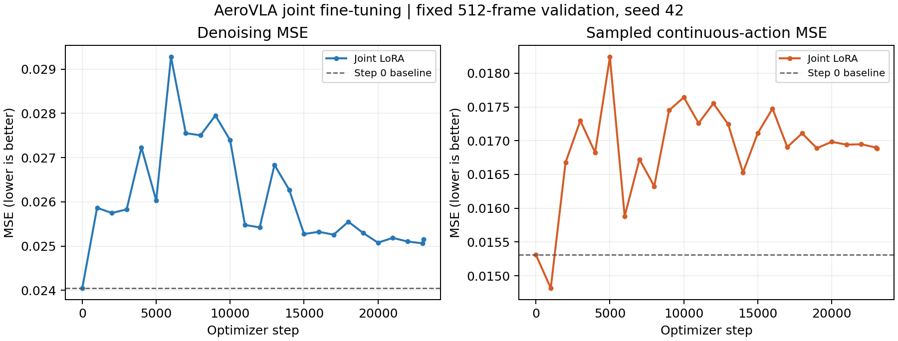

# 2026-11-03：从已训练扩散头继续联合 LoRA 微调

> 历史归档：保留原统计日期和实验范围；不代表本课程实验已完成。入口见 [归档说明](../README.md)。

[返回文档首页](../../README.md) · [运行指南](../../guides/training_and_evaluation.md#joint-lora)

## 2026-11-04 最终结果：训练完成，尚未获得整体改善

本轮于北京时间 **11 月 4 日 15:15:43 正常完成**，监督进程退出码 0。开始于 11 月 3 日 20:21:11，总耗时 **18 小时 54 分 32 秒**；23,080 次 optimizer 更新完整覆盖 369,274 个训练帧。已核查日志步号连续、累计样本数正确，loss、总梯度范数及四组梯度范数均有限。

固定 512 帧验证子集、相同 seed=42 / batch=2 的结果如下。误差越低越好，LAND F1 越高越好：

| 指标 | 联合训练前 step 0 | 最终 step 23,080 | 相对变化 |
| --- | ---: | ---: | ---: |
| 去噪 noise MSE | 0.02405148 | 0.02515621 | **增加 4.59%** |
| 归一化连续动作 MSE | 0.01530770 | 0.01688216 | **增加 10.29%** |
| 前进 MAE | 0.12216267 | 0.13578759 | 增加 11.15% |
| 升降 MAE | 0.20844559 | 0.22445970 | 增加 7.68% |
| 偏航 MAE（rad） | 0.05817965 | 0.05683123 | 降低 2.32% |
| LAND F1 | 0.96296 | 0.96296 | 不变 |

**按预先设定的 noise MSE 选择规则，本轮 `best/` 仍为 step 0。** 25 次验证中，24 个训练后检查点的 noise MSE 均未低于初始值。连续动作 MSE 的最低点出现在 **step 1,000：0.01481677，比初始降低 3.21%**，该点 LAND F1=1.0，但 noise MSE=0.02586498（增加 7.54%）。因此 step 1,000 是可进一步评估的候选，不能据部分指标把它改称本轮预设标准下的 best。验证子集仅含 13 个 LAND 正例，不能据此推断停止动作泛化已显著提升。

产物位置：

- [最终权重目录](../../../checkpoints/joint_lora_stage2_20261103)：step 23,080 的 `joint_adapter.pt`、`diffusion_head.pt` 与配置。
- [本轮自动 best](../../../checkpoints/joint_lora_stage2_20261103/best)：step 0 的联合训练初始化状态；原 `checkpoints/best` 未被替换。
- [step 1,000 候选](../../../checkpoints/joint_lora_stage2_20261103/checkpoint-1000)：连续动作 MSE 最低的已保存检查点。
- [机器可读结果](../../reports/joint_lora_20261103/training_result_20261104.json)、[验证曲线数据](../../reports/joint_lora_20261103/validation_curve.csv)、[可导出 PDF](../../reports/joint_lora_20261103/validation_curve.pdf)。

结论范围：这是 **K=0、单次训练、固定 512 帧监控集** 的离线结果，未训练数值状态/历史分支。本次离线复核未进行完整 41,176 帧验证，不能宣称导航提升，也不能单凭这些数值确定退化原因。目前没有启动下一轮训练或自动替换原模型。

2026-11-04 20:00（北京时间）按用户要求启动 final step 23,080 的官方 NYC seen 全部 281 条闭环评估，模型 GPU 0、仿真 GPU 1；沿用原任务、动作和终止协议。进度及完成后与原 best 的 SR/OSR/SPL/距离对比见[闭环自动报告](nyc_joint_final_seen281_20261104.md)。原 best 的 281 条结果重新核验通过；新权重的全量结果待完成。完整 val 上 step 0、step 1,000、final 的比较仍未执行。

### 2026-11-05：中断前相同 81 条任务的闭环对比

首次闭环进程于 11 月 4 日 21:53（北京时间）在第 82 条任务中断，原因是 AirSim 返回零尺寸 RGB，原读取代码未拒绝 `reshape(0,0,3)`，随后 `cv2.cvtColor` 抛出空图错误。已完成 **81/281**，剩余任务未计为失败。以下只取新旧结果中完全相同的 81 个 UUID，不能把新模型 81 条与旧模型 281 条直接比较。

| 指标 | 原 best，同 81 条 | 联合 final，同 81 条 | 变化 |
|---|---:|---:|---:|
| SR | 52/81 = 64.20% | 55/81 = 67.90% | +3.70 个百分点 |
| OSR | 57/81 = 70.37% | 56/81 = 69.14% | −1.23 个百分点 |
| SPL（原协议） | 52.27% | 55.63% | +3.36 个百分点 |
| NE（参考终点距离均值） | 35.34 m | 33.15 m | −2.19 m |
| 最终目标距离均值 | 35.21 m | 33.06 m | −2.15 m |

配对结果：共同成功 41 条，原失败／联合成功 14 条，原成功／联合失败 11 条，共同失败 15 条。该子集按参考轨迹长度优先执行，不能代表全量 seen；目前只能说已完成部分的 SR/SPL 提高、OSR 略降，尚无全量优劣结论。离线动作误差上升也不能直接等同闭环 SR 下降。故障日志保存在[首次运行目录](../../../eval_results/joint_final_nyc_seen281_20261104)。

81 条部分核验通过：4,222 动作、21,191 状态、43,030 张 PNG 的序列、CRC 和像素解码完整，距离/SPL 独立重算及 10 个 checkpoint 哈希一致，见[核验](../../../eval_results/joint_final_nyc_seen281_20261104/partial_audit_20261105.json)与[精确配对统计](../../../eval_results/joint_final_nyc_seen281_20261104/matched81_comparison_20261105.json)。取图边界新增响应数、尺寸、数据长度校验，异常进入原有最多 11 次、间隔 1 秒重试；未替换图像或修改控制。全套 184 项测试通过（其中 13 项为空图/重试针对性检查）。

**2026-11-05 17:22:36（北京时间）已续跑**：新[运行目录](../../../eval_results/joint_final_nyc_seen281_resume_20261105)保留已核验的 81 条，只执行其余 200 条；中断第 82 条的 45 个旧动作不计入新结果，该任务从 frame 0 重跑。GPU 0 推理、GPU 1 仿真，权重仍为 final step 23,080。续跑进程重新设 seed=100，没有恢复中断时的随机数状态；这与一次不间断运行不保证逐动作相同。总分母保持 281、每 UUID 只计一次，阶段与最终对比由[自动报告](nyc_joint_final_seen281_20261104.md)持续更新。

## 目标与训练边界

按用户选择，视觉骨干与 Llama 使用 LoRA，图文投影器和扩散动作头完整训练。GPU 0、1 用于这次训练，已按授权停止 GPU 0 上原 CARLA 服务（PID 3369666）；GPU 1 原为空闲。

初始化为 `checkpoints/best`：原动作头训练到 step 115400 / epoch 5。先恢复基座、合并原 AeroVLA adapter 和其 projector，再严格加载已有动作头，新增联合 LoRA 的 B 矩阵从零初始化。可训练 projector 使用 FP32，初始化时从 BF16 转换会改变后续计算精度，因此不能保证初始输出与旧冻结路径逐位一致；联合训练前另做固定验证集基线。

| 模块 | 本阶段更新方式 |
| --- | --- |
| DINO/SigLIP 视觉 Transformer 的有效 Linear 层 | LoRA，rank 16 / alpha 32 |
| Llama 的 q/k/v/o/gate/up/down 投影 | LoRA，rank 16 / alpha 32 |
| 图文 projector | 全部有效副本参数 |
| 扩散动作头 | 全部参数，继承 best |
| 基座原权重、token embedding | 冻结 |

此次不新增输入接口。`best` 为 K=0，无数值状态/历史；联合微调继承这个配置。对于已训练的 K>0 检查点，新入口会继承其历史长度与 schema，状态仍进入动作头；没有实施“状态 token 送入 Llama”的方案 B。

## 数据与验证

当前数据 manifest 和 split 的 SHA256 与 best 记录一致：train 369,274 帧 / 6,850 轨迹，val 41,176 帧 / 761 轨迹。820,900 个前视/下视图像路径全部存在；随机解码 16 帧、32 张图片通过，覆盖 8 个地图。路径存在性不等于全量图像解码校验。

保持原 train/val 划分；官方 NYC seen 281 任务不进入这次训练。默认用固定 seed=42 的 512 帧 val 子集监控并选 best，完整验证可用 `--max-val-samples 0`。原 AeroVLA adapter 的预训练数据重叠仍未知。

## 实现与当前进度

新增 [train_diffusion_joint.py](../../../src/train_diffusion_joint.py) 与双卡启动脚本；动作去噪 MSE 反向传播到视觉 LoRA、Llama LoRA、projector 和动作头。四组参数分开设学习率，首次 optimizer step 检查每组梯度有限且非零，并核验代表参数实际变化。

梯度累积按真实样本数加权，双卡使用 DDP；训练 DistributedSampler 每轮最多补齐一个训练帧，验证仅 rank 0 执行，不补齐、不重复。LLM 使用非重入梯度检查点；本地 timm 的 `get_intermediate_layers` 不使用普通的梯度检查点开关，因此视觉前向单独用非重入 checkpoint 包装。

联合检查点为 format v2，保存 `joint_adapter.pt`（本轮 LoRA 与完整 projector）、`diffusion_head.pt`、配置、处理器与 split；仍依赖原基座和原 AeroVLA adapter。v1 头检查点继续兼容。再次传入联合检查点会继承本轮 LoRA 和头权重，但重新创建 optimizer/scheduler，**不是精确中断恢复**。

- 全套 **171 项测试通过，13.42 秒**，包含 5 项新的联合模型测试与 43 项训练入口测试；[测试原始结果](../../reports/joint_lora_20261103/pytest.txt)。
- 双卡真实 OpenVLA 7B 两步训练 → 保存 → 独立进程重载评估**全部通过**；8 帧 train、4 帧 val，两次更新 loss=0.02590448 / 0.01989731。四组参数均有非零有限梯度且确实更新。
- 保存/重载 noise MSE 均为 0.06938577309，连续动作 MSE 均为 0.00149425047，LAND 统计一致。4 条 val 无 LAND 正例，这个小检查不能证明导航收益。
- rank 0 两步峰值 allocated 显存 16.85 GiB；可训练参数 130,072,324（视觉 LoRA 13,444,096；Llama LoRA 39,976,960；projector 71,385,600；动作头 5,265,668）。冻结计数含 PEFT 保留的原 projector 副本。
- [机器可读核验](../../reports/joint_lora_20261103/verification.json)、[流程检查](../../reports/joint_lora_20261103/smoke_snapshot/pipeline_check.json)、[独立评估](../../reports/joint_lora_20261103/smoke_snapshot/offline_eval.json)、[日志](../../reports/joint_lora_20261103/smoke.log)。

## 正式训练

真实流程通过后，已启动 tmux 持久会话 `aero_joint_stage2_20261103`，GPU 0、1；由 [launch_joint_training.py](../../../scripts/launch_joint_training.py) 监督，退出码与训练状态共同决定完成标记，每 30 秒刷新[实时 Markdown 报告](joint_lora_20261103.md)。

- 输出：`checkpoints/joint_lora_stage2_20261103`；日志：[training.log](../README.md)。
- 重新从原 `checkpoints/best` 初始化，未把两步 smoke 权重当作正式起点。
- 1 epoch，全部 369,274 个 train 帧；每卡 batch=2，累积=4，两卡有效 batch=16，预计 23,080 次 optimizer 更新。
- LoRA LR=2e-5，projector/head LR=1e-5；3% 线性 warmup 后 cosine；梯度裁剪 1.0，AdamW weight decay=0.01。
- 固定 seed=42 的 512 帧 val 子集，初始 step 0 及每 1,000 步/最后一步验证；每 1,000 步保存，另保留验证最优 best 和最终权重。

本节保留启动时的配置。训练已完成，最终结果见[上方复核](#result-20261104)；正式训练尚无闭环评估结果。

20:22（北京时间）启动复核：已完成前 4 次 optimizer 更新，首步四组参数变化均为 True，未出现 OOM 或异常。正式配置的 rank 0 峰值 allocated 显存为 17.53 GiB；`nvidia-smi` 占用还包括缓存及 CUDA/NCCL 开销，不能与 allocated 直接混用。初始 512 帧 val noise MSE=0.02405148、连续动作 MSE=0.01530770，作为本轮固定监控集基线；不能直接和 best 原来的完整 41,176 帧验证数值比较。

## 方法来源

LoRA 的低秩增量来自 [LoRA 原论文](https://arxiv.org/abs/2106.09685)；视觉/语言模块目标层选择与 projector 完整训练使用 [PEFT 官方自定义模型接口](https://huggingface.co/docs/peft/en/developer_guides/custom_models)。模块覆盖、分组学习率和两阶段衔接是本项目的工程设定，尚无导航收益结论。
