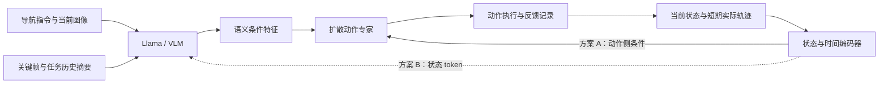

# AeroVLA：历史轨迹、当前位姿与运动状态如何进入语言模型和动作专家

> 历史归档：保留原统计日期和实验范围；不代表本课程实验已完成。入口见 [归档说明](../README.md)。

[返回文档首页](../../README.md)

> **调研与设计建议，含后续实施入口。** 2026-10-12 已实现方案 A 的数值状态/短历史动作头分支，123 项测试及真实 7B 两步训练/重载通过；当前数据合同见[扩散头架构](../design/diffusion_action_head.md#uav-history)，运行与验证记录见[指南](../../guides/training_and_evaluation.md#uav-history)。本文的 Llama 状态 token、语义长期记忆、规划器和安全机制仍为研究建议；历史检查结论保留调研当时语境。

日期：2026-10-12。范围：机器人导航、机器人操作 VLA、无人机导航的原论文及部分官方实现。本文主体保留最初调研与设计建议，后续已实施的子集以上方架构/指南链接为准。延续[两阶段架构方案](../README.md)。

**建议向模型补充当前状态与真实历史，但同时研究 Llama 入口和动作专家入口。** 最直接的实现参考是 OpenVLA-OFT 的连续状态 token；最接近两阶段无人机方案的是 FLIGHT VLA；长期导航记忆可参考 MapGPT、HAMT 和 NaVid。已有工作并未证明“把所有历史数值都写进 Llama 的 prompt”是最优方案。

## 1. 先区分四类信息

| 信息 | 无人机示例 | 主要回答的问题 |
|---|---|---|
| 当前位姿 pose | 位置 `p_t`，姿态 `R_t`，包含 roll/pitch/yaw | 我在哪里，朝向哪里？ |
| 当前运动状态 | 线速度、角速度；必要时加加速度和状态估计质量 | 我正在怎样运动，是否还在转向/爬升？ |
| 已发生的轨迹和执行反馈 | 过去真实位姿、下发动作、实际位移/转角、持续时间、干预 | 我实际飞过哪里，上一条命令完成了多少？ |
| 视觉与任务历史 | 历史图像、地标、已完成子任务、上一次计划 | 我见过什么，指令执行到哪一步？ |

位姿不包含速度；相同位置和朝向可以对应悬停、向前飞或侧向漂移。只有坐标也无法判断“刚才是否已经经过指令中的路口”。因此，这几类信息应互相补充。

本文中的“历史”只包括截至当前决策已经发生的内容。未来专家轨迹是训练标签，不能混入模型输入。模型预测了多步未来动作，也不代表它使用了多步过去观测。

## 2. 导航领域如何使用历史与 pose

以下“进入模型”区分专用导航 Transformer 与预训练 LLM；不能把前者直接称为 Llama。

| 工作与核验位置 | 历史表示 | 位姿/空间信息的作用 | 对本项目的意义与边界 |
|---|---|---|---|
| [HAMT，NeurIPS 2021](https://papers.nips.cc/paper/2021/file/2e5c2cb8d13e8fba78d95211440ba326-Paper.pdf)，§3.1 | 历史全景逐级编码：图像、全景内空间关系、跨时刻关系；融合过去执行的转角和步数 embedding | 当前视角相对朝向的 heading/elevation 使用 sin/cos 编码 | 支持“视觉＋动作＋时间”的历史组织；使用专用 Transformer，不能解释为输入整段绝对 XYZ 给 Llama |
| [DUET，CVPR 2022](https://openaccess.thecvf.com/content/CVPR2022/papers/Chen_Think_Global_Act_Local_Dual-Scale_Graph_Transformer_for_Vision-and-Language_Navigation_CVPR_2022_paper.pdf)，§3.1、§3.2.2–3.2.3 | 在线拓扑图保存已访问及已观察到的候选地点、视觉特征、最近访问步 | 坐标用于构图；相对当前节点的方向/距离等进入位置特征；局部分支也使用相对起点的位置 | 是显式空间历史的参考；离散任务提供可达邻居，无人机需要自己建立可信的通路关系 |
| [NavGPT，2023 v2](https://arxiv.org/html/2305.16986v2)，§3.1–3.4 | 历史观察描述、先前推理和动作组成文本记录；对观察做摘要 | 将方向、转向/相对距离及感知结果转成语言 | 展示 LLM 通过历史跟踪任务进度的接口；视觉转文字和摘要会损失信息，不能替代精确控制反馈 |
| [MapGPT，ACL 2024](https://aclanthology.org/2024.acl-long.529.pdf)，§3.2–3.3 | 访问节点序列、地图连通关系、地点图像/描述、上次计划进入 prompt | 作者保留拓扑关系而不直接输入精确坐标，报告其 GPT 设置较难理解大量精确坐标 | 很适合可检查的长期记忆；其观察不等于所有 LLM 都不能学数值状态 |
| [NaVid，RSS 2024，v7](https://arxiv.org/html/2402.15852v7)，§IV-B | 当前 RGB 的通用视觉 token 较多，历史每帧强压缩；另有指令查询特征，用标记区分当前/历史 | 明确不依赖 odometry、depth 或地图 | 支持历史图像进入视频 LLM；不能引用为“数值 pose 进入 LLM”的实验证据 |
| [StreamVLN，2025 v1](https://arxiv.org/html/2507.05240v1)，§3.1–3.3 | 近期图像与动作交错成多轮上下文，滑窗 KV cache；旧内容保留视觉记忆 | 论文提出几何辅助的 3D token 去重；不是把原始 pose 当普通文字 | 适合研究长历史计算成本；论文设计和公开代码的实际数据流需分别核对 |

**StreamVLN 的实现核验补充。** 截至调研日，官方 `main` 的[评估入口](https://github.com/InternRobotics/StreamVLN/blob/main/streamvln/streamvln_eval.py)读取 depth、GPS/compass 并传入 pose；但检查[模型 `encode_rgbd()`](https://github.com/InternRobotics/StreamVLN/blob/main/streamvln/model/stream_video_vln.py)时，`depths/poses/intrinsics` 参数未在该函数体参与计算。因而不能仅根据接口参数声称公开模型实际使用了 pose。此结论限于所查主路径，`main` 链接可能随更新变化。仓库现标 ICRA 2026，这里分析的论文版本是 2025-07-07 v1。

## 3. VLA 领域如何把当前状态交给 LLM 或 action expert

| 工作与核验位置 | 状态的编码与进入位置 | 是否使用数值状态历史 | 对 AeroVLA 的意义 |
|---|---|---|---|
| [PaLM-E，2023](https://palm-e.github.io/assets/palm-e.pdf)，§4、§6.4 | 连续状态/状态估计经可学习映射进入语言 embedding 空间，与图像及文字交错输入 | 移动操作实验有已执行技能的文本历史；不能据此推断整段 pose 轨迹输入 | 说明机器人连续信息可作为“非文字 token”进入语言模型 |
| [OpenVLA-OFT，2025 v1](https://arxiv.org/html/2502.19645v1)，§IV-B、附录 A-A、Tables IV/V | 当前低维 state 经独立 MLP 映射成一个连续 embedding，和图像、文字拼接后送入 Llama | 表格明确单帧输入，无 observation history | 与本项目 OpenVLA/Llama 基础最接近；但训练还更新 LoRA，不能直接证明完全冻结 Llama 的效果 |
| [π0，2024](https://arxiv.org/html/2410.24164)，§IV、附录 A-B | state 投影后进入动作专家；图像/语言前缀不反向关注后面的 state 块 | 使用当前状态 | 说明准确状态可以直接服务动作生成，不一定经过大型语言模块 |
| [π0.5，2025 v1](https://arxiv.org/html/2504.16054v1)，§IV-A、附录 A-E | 当前 state 离散化后作为文本 token 进入 VLM prefix | 使用当前状态，不能将未来 action chunk 视为状态历史 | 无需新增状态投影器，但会增加语言 token；数值离散化仍需匹配训练，不能假定原 checkpoint 零样本理解 |
| [How Should Vision-Language-Action Models Use Proprioceptive State?，2026-08 v1 预印本](https://arxiv.org/html/2608.03052v1)，§4–5 | 比较文本状态、VLM 连续前缀、动作连续前缀、state expert 和特征调制 | 比较 1–96 帧，并加入重复当前状态的等槽位对照 | 直接研究“送到哪里、保留多少历史”；是机器人操作实验，未验证无人机导航 |

### 3.1 最值得参考的 Llama 接口：OpenVLA-OFT

它的状态输入可以简化理解为：

```text
当前数值状态 ── 两层 MLP ── state embedding ──┐
当前图像 ───── 视觉编码器 ── visual tokens ───┼─ Llama ── action head
任务文字 ───── tokenizer ─── text tokens ─────┘
```

官方 [ProprioProjector](https://github.com/moojink/openvla-oft/blob/main/prismatic/models/projectors.py)是 `Linear → GELU → Linear`。这里的 token 是可学习向量，并非必须先把 `(x,y,z)` 变成一句话。对我们而言，可以将当前飞行状态映射到同一 hidden dimension，再将历史按时间编码；后一个扩展是本项目设计推论，并不是 OFT 已做的历史实验。

### 3.2 π0.5 的“状态文字”也不是未经处理的原始 JSON

官方 [tokenizer](https://github.com/Physical-Intelligence/openpi/blob/main/src/openpi/models/tokenizer.py)对归一化 state 分成 256 个桶，再将整数序列放入任务/状态文本；[模型代码](https://github.com/Physical-Intelligence/openpi/blob/main/src/openpi/models/pi0.py)区分 π0 与 π0.5 的 prefix/suffix 路由。因此，“数值序列作为语言输入”是经过训练的接口选择，不意味着加一句位置说明就能让任何旧 VLA 权重稳定使用它。

### 3.3 一项很有价值的对照：真实历史 vs 重复当前状态

上述 2026 年 state 接口论文 Table 2 在 RoboCasa 复合操作任务、末端位姿状态设置下报告：

| 条件入口 | 1 帧当前状态 SR | 8 帧真实历史 SR |
|---|---:|---:|
| 动作模块前缀 AP | 28.2% | 39.0% |
| VLM 前缀 VP | 34.4% | 33.8% |

在同样 8 个状态槽位下，重复当前帧为 30.8%，真实有序历史为 39.0%。这支持检验历史的时间信息，而不只增加 token 数。以上是单训练种子点估计；论文所有模型由同一 π0.5 初始化后**全量微调**，不是冻结骨干；导航明确不在范围内。其关节状态实验的入口差异也更小。应借鉴实验设计，不把“8 帧”或 AP 优势当成无人机通用规律。[原文 §5.1–5.2](https://arxiv.org/html/2608.03052v1)

## 4. 与无人机最接近的两篇

### FLIGHT VLA：状态同时服务语义规划与动作执行

[Think Like a Pilot: Fine-Grained Long-Horizon UAV Navigation，2026-06 v1 预印本](https://arxiv.org/html/2606.06836v1)的 §4、式 (4)–(7) 将系统分为：

- 慢速 VLM：指令、最近视频/状态窗口、历史语义记忆。
- 快速动作模型：最新图像的独立视觉特征、相对位姿、最近一次 VLM 语义隐藏状态。

相对位姿的参考系是**上一次 VLM 推理时刻的无人机坐标系**。它帮助动作模块知道“收到这份计划以后又移动了多少”。论文还模拟语义特征延迟。正文未完整交代 VLM state 的具体 tokenizer/投影实现，不能据此虚构一套逐维编码。其训练先联合优化，再冻结 VLM；动作生成采用 flow matching。

### DreamFly：有历史记忆，但没有输入数值 pose

[DreamFly，2026-08 v1 预印本](https://arxiv.org/html/2608.12308v1)的 §3.3 用有限视觉记忆槽保存历史信息，和当前图像融合后进行动作预测；§4.1.1 明确相对位姿仅作为数据来源元信息，**不参与记忆构建或策略推理**。它支持因果视觉记忆的设计，但不能作为“给 LLM 添加位姿轨迹”的直接证据。

## 5. 本地 AeroVLA 现在缺什么

本次复核时仓库基线为 `d8b3a1e`。以下针对本地代码，而非对所有 AeroVLA 实现作概括。

| 位置 | 核查结论 |
|---|---|
| [aerovla_wrapper_ui.py](../../../src/model_wrapper/aerovla_wrapper_ui.py)，`prepare_inputs`，约 99–109 行 | 收到 `episodes`，但仅读取最后一个状态和最后一组前/下 RGB；数值位姿与目标坐标用于程序计算方向提示 |
| 同文件，约 162–165 行 | prompt 主要是方向和目标描述，没有数值状态、历史轨迹或历史执行反馈 |
| [aerovla_diffusion.py](../../../src/model_wrapper/aerovla_diffusion.py)，`encode_condition`，约 154–210 行 | 输入只有当前图像/文本；没有 state/history 分支；整个条件编码在 `torch.no_grad()` 中 |
| 同文件，约 91–107 行 | 删除 `lm_head`，骨干冻结；优化器参数仅来自 `diffusion_head` |
| [diffusion_dataset.py](../../../src/diffusion_dataset.py)，约 100–120 行 | 每个样本只有当前图像、指令和动作目标；尚无历史窗口 |
| [AirVLNSimulatorClientTool_AeroVLA.py](../../../airsim_plugin/AirVLNSimulatorClientTool_AeroVLA.py)，约 35–58、386–389 行 | 环境能够采集位姿、速度、角速度、时间戳；但动作结束后把同一末态写入 5 次，不能看作 5 个真实时刻 |

所以，你提出的输入是当前模型的实际缺口。环境能获得状态，不等于 Llama 或 diffusion head 已经使用状态。前述[数据审计](../README.md)抽样发现原示范有位姿轨迹，但部分日志没有时间戳/速度；新数据接口必须如实表示缺失。

## 6. 推荐的状态与历史表示

以下是结合论文与本地实现给出的**项目方案**，不是某一篇论文的现成配置。

### 6.1 当前状态：局部几何与动力学分开记录

建议包含：相对起点位置/高度、姿态、线速度、角速度，以及字段有效性、观测时间和估计质量。加速度可以后续单独验证。NED 的 `z` 向下，因此相对起点的上升量是 `z_0 - z_t`；它不是离地高度，后者需要独立测距/地形估计。

位置/速度建议采用统一、明确的局部坐标。对于当前以水平前进、偏航和升降为主的动作定义，优先使用**原点在当前无人机位置、朝向与当前 yaw 对齐、竖直轴保持重力方向的坐标系**。它与随 roll/pitch 倾斜的完整机体系不同；必须与标签和控制器统一。

设世界位置为 `p_i`，当前偏航为 `ψ_t`，则过去点在这一当前参考系中的表示为：

\[
\Delta p_{i\mid t}=R_z(\psi_t)^\top(p_i-p_t),\qquad i<t.
\]

朝向差可用：

\[
[\sin(\psi_i-\psi_t),\;\cos(\psi_i-\psi_t)]
\]

避免角度在 `-π/π` 附近出现数值突变。完整姿态仍应保存 quaternion/rotation，核对四元数顺序和 yaw 提取约定；roll/pitch 不能因采用水平局部位置系而丢弃。所有历史点应转换到**同一个当前参考系**，不要把每一步自己的局部坐标直接拼成一条路径。

### 6.2 短历史：同时记录命令和实际结果

建议每个过去决策条目记录：

```text
观测帧 ID、采样时间、相对当前的位姿、有效性
当时下发的动作、命令开始/结束时间
实际位移和转角、执行状态、安全层干预
```

“命令前进 5 米”与“实际只前进 0.5 米”必须分开；后者可能是受阻、超时或安全干预，需要其他观测判别，不能仅据位移小就自动标注碰撞。历史命令能提供意图，实测轨迹提供发生了什么。直接使用过去专家命令还可能产生动作复制捷径，应单独做消融和闭环检查。

还要记录动作解释器的实际分支和预期执行量：当前控制器在 `abs(yaw) >= 0.25` 时主动跳过 `fwd` 平移，只处理转向/高度；小转角分支的平移沿转向后的目标 yaw。正常的大转弯零前移不能标成受阻，坐标变换也不能默认所有位移都沿决策前朝向。依据是 [AirVLNSimulatorClientTool_AeroVLA.py](../../../airsim_plugin/AirVLNSimulatorClientTool_AeroVLA.py) 约 325–382 行。

首轮可比较 `K=1/4/8/16` 个真实决策观测，均包含当前帧，并记录真实时间跨度；这些是实验候选值。按动作边界取样时，K 相同并不意味着覆盖相同秒数。没有可靠时间间隔时，只能提供位移/转角，不能将帧差伪装成 m/s。首帧和不足窗口使用 padding 与有效 mask。

### 6.3 长记忆：关键帧、地标与任务进度

建议在长期记忆中维护已确认地标、经过顺序、关键帧、当前任务阶段、未完成子任务，以及已经证实的通路/阻断。几何重复访问可由位姿辅助检测；“红楼”“路口”需要图像证据。短历史逐步更新，长期记忆按转向、地标发现、阶段完成、路径受阻等事件更新。

下面仅是接口示例，数值和事件均为虚构，不是已有轨迹标注：

```text
当前：相对起点升高 12.0 m；水平朝向较起点左转约 90°；速度字段未知。
最近执行：命令前行 3.0 m，实测平移 2.8 m；本条执行已结束。
路线记忆：经过地标 A；在关键帧 25 确认路口 B；随后完成一次左转。
任务进度：已完成“到 B 左转”；“接近目标建筑”尚未完成。
```

文字中的几何事实由程序计算；视觉事实附帧引用与置信度；语义阶段需要监督或可核验规则。不能让 LLM 自由补出未见过的障碍、地标或飞行事实。

## 7. 两种模型入口与当前冻结约束



这幅图是拟议输入架构。方案 A 和 B 可以先分别实验，再组合，不代表必须同时引入。

### 方案 A：状态直接进入扩散头；Llama 接收简短、可读的历史摘要

将归一化数值状态和短历史投影到扩散头的 hidden dimension，加入时间编码、类型编码和 mask，作为 cross-attention 条件。让投影器/历史编码器属于扩散头内部，可以延续“头前参数全部冻结”的范围。

若需要让冻结 Llama 也接触历史，可以把程序计算的简短状态/执行摘要纳入训练和推理 prompt；这不新增 Llama 参数，但改变了输入分布，需要重新适配扩散头并验证。它只表示 Llama 能读取这些文字，不证明它已经学会准确的状态推理。多帧视觉支持也需要单独处理，当前单图拼接接口不会自动成为视频模型。

### 方案 B：状态 token 进入 Llama，再传给扩散头

借鉴 OFT，将当前状态及少量历史通过 projector 映射到 Llama 的 embedding 维度，并为时间、类型和缺失情况提供编码。这是对“把 pose 真正给 Llama”最直接的实验。

但必须处理当前代码的两个训练约束：

1. 新 projector 在计算图中位于扩散头之前；训练它会改变原先“头前全部冻结”的参数范围。需要明确这是新实验配置，不能仍声称与旧训练边界完全相同。
2. `encode_condition()` 整段带 `@torch.no_grad()`。即使 Llama 权重保持 `requires_grad=False`，为了训练其输入 projector，也需要保留从扩散损失穿过 Llama 运算回到 projector 的梯度；继续使用整段 `no_grad` 会截断这条路径。相应显存和反向计算成本也会增加。

只移除 `no_grad` 还不够：[train_diffusion_head.py](../../../src/train_diffusion_head.py) 约 51–57 行会拒绝 `diffusion_head.*` 之外的可训练参数，现有优化器也只取头部参数；若把 projector 放入 `backbone`，`_freeze_backbone()` 还会反复冻结它。因此方案 B 需要同时设计参数归属、冻结审计、优化器与 checkpoint 保存/恢复，不能仅加一层网络就沿用旧脚本宣称训练成功。

此外，当前 checkpoint 已删除 LMHead。输入历史不会自动恢复自然语言计划输出；若要接入显式 planner，应采用独立规划 VLM，或重新设计/训练文本输出分支，见[两阶段方案](../README.md)。

**建议实施顺序：** 先建立对齐的数据与方案 A，确认状态/历史的闭环收益；再用相同数据比较方案 B。若研究目标就是状态如何参与 Llama 语义推理，方案 B 是需要完成的对照，不能用“专家获得了状态”替代这一验证。

<a id="scheme-b-assessment"></a>

### 2026-10-13：方案 B 是否会比动作侧输入更好？

**有潜力，但现有证据不足以认定 B 优于 A。** B 提供状态与图文在 Llama 内联合计算的路径；是否学会利用这条路径、是否改善闭环导航，需要训练和对照实验。当前 A 也只有流程验证，不能把它当作已证实的效果基线。

文献证据需分开解释：OpenVLA-OFT 验证了连续状态进入 Llama 的可行性，但同时使用 LoRA、不同注意力/动作解码等设计，其整体成绩不能隔离证明“入口改到 Llama”优于动作侧。[论文 §IV-B、附录 A 与 Tables IV/V](https://arxiv.org/html/2502.19645v1) 更直接的入口比较见上文 §3.3：2026 年 state 接口预印本在 RoboCasa 复合任务、末端位姿状态下，VLM 入口 K=1/8 的 SR 为 34.4/33.8%，动作入口为 28.2/39.0%。这说明入口偏好可能随历史长度变化；实验全量微调 π0.5、主要是单训练种子点估计，不能推广为冻结 Llama 上的 UAV 规律。[原文 §5 / Table 2](https://arxiv.org/html/2608.03052v1)

对本项目的判断与条件：

- 若任务需要结合指令判断最近的转弯/升降是否符合阶段要求，B 的联合表示值得检验；这是设计假设。短期数值 pose 能描述运动，无法单独辨识此前经过的是哪栋建筑。长期地标和任务进度还需要相应视觉/语义历史，以及能区分这些阶段的训练数据。
- 当前仅用动作去噪损失，移除了 LMHead，没有显式阶段/子目标监督。动作监督可以间接塑造有用的状态表示，但接入 embedding 本身不能证明已形成可解释规划能力。若要输出可读计划，还需输出接口、训练目标及独立评测。
- 可以冻结 Llama 权重而训练输入 projector，但必须保留损失经过 Llama 回到 projector 的梯度。相对当前 VLM 整段 `no_grad`，训练的激活显存和反向计算成本通常会上升，需实测；LoRA 是另外的适配变量，不是方案 B 的必需条件，也不能只给 B 加 LoRA 后把收益全归因于输入位置。
- 当前使用原 Llama 因果 decoder。若把状态 token 追加在图文之后，状态 token 可以读取先前图文，但先前图文 token 的隐藏态不会反向读取状态；把状态放前面则改变信息流方向。应固定插入位置、读出 token 与注意力规则，不把简单拼接描述成所有 token 双向融合。OFT 的双向注意力不能默认视作本项目现有行为。
- 保持同一数值特征进行比较。当前相对坐标在 K=1 时位置全零、相对 yaw 恒定，缺速度时主要只新增 roll/pitch 和有效位；改成 Llama 入口不会恢复缺失信息。也不能只向 B 新增精确目标位置、历史 RGB 或阶段标签再作入口归因。

建议先比较同一冻结范围下的四组：原无状态基线、A（K=4 状态仅入动作头）、B（相同 K=4 状态仅入 Llama）、A+B（两个入口同时接收相同状态）。A+B 用于检验保留动作侧几何通道是否有帮助，尚无证据保证它最好。共享模块采用同一初始化，固定训练数据/样本曝光量、动作 horizon、目标信息和执行协议；报告新增参数、训练成本、推理延迟，并以多训练种子的闭环 SR/SPL、重复访问及终止原因判断效果。再按需要做同槽位重复当前状态对照，以及 A/B 成对开启 LoRA 的比较。

上述均为后续实验设计。本轮只核验并更新文档，没有实现方案 B、启动训练或得到新的导航指标。

## 8. 数据和实验如何避免得出错误结论

### 数据先做对齐与因果检查

- 通过 `trajectory_id + frame/image index` 对齐当前图像、位姿及动作，确认动作是该帧之前还是之后发生；只有执行结果在当前决策前已可见的动作才能进入历史。
- 用真实采样时间/记录 ID 去除控制器产生的副本；不能按“pose 相同”简单去重，否则会删掉合法悬停观测。数据副本与有时间推进的静止状态应区分。
- 缺失速度、时间戳、姿态分量分别记录 mask；不能用零冒充真实悬停。任何归一化统计只从训练集估计。
- 保持按原始轨迹/场景划分。先划分，再构建滑窗和语言改写；在线历史要来自策略实际执行路径，不能回放专家历史充当测试输入。
- 构造模型输入时不读取未来参考路径、最终成功标签或未来图像；未来专家动作/轨迹可用于制作监督目标。当前评估用真实目标坐标计算方向提示是既有协议，加入状态后也必须明确这点，不能额外悄悄提供精确目标位置或完整地图。
- 每个检查样本展示当前/历史帧、相对轨迹、状态来源、命令与实测差异、模型输入和专家目标。推理延迟及图像/pose 时间偏差也应记录。

### 建议的最小消融

| 实验 | 相对基线新增内容 | 能回答什么 |
|---|---|---|
| E0 | 现有图像＋指令，H=1/E=1 | 当前可比基线 |
| E1 | 当前状态进入动作专家 | 只加当前状态是否有用？ |
| E2 | E1 + 真实短期数值状态历史 | 运动过程是否提供额外信息？ |
| E2-control | 和 E2 相同槽位、复制当前状态并按同预算独立训练 | 收益是否来自真实时间变化？ |
| E3 | 与 E2 相同数值输入，改为 Llama 状态 token；明确新增可训练参数 | 同样的信息应进入哪里？ |
| E4 | 最佳数值状态方案 + 历史视觉/地标记忆 | 任务记忆是否有额外收益？ |
| E5 | 相同输入与数据下，再加入显式子目标规划 | 推理接口本身是否有用？ |

第一轮保持原有动作时域，不同时把预测长度也改成多步。训练/评估使用相同数据划分、初始化场景、目标信息、安全与执行协议；报告每种接口的训练参数、计算成本与随机种子。接口参数量不完全匹配时应说明，不能把所有差异归因于入口位置。

除了离线去噪损失与动作误差，还需要闭环 SR/SPL、物理接触、近障、重复访问/绕圈、异常爬升、阶段完成情况、推理延迟。现有 NYC 10 条任务适合回归诊断，结论需要更大保留集及多种随机初始化。历史可帮助发现重复受阻，但碰撞处理仍需最新几何观测和动作途中的安全机制，参见[碰撞改进方案](../README.md)。

## 9. 阅读优先级与本次工作记录

建议先读 **OpenVLA-OFT §IV-B → FLIGHT §4 → MapGPT §3.2 → state 接口实证论文 §4–5**，分别对应“如何接 Llama”“两阶段无人机如何用状态”“长期空间记忆怎么组织”“如何设计可靠的消融”。之后按需要读 HAMT/NaVid 的历史视觉编码。

本次记录：

- 2026-10-12：查阅表内论文正文与所列官方代码，分别标记历史图像、动作、数值状态和外部地图的使用位置。
- 2026-10-12：复核当前 AeroVLA 条件输入、参数冻结和状态采集实现；发现新增 Llama 输入投影时必须处理 `no_grad` 的梯度路径。
- 2026-10-12：新增本报告，给出坐标/时间表示、两种输入方案、数据核验和消融设计。方案及首轮 K 候选为设计建议，未冒充已验证结果。
- 2026-10-12：独立复核论文表述与代码约束，补充控制器转弯分支、优化器/冻结审计限制；修正将文本状态接口笼统称为低成本的表述。检查本地引用、Markdown 代码块与空白格式。
- 2026-10-13：补充[方案 B 收益判断](#scheme-b-assessment)，区分可学习接口与已验证效果、冻结权重与梯度计算、数值运动历史与语义进度；明确因果注意力下的插入位置，以及 A/B/双入口的公平实验条件。
- 本次只新增调研文档，未修改训练/推理代码，未启动 GPU 任务，未变更已有模型权重。
