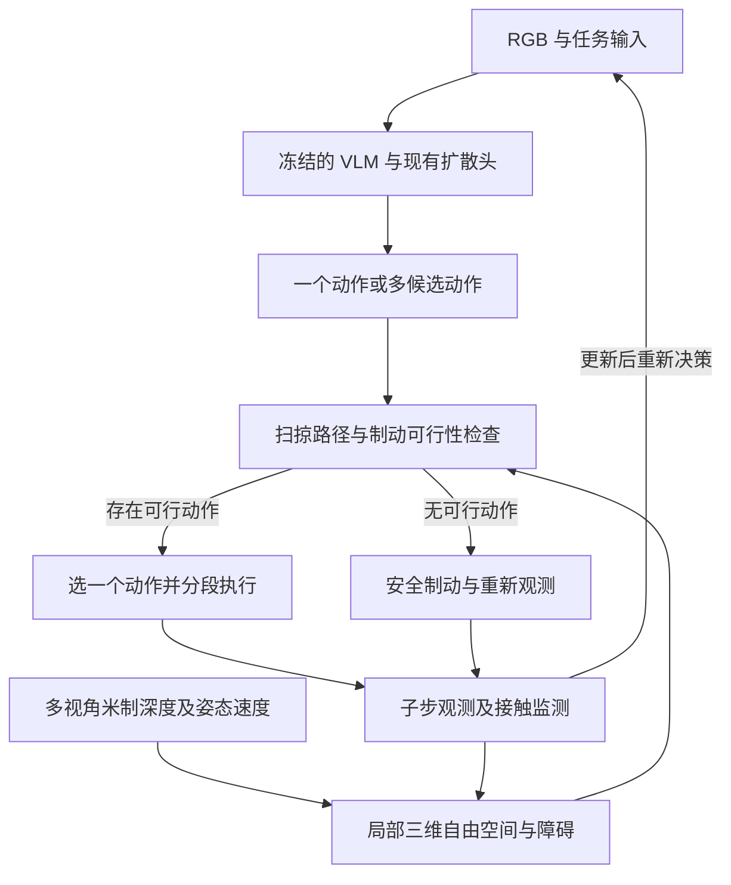

# AeroVLA 扩散动作头：碰撞问题调研与改进方案

日期：2026-10-12。分析对象：`checkpoint-70000` 的 NYC 10 任务闭环结果、当前 AeroVLA / NavDP 本地代码，以及下文列出的论文和官方文档。

**建议优先实施：保留当前权重，增加三维深度安全检查，将长动作改成可中断的短段执行。随后做多候选筛选，最后补充深度、历史、风险监督和恢复数据重新训练。** 当前问题同时涉及感知输入、动作执行和监督目标，不能仅靠增加训练轮数或预测步数解决。

本文是调研和实施设计。文中的新模块、参数、损失和实验均为建议，尚未实现或验证；本次只新增本报告，没有更改运行代码、模型权重或已有实验结果，没有启动 GPU 任务。

## 1. 先明确当前“碰撞”的含义

已有[配对比较报告第 8 节](diffusion_nyc10_baseline_comparison_20261011.md)区分了主动 STOP、深度近障和接触证据。这次扩散头的 10 个任务成功 7 个、失败 3 个；3 个失败都没有输出 STOP，均由深度近障规则终止，但只有其中一个在最后动作后出现新的接触标志。

| 任务前缀 | 扩散结果 | 终止时的证据 | 正确解释 |
|---|---|---|---|
| `4536c7ba` | 第 8 步失败 | 右视低深度像素占 27.203%；末态 `has_collided=False` | 深度近障终止，不能直接断言实体撞击；初始帧曾有接触标志 |
| `0c414bd0` | 第 6 步失败 | 前视低深度像素占 43.234%；所有保存状态的接触标志为 False | 深度近障终止，保存数据没有物理接触证据 |
| `c4261e45` | 第 18 步失败 | 前视低深度像素占 94.612%；接触标志由上一决策帧 False 变为 True | 深度近障终止，同时存在接触证据 |

原 `collision` 变量还包括停滞、持续远离目标等启发式规则，不能直接把 `3/10` 作为物理碰撞率。原始证据来自[评估日志](../eval_results/diffusion_ckpt70000_nyc10_seed42_gpu2_20261011/eval.log)、[动作记录](../eval_results/diffusion_ckpt70000_nyc10_seed42_gpu2_20261011/action_trace.jsonl)和[任务指标](../eval_results/diffusion_ckpt70000_nyc10_seed42_gpu2_20261011/episode_metrics.jsonl)。

### 最后动作之前是否已有近障线索？

有。对三个失败任务的**最后动作前**的前视深度 PNG，取中央宽 50%、高 50% 区域的第 10 百分位，得到下表。保存深度为 uint8，表中距离由 `像素值 × 100 / 255` 换算，是量化区间下界，区间宽约 0.3922 m。

| 任务 | 前一观测文件编号 | 中心区域深度 P10 近似值 | 接下来的模型动作 |
|---|---|---:|---|
| `4536c7ba` | `000035.png` | 2.745 m | 前进 4.789 m，down −0.021 m，yaw 0.047 rad |
| `0c414bd0` | `000025.png` | 3.137 m | 前进 3.936 m，down −2.587 m，合位移约 4.710 m |
| `c4261e45` | `000085.png` | 1.176 m | 前进 4.806 m，down −0.052 m，yaw −0.054 rad |

图片位于运行目录 `episodes/<完整任务 UUID>/frontcamera_depth/`；完整 UUID 见配对报告。CPU 重算方式为 `np.percentile(image[h//4:3*h//4, w//4:3*w//4], 10) * 100 / 255`，三个原始分位数依次为 7、8、3。

**这说明动作前存在值得检查的近障信息，但不证明这三个动作必然与障碍相交，也不证明加入安全层一定能救回任务。** 前视 P10 不是运动路径净空：还必须处理相机安装偏置、转向、升降、机体尺寸和遮挡。因此不建议直接把“P10 小于前进距离”作为最终避障算法。

## 2. 当前代码暴露出的具体问题

| 已确认的事实 | 代码位置 | 对碰撞的影响 |
|---|---|---|
| 模型只使用当前前视、下视 RGB | `src/model_wrapper/aerovla_wrapper_ui.py:99–105,151–159` | 当前扩散策略没有直接获得左右深度、速度及短期历史，侧向净空与运动状态信息不足 |
| 输出取动作序列的第一个动作，当前 H=1 | 同文件 `:183–190`；`src/diffusion_dataset.py:78–82` | 单步决策本身可行，但不能代替执行过程中的安全反馈 |
| 前进最大 5 m，down 在 ±5 m，NED 中 down 负值表示上升 | `src/aerovla_dataset.py:8–11`；`src/diffusion_dataset.py:49–58` | 单个动作的三维位移可达约 7.07 m |
| 先转向，小 yaw 分支整段移动，大 yaw 分支只执行垂直移动 | `airsim_plugin/AirVLNSimulatorClientTool_AeroVLA.py:343–382` | 真实执行路径有分支，不能只按预测动作终点检查碰撞 |
| 小 yaw 分支速度约 1 m/s，整段 `.join()`；结束才读取状态 | 同文件 `:354,365–387` | 平移最长约 7.07 仿真秒，另有转向和末尾保持；动作途中没有深度检查 |
| 每个动作只读取一次末态，再复制为 5 条记录 | 同文件 `:386–389` | 已保存的 5 条状态不是 5 次过程采样，无法恢复途中最小净空 |
| 控制器向环境固定返回 `collision=False` | 同文件 `:391–393` | 接触信息没有直接传入该通道；不能据此理解为仿真未发生接触 |
| 原始深度被裁剪到 0–100 m 并映射到 uint8 | 同文件 `:524–543` | 量化粒度约 0.3922 m，难以支持精细制动距离检查 |
| 任一路深度值 ≤1 的像素超过 10% 则判近障 | `src/vlnce_src/assist.py:24–29,48–51` | 对有效非负深度对应实际距离 <0.7843 m；不是 1 m，且面积规则可能漏掉细杆或误伤非运动方向近墙 |
| 动作后才执行近障、停滞及距离异常检查 | `src/vlnce_src/eval_aerovla.py:67–85`；`src/vlnce_src/closeloop_util.py:162–218` | 当前主要是在危险动作完成后终止任务，缺少前置预防 |
| 仿真 `ClockSpeed=10`，动作开始 unpause，末尾没有 pause | `airsim_plugin/AirVLNSimulatorServerTool.py:21`；客户端 `:309–393` | 推理及 RPC 期间仿真仍推进，安全周期必须按实际仿真时间衡量 |
| 训练仅使用加噪动作的 epsilon MSE | `src/model_wrapper/diffusion_action_head.py:192–231` | 去噪误差下降不能直接说明障碍风险下降，模型没有显式风险监督 |

另外发现一个需要单独核验的坐标问题：控制器使用 `R.from_quat(...).as_euler('zyx')[0]` 提取 yaw，而环境另一处使用常见航向角公式。非零 roll/pitch 时两者不一定相同。CPU 构造姿态 roll/pitch/yaw 为 30°/40°/45° 时，前者约 35.41°，后者为 45°；平飞时一致。**这是约定不一致的证据，不是这三个失败的已证实原因。** 修改前应核对训练标签生成规则、机体坐标和实际轨迹姿态，不能直接替换公式后混入安全层实验。

## 3. 调研结果：哪些方法值得借鉴

下表列出与本项目直接相关的原始论文、作者仓库及官方文档。本文的实施参数是针对 AeroVLA 的建议，不是复现论文参数后就能取得相同性能的承诺。

| 方法与来源 | 可借鉴之处 | 在 AeroVLA 中的限制与定位 |
|---|---|---|
| [NavDP，2025，v3](https://arxiv.org/html/2505.08712v3)；[官方仓库](https://github.com/InternRobotics/NavDP) | RGB 历史与当前深度共同条件化，生成候选轨迹，再用有危险轨迹监督的 critic 评分 | 借鉴感知、候选选择和风险监督；地面机器人轨迹及控制模型不能直接替代无人机三维模型 |
| [Diffusion Policy，RSS 2023](https://diffusion-policy.cs.columbia.edu/) | 预测动作序列，只执行其中一段，再依据新观测规划 | 支持以后研究 H=4/8、执行 E=1；多步输出本身没有碰撞保证 |
| [Fast-Planner](https://github.com/HKUST-Aerial-Robotics/Fast-Planner)；[RA-L 2019 论文](https://arxiv.org/abs/1907.01531) | 结合三维环境表示、动力学和轨迹优化进行无人机规划 | 可作为局部规划器方案；需要地图、状态估计和控制接口集成，改造量高于首版安全层 |
| [EGO-Planner，RA-L 2021](https://arxiv.org/abs/2008.08835)；[官方仓库](https://github.com/ZJU-FAST-Lab/ego-planner) | 无需构建完整 ESDF 的局部轨迹优化 | ESDF-free 不等于无需障碍信息，仍需三维感知、轨迹和动力学适配 |
| [FASTER，IROS 2019](https://arxiv.org/abs/1903.03558) | 在已知自由空间保留可行的备用轨迹 | 启发“随时可制动/退回安全状态”的设计；简单发送悬停不能继承论文条件下的安全结论 |
| [SafeDiffuser，ICLR 2025](https://proceedings.iclr.cc/paper_files/paper/2025/file/f95606d8e870020085990d9650b4f2a1-Paper-Conference.pdf)；[官方仓库](https://github.com/Weixy21/SafeDiffuser) | 在扩散过程中引入安全约束 | 需要适配约束及动力学；离散规划状态的约束不能直接保证 AeroVLA 阻塞执行期间安全，列为后续研究 |
| [DAgger，AISTATS 2011](https://proceedings.mlr.press/v15/ross11a.html) | 在策略实际访问到的状态上收集专家纠正，减少偏离示范后的误差积累 | 适合补充近障恢复数据；失败模型的原动作不是专家标签 |

本地 NavDP 进一步核查：`baselines/navdp/policy_network.py:93–120` 默认采样 16 条候选，评分后保留靠前轨迹；`policy_agent.py:182` 使用选中的轨迹。本地 `utils_tasks/tracking_utils.py:28,56–69` 是地面运动模型及跟踪优化，没有显式障碍约束。因此不能把“接入 NavDP 的 MPC”理解为自动获得无人机避障能力，也不能把 critic 分数当作校准后的碰撞概率。本地标准 NavDP 目录未提供可直接搬用的完整原训练流水线。

## 4. 推荐架构

扩散头负责提出动作，安全层在动作发出前及执行途中检查几何风险。首版保持 H=1 和 checkpoint 不变，优先验证执行闭环能否降低风险；之后再研究模型本身的避障能力。

## 5. P0：先把事件、时间和坐标记录清楚

这是后续可信比较的前提，可以先单独完成，尽量保持原终止行为。

1. 将 `physical_contact_new`、`depth_proximity`、`stuck`、`distance_nonprogress`、`model_stop_far`、`timeout`、`safety_intervention` 分开保存。允许多个事件同时发生，同时记录实际触发退出的主原因，保留 `legacy_collision` 供历史口径复算。
2. 接触事件依据同一次 `simGetCollisionInfo()` 的时间戳、接触点、法向、对象信息等识别。为每次 episode 保存 reset 后基准，区别已有接触和新接触。不能把目前固定 False 简单改成 `has_collided` 就结束，因为布尔值可能持续保留旧事件。[AirSim 官方 API 文档](https://github.com/microsoft/AirSim/blob/main/docs/apis.md)
3. 保存图像时间戳、状态时间戳、仿真时间、墙钟时间及控制延迟。选择经过验证的同步采样/仿真子步机制，或让独立安全监测覆盖模型推理期间；不能假设推理时飞行器完全静止。`ClockSpeed=10` 时尤其应实测仿真时间与墙钟时间的关系。
4. 初始位置、姿态和速度需要稳定后记录并匹配。无效出生位置采用预先规定、对两种模型一致的处理规则，报告重置次数，不能按最终结果剔除困难任务。
5. 核验 NED、yaw、相机外参和动作标签约定；若需要修正，单独记录代码版本和实验结果。

原停滞规则只看 XY 位移，可能把持续垂直运动视为停滞；连续远离目标也可能是合理绕障的一部分。这些判据值得后续改进，但**放宽它们属于导航终止协议变化，不等于减少物理碰撞**。

## 6. P1：无需重训的深度安全层与短段执行

### 6.1 使用原始米制深度，检查完整三维运动空间

新增安全深度通道，保留原来的 uint8 图用于历史指标。安全层直接使用 float32 米制深度及有效性 mask，显式处理 NaN、无回波、饱和和未知区域。

当前请求的是 `DepthPerspective`：距离沿像素射线测量，不能按 `DepthPlanar` 的光轴 Z 深度反投影。对光学坐标中的像素射线 `q = K⁻¹[u,v,1]ᵀ`，应使用 `p = d·q/‖q‖`，随后正确转换光学坐标、相机坐标、机体及 NED 坐标。[AirSim 图像 API 文档](https://microsoft.github.io/AirSim/image_apis/)

现有前、后、左、右相机相对机体原点存在约 1 m 偏置，不能把相机深度直接视为机体中心净空。应读取并验证实际内外参，对机体和旋翼包络进行障碍膨胀，构建局部“自由 / 占据 / 未知”三维表示。未知区域不能默认自由。

检查对象包括转向阶段、平移/升降阶段以及制动阶段的**整段机体扫掠空间**，而非仅检查终点。第一版先沿用现有 yaw 分支语义，避免同时改变控制含义；如果另行修复“大 yaw 不执行前向量”，应单独研究训练标签兼容性。

当前没有上视相机：不能在前方危险时无条件向上逃逸。可先约束爬升到已观测安全区域，必要时把新增上视传感器作为单独实验。也不建议随意设一个很低的全局高度上限，因为现有成功任务中有最高相对目标高度约 64 m 的例子，实际高度策略应由三维障碍决定。

### 6.2 让动作执行能够被中断

将一个高层动作拆成多个短控制窗口，每段前重新检查深度与状态，转向后重新观测，危险时能取消后续动作并制动。**仅提高 VLM 决策频率，而保留控制器内部长时间 `.join()`，不能解决动作中途来不及避障的问题。**

可先消融 0.1 / 0.2 / 0.5 仿真秒的窗口，或 0.25 / 0.5 / 1 m 的距离上限。这些只是待标定参数，实际值取决于 RPC 吞吐、传感更新、控制延迟和制动能力。每个子段不必重新运行大 VLM，可以由独立安全层更新；高层动作数与控制子段数分别统计。

如果采用暂停与 `continueForTime` 实现可控的仿真子步，需要验证命令生命周期及观测同步，并将其定义为新控制协议。两种动作头应使用相同协议重新比较，不能直接把新控制结果与历史连续推进结果作严格因果比较。

### 6.3 安全距离应与速度、延迟和制动能力相关

一个用于设计和标定的简化形式是：

\[
d_{guard}=r_{body}+e_{depth}+e_{pose}+v\tau+\frac{v^2}{2a_{brake}}.
\]

其中 `r_body` 表示机体包络，`e` 为传感/定位误差余量，`v` 为朝障碍方向的保守速度，`τ` 为最坏感知到控制生效延迟，`a_brake` 为经验证的保守制动减速度。该式只是静态障碍、简化制动模型下的设计估计；应对上下运动和动态障碍另行处理。若地图已经按机体及误差膨胀，就不能再次重复计入这些量。

无可行动作时，只有在当前及制动轨迹已知可行的条件下，才进入受控制动、短时保持、重新观测或局部重规划。设置等待预算并记录 `safety_blocked`，避免无限悬停。“安全层刹停”不等于模型输出任务 STOP/LAND，也不能计作任务成功。第一版优先缩短已有动作；若引入倒车、侧移等原动作空间没有的能力，要单列实验。

## 7. P2：利用扩散模型生成多个候选动作

在 P1 有效后，保持同一观测条件，缓存一次冻结 VLM 特征，批量生成 K=4/8/16 个候选；先按三维扫掠检查排除不可行候选，再选择一个与任务意图相符、净空较好且运动平滑的候选。

规则建议：安全约束优先；目标进展评分只能使用推理协议允许的目标信息，不能把评估器掌握的额外精确目标坐标或全局真值地图偷偷输入策略。首版可优先按对原提议动作的偏离、可观测净空和动作平滑排序。

**必须选取一个完整候选，不能直接平均多个动作或轨迹。** 两条分别从障碍左右绕行的可行轨迹，平均后可能正穿过障碍。全部候选不可行时，沿用 P1 的有界恢复机制。

该阶段在 H=1 下就能实现，不依赖未来动作标签。需要实测候选数量对推理延迟、干预率、死锁率和 SR 的影响；批处理与特征缓存可以复用计算，但不能假设额外采样没有时间成本。

## 8. P3：让扩散头本身学会避障与恢复

### 输入与序列

在冻结原 VLM/适配器的前提下，新增多视角深度、姿态/速度、上次动作与短历史编码，作为扩散条件。新编码器和风险头若需要训练，应明确计入新增的动作模块，列出全部可训练参数；不能仍声称只训练了当前原封不动的扩散头。

可比较 H=1、H=4、H=8，均先执行 E=1 并重新观测。H 是模型预测的高层动作数量，控制子段数是另一回事。当前 `AeroVLADiffusionDataset` 明确拒绝 H>1，因此需要按真实轨迹顺序构建未来动作，处理坐标、时间跨度、尾部 padding、STOP 边界及 mask。不能重复当前 label，也不能把每动作重复保存的 5 个末态当成 5 个未来动作。

### 风险监督和损失

先保留当前扩散去噪目标：

\[
L_{diff}=\mathbb E\big[\|\epsilon-\epsilon_\theta(a_t,t,c)\|^2\big].
\]

随后收集安全/危险候选，训练独立风险评分器，例如 `L_risk=BCE(q_phi(c,trajectory), y_collision)`，或回归轨迹最小净空。标签必须来自可靠三维几何或仿真执行，包含无人机运动与机体包络，不能只用无碰撞专家动作。这里是本项目的候选设计，不是对 NavDP 原论文公式的逐字复现。模型分数还需校准，不能代替几何安全层。

有可靠可微三维模型后，才考虑加入以下辅助项：

\[
L=L_{diff}+\lambda_r L_{risk}+\lambda_c L_{clear}+\lambda_s L_{smooth},\qquad
L_{clear}=\frac1J\sum_j\max(0,d_{safe}-ESDF(p_j))^2.
\]

`p_j` 必须来自**预测的干净动作**经正确运动模型展开后的轨迹，包含足够密的过程检查；若检查中心点，障碍需按机体膨胀。清洁动作由 epsilon 预测与噪声日程恢复，不能直接拿噪声向量当物理动作计算距离。高噪声时的恢复不稳定和各项尺度需要单独验证。给 epsilon MSE 加一个无梯度的布尔碰撞常数，并不能教会扩散头避障。

### 数据必须覆盖“已经走偏后怎么办”

参考 DAgger 的纠正数据思路，收集策略自身访问到的近障、偏航、过度爬升和恢复状态，由三维规划器或人工专家给出恢复动作。保留原示范数据，避免模型只学到悬停。训练标签不能直接取失败策略动作，也不能无条件把安全层的短时制动当作长期导航专家动作。[DAgger 原论文](https://proceedings.mlr.press/v15/ross11a.html)

建议每条监督记录包含：episode/step/时间戳、RGB 与米制深度、相机参数、位姿/速度、原提议动作、实际执行动作、专家纠正动作、候选风险标签、接触事件、安全层原因及数据来源。教师使用的信息若超出学生输入，应检查学生能否从其观测区分对应动作。

只从训练轨迹收集训练监督；当前 10 个任务可作为固定诊断/回归集，不能用于拟合后又作为独立测试证明泛化。强化学习微调可留到后续，例如 [DPPO](https://arxiv.org/abs/2409.00588)，但它需要环境交互、奖励设计和额外训练预算，不是当前最低成本的首选修复。

## 9. 实施文件与验证计划

以下为拟修改清单，文件名带“新增”的模块尚未创建。

| 阶段 | 拟修改位置 | 交付内容 |
|---|---|---|
| P0 | `src/vlnce_src/closeloop_util.py`、`assist.py`、仿真客户端 | 事件拆分、接触时间戳、真实观测时序与兼容历史日志 |
| P1 | 新增 `src/safety/depth_geometry.py` | 米制深度处理、外参变换、三维自由空间与机体膨胀 |
| P1 | 新增 `src/safety/action_shield.py`；修改仿真客户端和评估入口 | 提议动作检查、可取消的短段执行、制动与有界恢复 |
| P2 | `src/model_wrapper/aerovla_wrapper_ui.py` 及扩散推理接口 | 缓存条件、批量候选、筛选与完整日志 |
| P3 | `src/diffusion_dataset.py`、扩散头与训练脚本 | 真实未来动作、深度/状态条件、风险与恢复监督，参数冻结审计 |

### 验证顺序

1. **几何与控制核验**：构造前墙、侧墙、细杆、顶板、未知区域、边转向边制动等场景；检查 NED/yaw/相机转换、机体扫掠、迟到观测、旧接触事件及制动距离。确保不是只检查终点或漏检旋转。
2. **离线诊断**：回放已有 693 条扩散动作，检查三个失败动作之前是否能给出有效风险提示，同时统计对七个成功任务的干预。保存 PNG 已量化，旧日志缺少过程状态，因此离线只能验证部分规则，不能报告“已救回三个任务”。
3. **10 任务闭环回归**：固定实际初始状态、每 episode 随机种子和仿真协议，比较下表；随机采样和仿真非确定性用重复种子评估。旧结果作为背景参考，受控比较需重新运行。
4. **独立评估**：从未用于调参的任务划分开发集与保留测试集，并加入其他地图；参数在开发集确定后冻结。当前 10 个任务样本很少，即使全部成功也不能证明普遍消除碰撞。

| 实验 | 动作头 | 控制及安全机制 | 要回答的问题 |
|---|---|---|---|
| A0 | 原 LMHead、扩散头分别运行 | 兼容原协议，完善日志 | 两种头在相同重置条件下的基线表现 |
| A1 | 扩散头 | 分段执行，每段复用原近障规则并允许中断；不新增轨迹几何过滤 | 原规则从事后检查改为途中检查，能减少多少危险执行 |
| A2 | 原 LMHead、扩散头分别运行 | 分段执行 + 几何安全层 | 安全层收益与动作头收益能否区分 |
| A3 | 扩散头 | A2 + 多候选筛选 | 额外采样是否值得增加的延迟 |
| A4 | 重训扩散头 | A2/A3 + 分别加入深度/历史、序列、风险监督 | 每项训练改动的独立收益 |

所有安全层实验对两种动作头使用一致的深度、控制权限、超时和终止判据。高层步数、控制子段数、累计仿真时间分别记录，避免通过拆段改变 200 步预算含义。若修改近障或停滞终止规则，应另设协议版本，并同时报告原口径可计算的指标。

A1 必须明确具有“读到近障后中断”的行为；如果只拆分命令和记录传感器、完全不据此调整执行，就只能研究命令实现差异，不能把它称为安全反馈提升。A1 的检测时机变化本身也是实验变量，应记录协议版本。

核心指标：SR、原协议 SPL、新物理接触任务比例、近障终止比例、有效观测覆盖下的最小机体净空、每 100 m 干预数、死锁/超时率、任务完成耗时、控制和推理延迟 P95，以及初始化失败率。新增监测会发现旧方案未记录的事件，因此接触率比较需要两组相同的采样和事件判定方式。

**验收应同时要求风险降低与任务仍能完成。** 不能通过不动、频繁悬停、放宽碰撞阈值或删除困难样本来制造改善。三个失败案例是定位与回归用例，最终收益需要独立闭环结果支持。

## 10. 本次工作记录

| 日期 | 工作 | 结果 |
|---|---|---|
| 2026-10-12 | 只读审计 AeroVLA 模型输入、损失、控制器、深度和终止判据 | 定位长动作无中途深度检查、接触回传、量化深度、时序和事件混用等问题 |
| 2026-10-12 | 核对本地 NavDP 感知、候选评分和地面控制代码 | 明确可迁移的是方法组织方式，不能直接复制地面控制器或回退逻辑 |
| 2026-10-12 | 查阅 NavDP、Diffusion Policy、无人机规划、安全扩散和纠正数据的原始资料 | 形成按成本与依赖排序的 P0–P3 方案，并列出来源与适用条件 |
| 2026-10-12 | CPU 检查三个失败任务最后动作前的深度 | 两次独立读取的 P10 结果一致；报告保留量化、视角和反事实解释限制 |
| 2026-10-12 | 独立复核证据、方案与实验设计 | 澄清 A1 必须根据途中观测中断动作，避免把单纯拆分命令误当反馈改进 |
| 2026-10-12 | 新增本文 | 提供证据、拟修改位置、监督数据要求与受控实验计划；没有实施代码改动或新增训练/评估结果 |

建议下一步先落实 **P0 + P1**，保持 checkpoint-70000 不变，在固定 10 任务上检验“动作前检查 + 动作中可中断”的效果。若仍出现反复阻塞，再通过候选筛选、局部规划和恢复训练解决导航能力问题。
