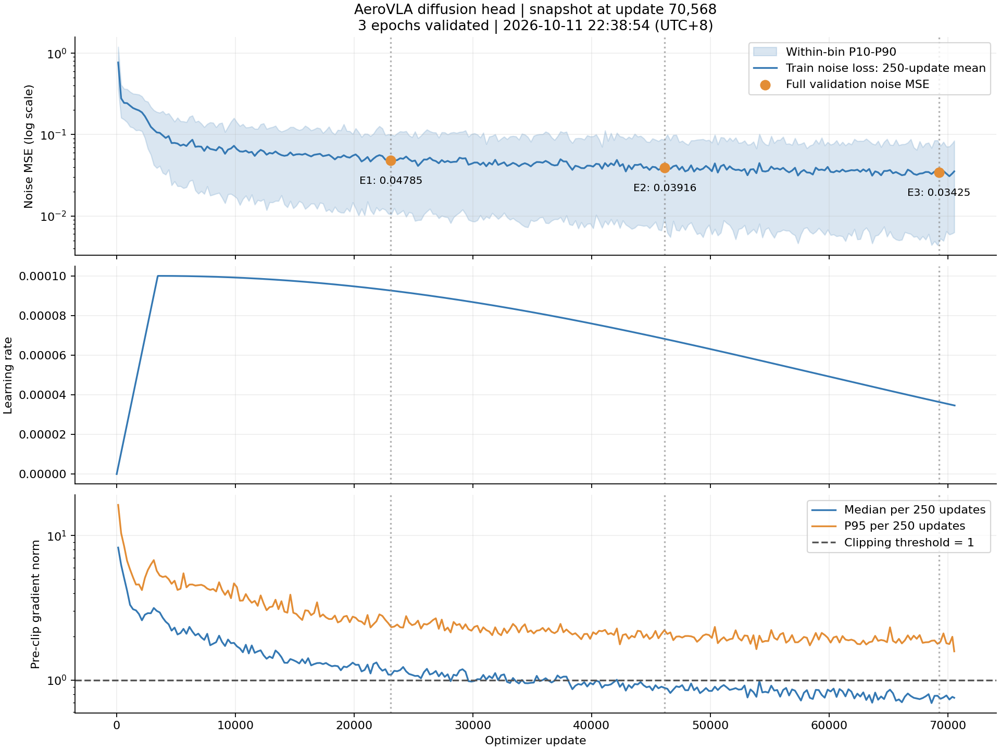

# 扩散头训练趋势图更新记录

## 2026-10-11：第三轮训练与全量验证完成

已根据正式训练日志生成新版趋势图，数据截止 **2026-10-11 22:38:54（北京时间）、step 70,568**。第 3 轮在 **step 69,240** 完成，采集时已进入第 4 轮。计划总更新次数为 115,400。



[下载 PNG](reports/training_trend_20261011_epoch3/training_trend.png) · [下载 PDF](reports/training_trend_20261011_epoch3/training_trend.pdf) · [统计与输出哈希](reports/training_trend_20261011_epoch3/summary.json)

### 数据结果

| 验证轮次 | 参数更新次数 | 验证样本数 | 验证噪声 MSE |
| --- | ---: | ---: | ---: |
| 第 1 轮 | 23,080 | 41,176 | 0.04784514 |
| 第 2 轮 | 46,160 | 41,176 | 0.03915988 |
| 第 3 轮 | 69,240 | 41,176 | 0.03424759 |

第三轮验证噪声 MSE 相对第二轮下降 **12.54%**。该指标衡量四维动作的噪声预测误差，不是物理动作误差或闭环导航成功率。第三轮 LAND F1 从第二轮的 **92.8490%** 降至 **92.0435%**，因此不能把噪声 MSE 的改善理解为所有指标都改善。

### 本次修改记录

1. 新增 [build_training_trend.py](reports/training_trend_20261011_epoch3/build_training_trend.py)，在 CPU 上读取日志、冻结数据并绘制三联图。读取时忽略尚未写完的日志尾行，记录源路径与 SHA256；后续重建只读固定快照。
2. 扩展训练曲线至 step 70,568，保留原图的训练 loss、学习率、裁剪前梯度范数三个面板；加入第三轮全量验证点与轮次边界，并标注每次验证的轮次和 loss。
3. 将 Matplotlib 和字体缓存放在报告目录中，解决初次绘图时字体缓存目录不可写的提示。
4. 导出新版 PNG、PDF、[固定日志快照及清单](reports/training_trend_20261011_epoch3/snapshot/manifest.json)和统计 JSON，新增本 Markdown 记录。

本次图表使用独立版本目录。原 [周报](weekly_report_20261011.md) 的 step 59,019 快照、图表和分析仍对应其原始统计时点。此次未改动模型、训练脚本、监督数据或正在运行的训练任务。

### 图表统计口径与检查

- 训练 loss 每 250 次参数更新分组取算术均值，阴影为组内 P10—P90，**不是置信区间**；最后一组只有 68 次更新。
- 梯度曲线为每组裁剪前梯度范数的中位数与 P95，阈值虚线为 1.0。
- 三条竖线是 step 23,080、46,160、69,240；三枚橙点来自各轮 41,176 个样本的全量验证。
- 70,568 条训练记录连续、无重复，loss、学习率、梯度范数及样本数均为有限值；验证记录与训练轮次、样本数量一致。
- 重建脚本校验输入文件 SHA256；PNG、PDF 与绘图脚本哈希写入 `summary.json`。图像已人工查看，确认三个验证点、标题、坐标和图例可读。

在 AeroVLA 项目根目录重新生成相同数据范围的图表：

```bash
/data/xiyang/.conda/envs/aero_vla/bin/python docs/reports/training_trend_20261011_epoch3/build_training_trend.py
```

后续更新应新建版本目录并重新采集日志，避免覆盖本次固定快照。
