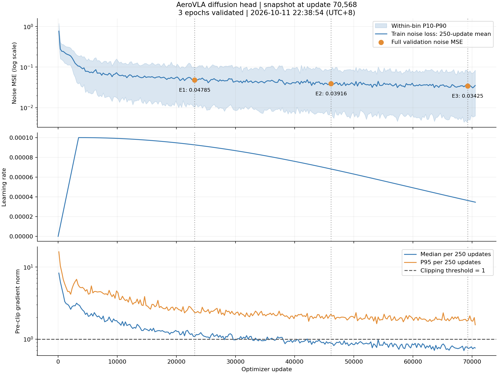

# GPU 1 全量训练：结果更新与运行记录

[返回文档首页](../README.md)

> **实验记录。** 最新已整理的固定快照截止 2026-10-11 22:38:54、step 70,568，包含第 3 轮全量验证；这不是对当前后台状态的实时查询。

阅读定位：[第三轮结果与新版曲线](#epoch3) · [启动配置、监督数据和监控](#launch) · [step 59,019 历史周报](weekly_report_20261011.md)。

<a id="epoch3"></a>

## 第三轮验证与训练曲线更新

### 2026-10-11：第三轮训练与全量验证完成

已根据正式训练日志生成新版趋势图，数据截止 **2026-10-11 22:38:54（北京时间）、step 70,568**。第 3 轮在 **step 69,240** 完成，采集时已进入第 4 轮。计划总更新次数为 115,400。



[下载 PNG](../reports/training_trend_20261011_epoch3/training_trend.png) · [下载 PDF](../reports/training_trend_20261011_epoch3/training_trend.pdf) · [统计与输出哈希](../reports/training_trend_20261011_epoch3/summary.json)

#### 数据结果

| 验证轮次 | 参数更新次数 | 验证样本数 | 验证噪声 MSE |
| --- | ---: | ---: | ---: |
| 第 1 轮 | 23,080 | 41,176 | 0.04784514 |
| 第 2 轮 | 46,160 | 41,176 | 0.03915988 |
| 第 3 轮 | 69,240 | 41,176 | 0.03424759 |

第三轮验证噪声 MSE 相对第二轮下降 **12.54%**。该指标衡量四维动作的噪声预测误差，不是物理动作误差或闭环导航成功率。第三轮 LAND F1 从第二轮的 **92.8490%** 降至 **92.0435%**，因此不能把噪声 MSE 的改善理解为所有指标都改善。

#### 本次修改记录

1. 新增 [build_training_trend.py](../reports/training_trend_20261011_epoch3/build_training_trend.py)，在 CPU 上读取日志、冻结数据并绘制三联图。读取时忽略尚未写完的日志尾行，记录源路径与 SHA256；后续重建只读固定快照。
2. 扩展训练曲线至 step 70,568，保留原图的训练 loss、学习率、裁剪前梯度范数三个面板；加入第三轮全量验证点与轮次边界，并标注每次验证的轮次和 loss。
3. 将 Matplotlib 和字体缓存放在报告目录中，解决初次绘图时字体缓存目录不可写的提示。
4. 导出新版 PNG、PDF、[固定日志快照及清单](../reports/training_trend_20261011_epoch3/snapshot/manifest.json)和统计 JSON，新增本 Markdown 记录。

本次图表使用独立版本目录。原 [周报](weekly_report_20261011.md) 的 step 59,019 快照、图表和分析仍对应其原始统计时点。此次未改动模型、训练脚本、监督数据或正在运行的训练任务。

#### 图表统计口径与检查

- 训练 loss 每 250 次参数更新分组取算术均值，阴影为组内 P10—P90，**不是置信区间**；最后一组只有 68 次更新。
- 梯度曲线为每组裁剪前梯度范数的中位数与 P95，阈值虚线为 1.0。
- 三条竖线是 step 23,080、46,160、69,240；三枚橙点来自各轮 41,176 个样本的全量验证。
- 70,568 条训练记录连续、无重复，loss、学习率、梯度范数及样本数均为有限值；验证记录与训练轮次、样本数量一致。
- 重建脚本校验输入文件 SHA256；PNG、PDF 与绘图脚本哈希写入 `summary.json`。图像已人工查看，确认三个验证点、标题、坐标和图例可读。

在 AeroVLA 项目根目录重新生成相同数据范围的图表：

```bash
/data/xiyang/.conda/envs/aero_vla/bin/python docs/reports/training_trend_20261011_epoch3/build_training_trend.py
```

后续更新应新建版本目录并重新采集日志，避免覆盖本次固定快照。

<a id="launch"></a>

## 全量训练启动与初期监控（历史记录）

日期：2026-10-10。用户明确要求在物理 GPU 1 全量训练并保存权重，随后要求估计耗时并整理监督数据。本轮增加启动脚本、独立 CPU 监控与监督标签审计，不改变此次运行的模型或训练算法。

**2026-10-11 更新：** 截至北京时间 17:44:31 已完成 59,019/115,400 次更新，处于第 3 轮；前两轮全量验证已完成，best 为第 2 轮 step 46,160。详细结果、固定日志快照、图表和分析见[本周周报](weekly_report_20261011.md)。下文保留 10 月 10 日启动与初始监控记录，其中“尚未验证/尚无检查点”仅描述当时状态。

### 配置

| 项目 | 设置 |
| --- | --- |
| 物理 GPU | 1，`CUDA_VISIBLE_DEVICES=1`，进程内设备 cuda:0 |
| 基座 / adapter | `openvla-7b` / `checkpoints/aero_vla`，均冻结 |
| 可训练部分 | 仅动作扩散头，5,265,668 个参数 |
| train | 全部 369,274 帧、6,850 条轨迹，不抽样 |
| val | 全部 41,176 帧、761 条轨迹，每个 epoch 验证 |
| 训练轮数 | 5 |
| batch / 梯度累积 | 2 / 8，有效 batch 16 |
| 学习率 | 1e-4，3% warmup 后 cosine |
| 精度 | 冻结基座 bfloat16，扩散头 float32 |
| optimizer 更新总数 | 115,400（每轮 23,080） |
| 保存 | 每 1,000 次更新；每轮按验证 noise_mse 保存 best；结束保存最终头 |
| 数据限制 | 不设置 max-samples、max-val-samples、max-steps |

“全量”使用划分中全部 train，保留 val 作独立验证，不把验证集加入训练。

### 文件与持久运行

- 输出目录：`checkpoints/aero_vla_diffusion_full_20261010_200045/`
- 最终权重：上述目录下 `diffusion_head.pt`
- 最佳权重：上述目录下 `best/diffusion_head.pt`
- 阶段权重：上述目录下 `checkpoint-N/diffusion_head.pt`
- 终端日志：`logs/aero_vla_diffusion_full_20261010_200045/train.log`
- 状态文件：`logs/aero_vla_diffusion_full_20261010_200045/status.json`
- 启动脚本：`logs/aero_vla_diffusion_full_20261010_200045/run.sh`
- tmux 会话：`aerovla_diffusion_gpu1_20261010_200045`

通过 tmux 后台运行，客户端断开不会结束训练。训练成功结束后，启动脚本检查最终和 best 权重存在且有限、全量数据计数及 115,400 次更新符合预期，然后生成 `completion_check.json`；若进程异常退出，状态文件记录 failed 和退出码。

当前实现保存扩散头、配置、数据划分和 tokenizer/processor，冻结基座无需重复保存。检查点不含优化器状态，因此不能作为精确断点续训快照。

### 操作记录

1. 检查 GPU 1 空闲，GPU 0 有其他任务；检查磁盘剩余约 15 TB、所需模型/数据/解释器及 tmux 均存在。
2. 创建带退出状态记录与最终权重核验的独立启动脚本，输出目录与前序 smoke 分离。
3. **北京时间 2026-10-10 20:02:35 已启动**上述 tmux 会话。实际 `run_config.json` 核对全量 train/val、5 轮、无样本/步数限制、冻结与可训练参数数量均符合配置。GPU 1 显存约 15 GB，训练指标持续增长。
4. 保存 `logs/aero_vla_diffusion_full_20261010_200045/launch_manifest.json`，记录此次训练关键源文件 SHA256；`run.sh` 保存完整启动参数。

### 耗时初估

北京时间 20:04:30—20:05:10 观察第 37→72 次更新，40.00 秒完成 35 次，约 **1.143 秒/更新**。按当时剩余 115,328 次更新估计，纯训练剩余 **36.61 小时**，一轮训练约 7.33 小时。

该实测窗口尚未包含 checkpoint 写盘及任何全量验证。全量验证共 5 次，每次 41,176 帧且包含扩散动作采样，额外耗时还未测定；整体先预留约 2 天，不能把 36.61 小时视为含验证的完成承诺。原始测量保存在 `logs/aero_vla_diffusion_full_20261010_200045/eta_snapshot.json`。后续动态估计见本次输出目录下的 `monitoring/status.md`。

### 监督数据与训练记录的检查入口

本次运行目录为 `checkpoints/aero_vla_diffusion_full_20261010_200045/`。全量原始标注仍在 `data/aerovla_train_dataset.json`；审计目录保留全量汇总与固定抽查样本，监控目录汇总持续生成的训练记录。

| 入口（相对本次运行目录） | 检查内容 |
| --- | --- |
| `supervision/README.md` | 原始标签范围、裁剪频率、LAND 正负样本和地图分布 |
| `supervision/samples.csv`、`samples.jsonl` | 固定样本的原清单索引、train/val、指令、前/下视图片路径、原始/裁剪/归一化 4D 标签 |
| `supervision/axis_statistics.csv` | train/val 每一轴的原始、裁剪后、归一化后分布 |
| `supervision/map_distribution.csv`、`trajectory_distribution.csv` | 全部地图与轨迹的样本数、LAND 和裁剪分布 |
| `supervision/source_manifest.json` | 数据/split/代码哈希及与此次 run_config 的一致性 |
| `monitoring/status.md` | 持续更新的训练状态、吞吐、仅训练部分的 ETA、异常记录与文件入口 |
| `monitoring/train_metrics.csv` | 每次更新的 loss、学习率、裁剪前梯度范数和样本数 |
| `monitoring/validation_metrics.csv` | 每轮验证的 noise_mse、动作误差和 LAND 分类指标 |
| `monitoring/training_curves.png` | 原始与平滑训练 loss、学习率、梯度范数、验证曲线 |
| `monitoring/checkpoints.csv` | 已出现的阶段、best、最终权重文件信息 |

固定审计样本按 split/map 选取存在的 LAND 正负、last/penultimate、各轴上下越界等类别；**它们不是训练实际 minibatch 顺序，也不包含模型预测**。归一化直接调用训练所用函数，保留 float32 计算结果。`grad_norm` 是梯度裁剪前的值，大于 1 并不表示裁剪失效。

监控脚本只读取现有 JSONL、状态与权重文件信息，不加载模型，使用 CPU 每 60 秒刷新。缺失验证文件时输出空表，等待真实验证完成后补充。首个阶段权重在第 1,000 次更新保存；best 在首次验证后产生，最终权重在训练结束后产生。

修改记录分别见 [监督标签审计记录](../development/changelog.md#supervision)和[训练监控记录](../development/changelog.md#monitor)。

#### 本次标签审计结果

北京时间 20:09:40 完成 410,450 帧静态标签检查，非法标签为 0，数据/split 哈希与此次训练配置匹配，生成 139 个固定抽查样本。

| 集合 | LAND 正例 | LAND 比例 | 任一轴裁剪帧数 | fwd 裁剪 | down 裁剪 | yaw 裁剪 |
| --- | ---: | ---: | ---: | ---: | ---: | ---: |
| train | 8,203 | 2.2214% | 9,605 | 4,669 | 807 | 8,308 |
| val | 910 | 2.2100% | 1,051 | 532 | 72 | 896 |

各轴裁剪可能发生在同一帧，不能相加当作独立样本数。裁剪计数按原始标签超出声明动作上下界判定，裁剪后的标签与生产训练函数一致。LAND 正例占比较低，因此后续要结合 precision/recall/F1 和正例数检查，不能只看 accuracy。

#### 监控启动与本轮验证

- 20:10:45 首次对真实训练执行单次导出：读取到第 360 次更新，生成 CSV、Markdown、JSON 与 PNG，告警数 0；已实际查看曲线图。
- **20:11:08 启动持续 CPU 监控**，tmux 会话 `aerovla_monitor_gpu1_20261010_200045`，启动脚本 `logs/aero_vla_diffusion_full_20261010_200045/monitor.sh`，日志 `monitor.log`。监控初次读到第 379 次更新。
- 20:12:10 核对第二次自动刷新：已到第 432 次更新，告警数 0；监控观测 61.60 秒内增加 53 步，0.8604 step/s，估计剩余训练约 37.12 小时（仍不含验证）。确认后台持续导出正常。
- `logs/aero_vla_diffusion_full_20261010_200045/supervision_manifest.json` 记录监控/审计脚本与启动脚本哈希；再次核对正式训练源文件与启动时 SHA256 一致。
- 新增标签审计测试 **8 项通过**，监控测试 **13 项通过**；监督样本 278 个图片路径均存在、归一化目标有效。Shell 语法与 `git diff --check` 通过。
- 当前处于第一轮训练，尚未达到第 1,000 步的首次阶段保存，也未进行首轮全量验证。本报告中的启动验证不代表 5 轮训练完成；完成情况以 `status.json` 和最终 `completion_check.json` 为准。
