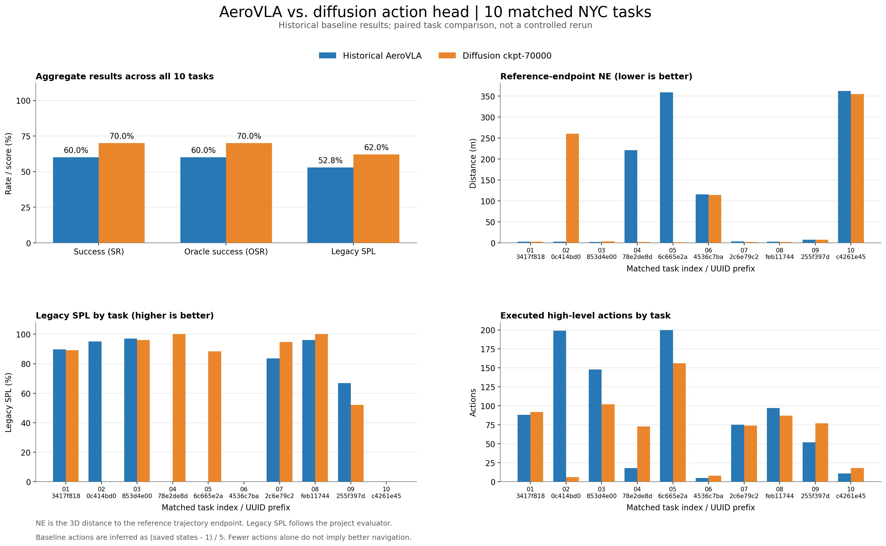
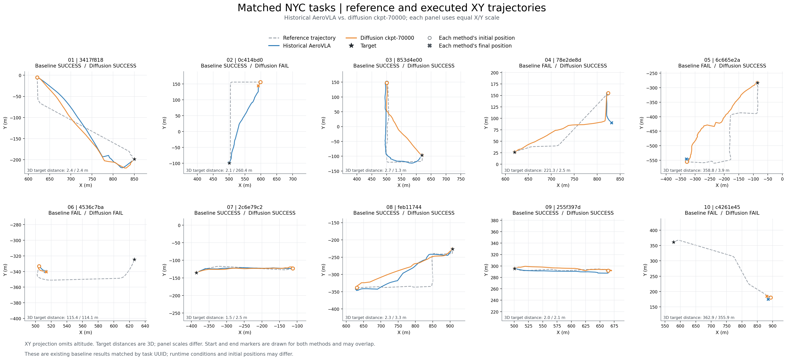
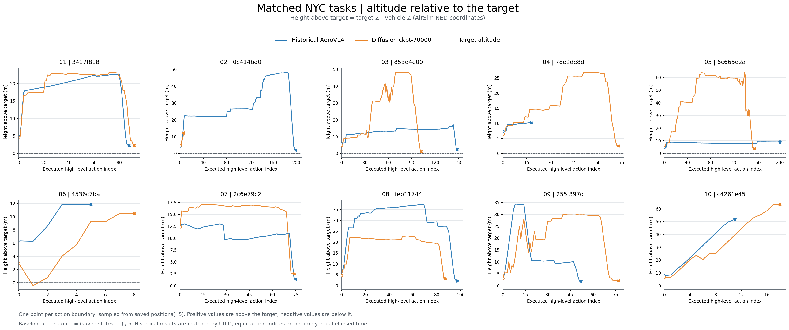

# NYC 随机 10 任务：闭环评估、基线对比与失败分析

[返回文档首页](../README.md)

> **已完成的实验。** checkpoint-70000 在 GPU 2 上评估：扩散头 7/10 成功，配对历史基线 6/10。历史基线初始状态与运行条件不完全一致，该小样本比较不能把差异全部归因于动作头。

阅读定位：[基线对比与可视化](#comparison) · [STOP、近障与接触证据](#termination) · [GPU 2 运行配置、修复及原始产物](#run)。

<a id="comparison"></a>

## 一、相同任务的基线对比与可视化

已在指定基线目录中找到全部 **10/10 个唯一匹配任务**。在同一任务集合、同一指标口径下，原 AeroVLA 历史结果成功 **6/10**，扩散 `checkpoint-70000` 成功 **7/10**；原协议 SPL 从 **52.81%** 提升到 **62.03%**。

配对结果是 **5 个共同成功、2 个仅扩散成功、1 个仅基线成功、2 个共同失败**。扩散在这组任务上的总体结果较好，但共同成功任务的平均路径效率接近，且两次实际初始状态不完全相同。本报告比较的是历史结果与本次扩散结果，不能将差异全部归因于动作头结构。

### 1. 数据来源与匹配

- 基线：`/data/xiyang/project/AeroVLA/eval_results/aero_vla/seen_valset/NYCEnvironmentMegapa`。
- 扩散：[checkpoint-70000 的 GPU2 闭环结果](../../eval_results/diffusion_ckpt70000_nyc10_seed42_gpu2_20261011/)，模型路径为 `checkpoints/aero_vla_diffusion_full_20261010_200045/checkpoint-70000`。
- 任务集合固定为扩散运行的 `selected_episodes.json`，即此前 seed=42 抽出的 10 条 NYC 任务。没有按成功与否重新选样。
- 去掉基线结果目录的 `success_` / `oracle_` 前缀后，以完整 UUID 匹配；每个任务恰好一个基线结果，无缺失或重复。
- [完整目录匹配清单](../reports/nyc10_baseline_vs_diffusion_20261011/matched_tasks.json)保留每个 UUID 及两组绝对路径；[逐任务 CSV](../reports/nyc10_baseline_vs_diffusion_20261011/paired_results.csv)同时包含路径、指标和差值。

两组各任务的 `merged_data.json`、`mark.json`、对象描述均逐字节相同。所有距离和路径长度均从保存位置重新计算；基线成功标志按原项目保存目录前缀读取，扩散标志还与其 `episode_metrics.jsonl` 交叉核对。

### 2. 总体指标

下表分母均为这 **10 个匹配任务**，变化列为“扩散 − 基线”。

| 指标 | 原 AeroVLA | 扩散 checkpoint-70000 | 变化 |
|---|---:|---:|---:|
| SR | 60.00%（6/10） | 70.00%（7/10） | +10.00 个百分点 |
| OSR | 60.00% | 70.00% | +10.00 个百分点 |
| 原协议 SPL | 52.81% | 62.03% | +9.22 个百分点 |
| 平均参考终点误差 NE | 107.706 m | 74.879 m | −32.827 m |
| 平均目标距离 | 107.129 m | 74.855 m | −32.274 m |
| 平均实际路径长度 | 222.772 m | 265.456 m | +42.684 m |
| 平均高层动作数 | 89.3 | 69.3 | −20.0 |
| 高层动作总数 | 893 | 693 | −200 |

**路径长度和动作数的全体平均值受失败提前结束影响。** 例如 `0c414bd0` 从基线成功执行 199 步变为扩散 6 步失败，会显著降低扩散平均动作数；不能由此宣称推理更快或导航更高效。反过来，两个新增成功任务飞到了目标，增加了总路径长度，也不能因此判断扩散更低效。这里的“提前结束”不等于模型主动输出 STOP；具体分类见[终止原因分析](#termination)。

指标口径：

- **NE**：最终位置到共同参考轨迹末点的三维距离。原函数虽然称其为 “Normalized Error”，实际没有归一化。
- **目标距离**：最终位置到 `mark.json` 中目标位置的三维距离，区别于 NE。两仓地图放置表相同，按原 `find_closest_area` 规则重新计算后，10 个目标都与标注位置、扩散运行目标完全一致；基线未另存历史目标轨迹。
- **原协议 SPL**：`success × max(0, (参考路径长度−20) / max(参考路径长度−20, 实际路径长度))`。参考路径不是重新计算的导航最短路径。
- **OSR**：按原协议，成功或保存为 `oracle_` 的任务计入。本次两组都没有额外的 oracle-only 任务。
- **动作数**：基线由 `(保存状态条数−1)/5` 恢复；扩散还与逐动作审计记录核对。它不是模型前向次数、扩散去噪次数或墙钟时间。



[指标图 PDF](../reports/nyc10_baseline_vs_diffusion_20261011/comparison_overview.pdf)。蓝色为历史 AeroVLA，橙色为扩散头；图中任务序号与下表一致。

### 3. 逐任务对比

所有成对数值均为 **基线 / 扩散**。UUID 前缀可在完整匹配清单或 CSV 中定位到完整 UUID 与结果目录。

| 序号 / UUID 前缀 | 结果 | NE（m） | 原协议 SPL | 高层动作数 | 最高相对目标高度（m） |
|---|---|---:|---:|---:|---:|
| 01 `3417f818` | 成功 / 成功 | 2.297 / 2.207 | 89.64% / 89.19% | 88 / 92 | 22.7 / 23.2 |
| 02 `0c414bd0` | 成功 / 失败 | 2.603 / 260.317 | 95.13% / 0.00% | 199 / 6 | 48.3 / 12.2 |
| 03 `853d4e00` | 成功 / 成功 | 2.010 / 3.192 | 97.00% / 96.02% | 148 / 102 | 17.3 / 48.3 |
| 04 `78e2de8d` | 失败 / 成功 | 221.204 / 2.025 | 0.00% / 100.00% | 18 / 73 | 10.2 / 26.9 |
| 05 `6c665e2a` | 失败 / 成功 | 358.747 / 1.258 | 0.00% / 88.33% | 200 / 156 | 9.2 / 64.1 |
| 06 `4536c7ba` | 失败 / 失败 | 115.101 / 113.900 | 0.00% / 0.00% | 5 / 8 | 11.9 / 10.5 |
| 07 `2c6e79c2` | 成功 / 成功 | 3.094 / 1.912 | 83.50% / 94.66% | 75 / 74 | 13.0 / 17.1 |
| 08 `feb11744` | 成功 / 成功 | 2.388 / 1.647 | 96.02% / 100.00% | 97 / 87 | 37.3 / 22.8 |
| 09 `255f397d` | 成功 / 成功 | 7.381 / 7.183 | 66.82% / 52.10% | 52 / 77 | 34.2 / 29.9 |
| 10 `c4261e45` | 失败 / 失败 | 362.234 / 355.148 | 0.00% / 0.00% | 11 / 18 | 51.7 / 63.4 |

#### 成功状态发生变化的 3 个任务

| 任务完整 UUID | 基线 | 扩散 | 可确认的变化 |
|---|---|---|---|
| `78e2de8d-2a78-463e-b6d0-0d286623f08d` | 18 步失败 | 73 步成功 | NE 从 221.204 m 降到 2.025 m |
| `6c665e2a-41ba-48d9-a80c-2a85951edb2a` | 200 步失败 | 156 步成功 | NE 从 358.747 m 降到 1.258 m |
| `0c414bd0-ea66-4d6c-b5e2-b8f36ede8d38` | 199 步成功 | 6 步失败 | 扩散前视深度近障规则触发，终点仍离目标 260.431 m |

基线 `6c665e2a` 的动作数达到现存代码的 200 步上限；由于没有完整历史终止日志，不将其进一步断言为唯一由超时导致。扩散失败原因的日志证据见[此前闭环评估报告](nyc10_evaluation_20261011.md#run)。

### 4. 轨迹和高度可视化

#### XY 轨迹



[轨迹图 PDF](../reports/nyc10_baseline_vs_diffusion_20261011/trajectory_comparison.pdf)。灰色是参考轨迹，蓝色是历史 AeroVLA，橙色是扩散；每张子图保持 x/y 等比例，展示两组各自的实际起终点与共同目标。俯视图不包含高度，因此不能只凭 XY 线的长短评价三维路径效率。

#### 相对目标高度



[高度图 PDF](../reports/nyc10_baseline_vs_diffusion_20261011/altitude_comparison.pdf)。AirSim 使用 NED 坐标，图中高度为 `目标 z − 无人机 z`，正值表示高于目标；它不是相对当地地面的离地高度。横轴是高层动作序号，不是时间；两组相同横坐标不表示经过相同秒数。

高度图补充了俯视图看不到的差异：

- `853d4e00` 两组均成功，但扩散最高相对目标高度约 **48.3 m**，基线约 **17.3 m**；扩散动作较少，并不代表飞行高度或路径代价都更小。
- `6c665e2a` 基线长期保持约 9 m 的相对高度并最终失败；扩散达到约 **64.1 m** 后下降并成功。可以确认不同高度策略与不同结果同时出现，但没有障碍物占据图及受控重跑，不能据此证明爬升就是成功原因。
- `c4261e45` 两组均大幅爬升后失败，最高相对目标高度分别约 **51.7 / 63.4 m**。这说明该类爬升行为并非只在扩散版本中出现。
- `255f397d` 扩散存在较明显的升降变化，虽然也成功，但三维路径由 **221.366 m** 增到 **283.887 m**，SPL 由 **66.82%** 降到 **52.10%**，是路径效率退化的具体例子。

### 5. 共同成功任务的效率分析

为了减少“失败提前结束使路径或步数看起来更小”的混淆，额外比较双方都成功的 5 个相同任务：`3417f818`、`853d4e00`、`2c6e79c2`、`feb11744`、`255f397d`。

| 指标（仅共同成功 5 例） | 原 AeroVLA | 扩散 | 变化 |
|---|---:|---:|---:|
| 平均路径长度 | 339.369 m | 336.679 m | −2.690 m |
| 平均高层动作数 | 92.0 | 86.4 | −5.6 |
| 平均原协议 SPL | 86.59% | 86.39% | −0.20 个百分点 |
| 平均 NE | 3.434 m | 3.228 m | −0.206 m |
| 平均目标距离 | 2.168 m | 2.319 m | +0.151 m |

这 5 个任务的平均路径长度、SPL 和最终精度较接近，收益不是每个任务都一致。`2c6e79c2` 和 `feb11744` 的扩散路径分别缩短约 **38.984 m** 和 **42.984 m**，而 `255f397d` 变长约 **62.522 m**。总体 SPL 的提高主要来自成功状态改变的任务，不能解释成所有已成功任务的路径效率全面提高。该共同成功子集也是按结果选出的子集，仅作诊断，不替代全体 10 例指标。

### 6. 可比性和解释边界

已核对当前两仓的评估入口、终止状态机、深度检查、动作控制器、仿真服务、`utils/metric.py`、目标放置表逐字节一致。`env_uav.py` 差异只有数据量日志和绝对路径保留修复，不改变控制行为；模型 wrapper 的图像拼接、目标方向提示一致，动作头加载/输出路径不同。文件路径和 SHA256 保存在 [comparison_data.json](../reports/nyc10_baseline_vs_diffusion_20261011/comparison_data.json)。

仍需保留以下限制：

1. **实际初态不完全相同。** 10 对 `log/000000.json` 的位置差为 **0.110–3.379 m**，均值 **0.943 m**。完整四元数旋转差为 **1.489–44.708°**，包含滚转和俯仰，不能当作偏航差；按标准 yaw 单独计算，最大差约 **9.300°**。CSV 逐任务记录了位置差和完整旋转差。
2. **基线历史参数不完整。** 基线结果目录没有历史启动清单、权重哈希、逐步动作或模型推理耗时。当前代码配置和当前权重文件不能完全证明历史运行时版本，因此不比较两组模型延迟、GPU 用量或端到端用时，也不将本次对比称为严格的动作头消融实验。
3. **保存日志有重复。** 原控制器每个高层动作结束后获取一次状态，再复制成 5 条保存。已检查两组 20 条轨迹，每组 5 条的位置和时间戳都完全相同。基线保存 4,475 条状态，对应 893 次动作和 903 次含初始帧的观测；扩散保存 3,475 条状态，对应 693 次动作和 703 次观测。高度图按 `positions[::5]` 去重，未把日志数量误当作独立采样频率。
4. **碰撞口径不同于接触标志。** 基线若干成功任务也含 `has_collided=True`；该传感器标志不能与扩散运行的深度近障、停滞等综合终止标志直接比较。未从缺失的基线终止日志推断失败原因。
5. **沿用原提示与成功协议。** 每步提示包含由真实目标位置计算的语义方向，成功阈值为 20 m 且受原状态机约束。这是同一 NYC 地图的 10 条任务，不代表 10 张地图或完整基准；多成功 1 例尚不足以确定稳定优势。

### 7. 文件、复现与修改记录

全部新增产物位于 [nyc10_baseline_vs_diffusion_20261011](../reports/nyc10_baseline_vs_diffusion_20261011/)，未改动两组原始评估结果，也未启动新的训练或 GPU 仿真。

| 产物 | 用途 |
|---|---|
| [matched_tasks.json](../reports/nyc10_baseline_vs_diffusion_20261011/matched_tasks.json) | 10 个完整 UUID 与两组实际目录 |
| [paired_results.csv](../reports/nyc10_baseline_vs_diffusion_20261011/paired_results.csv) | 逐任务指标、差值、初始状态差、结果路径 |
| [comparison_data.json](../reports/nyc10_baseline_vs_diffusion_20261011/comparison_data.json) | 指标、分组、绘图坐标、定义与输入哈希 |
| [verification.json](../reports/nyc10_baseline_vs_diffusion_20261011/verification.json) | 匹配、资源、状态索引、相机帧、目标放置和重算核验 |
| [original_metric_check.log](../reports/nyc10_baseline_vs_diffusion_20261011/original_metric_check.log) | 原 `utils/metric.py` 对两组相同 10 例的 NE/SPL 复算输出 |
| [build_comparison.py](../reports/nyc10_baseline_vs_diffusion_20261011/build_comparison.py) | CPU 重建配对数据、CSV、核验结果 |
| [plot_comparison.py](../reports/nyc10_baseline_vs_diffusion_20261011/plot_comparison.py) | CPU 生成三组 PNG/PDF |

修改记录：

1. 新建比较目录及 `build_comparison.py`：固定 UUID 集合、唯一匹配、参考/标注哈希核验、两组指标重算、CSV 与 JSON 导出。
2. 补充构建脚本核验：验证每动作五份重复状态，按原地图放置规则恢复目标，记录当前协议代码哈希；明确原始日志条数与独立动作末观测数的区别。
3. 新建 `plot_comparison.py`：生成总体/逐任务指标、XY 轨迹、相对目标高度三组图；将字体缓存放入本次输出目录，高度图采用整数动作刻度。
4. 新建本 Markdown 报告：记录总体与逐任务结果、共同成功子集分析、改善与退化案例、可比性限制和复现方法。
5. 2026-10-12：根据用户追问补充第 8 节，区分模型提前 STOP、深度近障、实体接触、持续远离目标与动作上限；将容易混淆的泛称“失败早停”改为“失败提前结束”。本次仅补充分析文字，原始结果、指标和图表未改动。

核验已通过：10/10 唯一匹配，参考数据和对象描述一致，所有日志索引与十路相机文件完整性通过；扩散重算指标与原运行记录一致，另一个独立核算结果也一致。原项目指标函数对相同 10 例得到基线 **NE=107.71、SPL=52.81%**，扩散 **NE=74.88、SPL=62.03%**，与本报告吻合。三组图已检查排版和坐标定义。

在 `/data/xiyang/project_orig/AeroVLA` 下重建数据与图表：

```bash
/data/xiyang/.conda/envs/aero_vla/bin/python docs/reports/nyc10_baseline_vs_diffusion_20261011/build_comparison.py
/data/xiyang/.conda/envs/aero_vla/bin/python docs/reports/nyc10_baseline_vs_diffusion_20261011/plot_comparison.py
```

这些命令只读取已保存结果并更新本次比较产物。报告叙述对应本次结果快照；如果换成另一轮基线或扩散数据，应另建对比目录并重新核对实验设置。

<a id="termination"></a>

### 8. 哪些是提前 STOP，哪些是碰撞或其他终止（2026-10-12 补充）

这里将“主动早停”限定为模型尚未进入成功范围就输出 STOP，对应原状态机的 `early_end` 判据。**扩散头这 10 个任务中主动早停为 0：全部 `early_end=False`，3 个失败任务的动作记录中没有任何 STOP，7 个成功任务均只在最后一步输出 STOP。** 基线未保存动作输出和终止日志，无法确认其失败任务过程中是否曾输出过 STOP。

| UUID 前缀 | 原 AeroVLA 历史结果 | 扩散头结果 |
|---|---|---|
| `4536c7ba` | 第 5 步结束，末帧满足右视深度近障条件（推断） | 第 8 步右视深度近障终止（日志确认） |
| `0c414bd0` | 第 199 步成功 | 第 6 步前视深度近障终止（日志确认） |
| `78e2de8d` | 第 18 步结束，末帧满足右视深度近障条件（推断） | 第 73 步成功 |
| `c4261e45` | 第 11 步结束，首次满足最近 10 个决策位置距目标连续非降条件（轨迹推断） | 第 18 步前视深度近障终止，同时有 AirSim 接触标志（日志确认） |
| `6c665e2a` | 执行 200 步，达到现存代码的动作上限；末帧无深度近障、停滞或距离非降触发证据（推断） | 第 156 步成功 |

其余 5 个任务两组均成功。

#### 扩散头：有直接终止日志

- `4536c7ba`：`eval.log:48–51` 明确记录右视深度触发。末帧低深度像素占比 **27.203%**，终止帧 `has_collided=False`。初始帧曾有接触标志，不能将初始标志直接归因到第 8 步终止。
- `0c414bd0`：`eval.log:739–742` 明确记录前视深度触发。末帧低深度像素占比 **43.234%**，全程保存的 `has_collided=False`。
- `c4261e45`：`eval.log:1182–1185` 明确记录前视深度触发。末帧低深度像素占比 **94.612%**；最后动作后 `has_collided=True`，前一决策帧为 False，存在同时发生的接触证据。

低深度判据指深度图数值 ≤1 的像素占比超过 10%，不能将数值 1 直接解读为 1 m。上述日志位于[扩散 eval.log](../../eval_results/diffusion_ckpt70000_nyc10_seed42_gpu2_20261011/eval.log)，STOP 和 `early_end` 证据分别见[动作记录](../../eval_results/diffusion_ckpt70000_nyc10_seed42_gpu2_20261011/action_trace.jsonl)与[任务指标](../../eval_results/diffusion_ckpt70000_nyc10_seed42_gpu2_20261011/episode_metrics.jsonl)。

#### 基线：根据保存观测恢复触发条件

- `4536c7ba` 的末帧 `rightcamera_depth/000025.png` 中低深度像素占比约 **14.601%**；`78e2de8d` 的末帧 `rightcamera_depth/000090.png` 为 **35.870%**，都超过 10%。两者末帧 `has_collided=False`，因此应称“符合深度近障条件”，不应断言真实撞击。
- `c4261e45` 的末帧五路深度均未达到阈值，`has_collided=False`；第 11 步首次出现最近 10 个决策位置的目标距离连续不减，约从 **359.519 m** 增至 **362.879 m**。现存代码会因此设置 `collision=True` 并终止，这属于导航异常启发式规则，不能当作实体碰撞。
- `6c665e2a` 执行了 200 步，达到现存最大动作数。保存的 `has_collided` 从第 7 至第 200 步持续为 True，但现存控制器不直接把这个传感器标志作为结束条件；因此不能仅凭它将该任务分类为“碰撞结束”。

基线缺少本次扩散那样的完整审计日志，上述分类是保存观测与现存判据相符的证据，不能冒充历史状态机的直接记录。原 `collision` 标志还包含深度近障、停滞和持续远离目标等规则，不能把它汇总成纯物理碰撞率。

<a id="run"></a>

## 二、checkpoint-70000 闭环运行与产物核验

### 最终结果

**已在 `aero_vla` 环境、物理 GPU2 上完成全部 10 条任务，成功 7 条，SR=70%。** 正式运行于北京时间 2026-10-11 22:55:51 启动，23:13:53 完成，包含模型和场景加载共约 **18 分 02 秒**。评估器退出码为 0，任务集合与抽样清单完全一致。

| 指标 | 结果 |
|---|---:|
| 完整任务数 | 10/10 |
| SR / OSR | 70.00% / 70.00% |
| 原协议 SPL | 62.03% |
| 平均目标距离（三维） | 74.855 m |
| 平均参考终点距离（原 NE） | 74.879 m |
| 7 条成功任务的平均目标距离 | 2.576 m |
| 成功任务目标距离范围 | 1.312–3.943 m |
| 深度近障终止 | 3/10 |
| 提前 STOP 标志 | 0/10 |
| 高层动作 / STOP 信号 | 693 / 7 |
| 单次模型推理平均 / P95 | 0.136 / 0.152 秒 |

结果表明 checkpoint-70000 已能在这组任务中完成图像输入、动作扩散采样、仿真执行、反馈观测和停止判断的闭环。3 条失败均较早因深度近障规则终止，拉高了全体平均目标距离；不能用成功子集的 2.576 m 代替全体指标，也不能用本次同一地图的 10 条小样本结果代表完整基准。各条任务的指标见[最终逐任务报告](../../eval_results/diffusion_ckpt70000_nyc10_seed42_gpu2_20261011/results.md)。


### 请求与配置

- 模型：`checkpoints/aero_vla_diffusion_full_20261010_200045/checkpoint-70000`。
- 数据地图：`dataset_raw/NYCEnvironmentMegapa`；这里的 10 个场景是同一地图的 10 条独立 episode，各自有起点、目标与指令。
- 环境：`/data/xiyang/.conda/envs/aero_vla/bin/python`。
- 模型与 Unreal 场景：物理 GPU2；模型环境变量 `CUDA_VISIBLE_DEVICES=2`，场景由 `-GraphicsAdapter=2` 指定。
- 新建仿真服务端口 `40000`，首个场景端口 `40001`，评估 DDP 检查端口 `20003`。
- 单任务 batch=1，最多 200 次高层动作；预测 1 步、执行 1 步，每次动作采样去噪 10 次。
- 抽样 seed=42；推理沿用原入口 `setup()` 的随机 seed=100，二者含义不同。

### 抽样与数据核验

从官方 `data/uav_dataset/seen_valset_splits/NYCEnvironmentMegapa.json` 的 281 条独立任务中，先按轨迹路径排序去重，再使用 `random.Random(42).sample(..., 10)` 抽样。没有对逐帧记录直接抽样，以免同一任务重复出现。

10 条任务与本轮扩散头训练轨迹、离线验证轨迹均无交集；基座及既有 adapter 的历史训练暴露未知，不能据此宣称完整模型从未见过这些任务。

[抽样 JSON](../../eval_results/diffusion_ckpt70000_nyc10_seed42_gpu2_20261011/selected_episodes.json)和[完整抽样清单](../../eval_results/diffusion_ckpt70000_nyc10_seed42_gpu2_20261011/selection_manifest.json)保存了抽样顺序、环境实际排序、指令、资源检查、训练交集检查和输入/权重 SHA256。checkpoint 权重哈希为 `4d5259f3d89c8613d7ca0d28577bb14821ab0e90f57c5a3a6235133944ac7fdf`。

### 本次实施记录

1. 核对 checkpoint、地图程序、仿真客户端和 `aero_vla` 依赖；GPU2 初次检查空闲，GPU1 正在训练。沙箱内 CUDA 不可见，经沙箱外检查确认 GPU2 可用。
2. 新增独立抽样 JSON 与 provenance 清单，检查 10 条任务的 merged/mark/object JSON、初始姿态、地图 spawn 和描述资源。
3. 新增本次任务目录内的 `launch_job.py` 和 `launch.sh`，在持久会话中管理专用仿真服务、评估子进程、日志和完成状态；只清理本次启动的进程与服务。
4. 新增 `trace_eval.py`，包装原评估入口以记录逐步模型动作、停止标志、推理耗时和每个任务的结束指标；保持原输入处理、控制和终止逻辑。
5. 首次运行在第一个任务保存时触发 `FileNotFoundError`：`env_uav.py` 对绝对路径分段后丢失了开头的 `/`。改为 `str(Path(merged_json).parent)`，并修正数据加载数量日志。CPU 核验三种路径形式、共 30 个任务加载和对象描述复制通过；首次尝试日志与输出保存在 `attempts/initial_absolute_path_issue/`。详情见[闭环修改记录](../development/changelog.md#closed-loop)。
6. 新增 `summarize_results.py`，生成 JSON、逐任务 CSV 和 Markdown。用 CPU 临时数据核验 0/10、部分完成、10/10、重复任务、未写完日志尾行及指标口径。
7. 新增 `plot_trajectories.py`，从已保存的状态日志绘制参考轨迹与实际轨迹的 XY 对照图，输出 PNG/PDF；目标距离仍按三维坐标计算，未完成任务不填入最终结果。
8. 新增 `verify_results.py`，完成后从独立保存的逐帧位置重算指标，检查 10 个任务身份、逐步动作序号与范围、传感器日志/相机帧完整性、对象描述复制和 checkpoint SHA256，并将核验结果写入 `verification.json`。
9. 交叉复核时修正核验脚本的相机帧索引断言：原控制器每步记录 5 条状态，仅最后一条带图像；因此日志数应为 `1 + 5 × 动作数`，各相机图像数为 `1 + 动作数`，图像索引为 `000000/000005/000010/...`。没有改动评估器的保存频率。

模型与训练代码、checkpoint 权重不作修改。原评估器每个任务保存传感器日志和图像；本次另保存 `action_trace.jsonl`、`episode_metrics.jsonl`，便于检查。

### 评估口径

沿用项目原有闭环评估协议：输入提示含根据目标位置计算的相对方向；成功要求模型发出停止信号且满足 20 的目标距离阈值及原终止条件。`collision` 标志也可能来自停滞或距离持续增加等启发式判断，不能一概解释为真实物理碰撞。

报告中的目标距离与到参考轨迹终点的距离分别保存。legacy SPL 沿用原 `utils/metric.py` 的参考路径长度减 20 口径，不将其冒称为基于真实最短路径的标准 SPL。

### 已核实的失败原因

| 任务前缀 | 高层动作数 | 触发规则 | 触发相机中深度灰度值 ≤1 的像素占比 | 结束时目标距离 |
|---|---:|---|---:|---:|
| `4536c7ba` | 8 | 右视深度近障阈值 | 27.203% | 114.133 m |
| `0c414bd0` | 6 | 前视深度近障阈值 | 43.234% | 260.431 m |
| `c4261e45` | 18 | 前视深度近障阈值，末状态另有 AirSim 接触标志 | 94.612% | 355.950 m |

前两条记录在 `eval.log` 中均先出现具体相机的 `collision type: close`，随后终止。`assist.py` 对任一深度图中灰度值 ≤1 的像素占比超过 10% 时设置碰撞和结束标志；这里的 1 是保存/处理后的深度图数值，不能直接表述为 1 m。前两条任务均未发出 STOP，也未触发提前停止标志，执行次数不足以达到十次持续远离或超过十五次停滞的终止条件。

第一条初始传感器日志曾出现 `has_collided=True`、碰撞对象名为空，后续及终止帧均为 False；第二条所有保存的传感器日志均为 False。因此，报告使用“深度近障判据触发”，不将其等同为两次实际撞机。第一条由右视触发，而模型只接收前视和下视，这是观测范围的限制；现有记录尚不能确定近障、深度渲染和策略行为各自的因果贡献。

第三条同样由前视深度近障规则直接终止（`eval.log:1182–1185`）；其最后一次动作后 `has_collided=True`，此前一条决策帧为 False，说明还出现了 AirSim 接触标志，但对象名为空，无法识别碰撞物体。18 次动作均没有 STOP，其中 15 次 `down<0`，11 次 `down≤−4`；NED 坐标 z 从 −7.836 到 −64.631，净上升约 56.79 m，XY 净位移仅约 13.42 m。可确认存在持续爬升、水平推进有限的行为，不能仅由此确定模型或控制器的根因。

### 核验与保存产物

`verify_results.py` 已通过：10 个唯一任务、693 条逐步动作、3,475 条传感器状态日志、7,030 张相机 PNG，所有相机文件索引与原保存频率一致；由保存坐标独立重算各项距离、路径长度和 SPL，与汇总匹配。checkpoint 清单中所有文件的 SHA256 均未变化。核验文件见[verification.json](../../eval_results/diffusion_ckpt70000_nyc10_seed42_gpu2_20261011/verification.json)。

另使用项目原 `utils/metric.py` 读取同一结果目录复算，得到 SR=70%、OSR=70%、NE=74.88、SPL=62.03%，与新汇总一致；原始输出保存在[original_metric.log](../../eval_results/diffusion_ckpt70000_nyc10_seed42_gpu2_20261011/original_metric.log)。核心路径修复的 `git diff --check` 通过。

运行目录：[diffusion_ckpt70000_nyc10_seed42_gpu2_20261011](../../eval_results/diffusion_ckpt70000_nyc10_seed42_gpu2_20261011/)。

- [最终报告](../../eval_results/diffusion_ckpt70000_nyc10_seed42_gpu2_20261011/results.md)、[逐任务 CSV](../../eval_results/diffusion_ckpt70000_nyc10_seed42_gpu2_20261011/episode_results.csv)、[汇总 JSON](../../eval_results/diffusion_ckpt70000_nyc10_seed42_gpu2_20261011/summary.json)。
- [逐动作记录](../../eval_results/diffusion_ckpt70000_nyc10_seed42_gpu2_20261011/action_trace.jsonl)：fwd/down/yaw、STOP、动作前位置、模型推理耗时；[逐任务原始指标](../../eval_results/diffusion_ckpt70000_nyc10_seed42_gpu2_20261011/episode_metrics.jsonl)。
- [图像和状态日志](../../eval_results/diffusion_ckpt70000_nyc10_seed42_gpu2_20261011/episodes/)：每条任务各自保存五路 RGB、五路深度图、逐帧状态、对象描述及原轨迹索引；这些是闭环评估输出，专家参考轨迹仍保留在原数据目录。
- [轨迹图 PNG](../../eval_results/diffusion_ckpt70000_nyc10_seed42_gpu2_20261011/trajectory_overview.png)、[PDF](../../eval_results/diffusion_ckpt70000_nyc10_seed42_gpu2_20261011/trajectory_overview.pdf)：XY 俯视图，标注的目标距离按三维计算。
- [运行状态](../../eval_results/diffusion_ckpt70000_nyc10_seed42_gpu2_20261011/status.json)、[启动命令与配置](../../eval_results/diffusion_ckpt70000_nyc10_seed42_gpu2_20261011/launch_manifest.json)、[评估日志](../../eval_results/diffusion_ckpt70000_nyc10_seed42_gpu2_20261011/eval.log)。

修复后运行使用持久会话 `aerovla_nyc10_ckpt70000_gpu2_20261011_retry`。结束时 `status.json` 为 `completed`，`scene_cleanup_success=true`；端口 40000、40001、20003 已释放，GPU2 显存回到约 21 MiB。GPU1 的训练仍在运行。

如需重新生成汇总与图像，可在 AeroVLA 根目录执行下列 CPU 命令；它们不会重新运行模型或仿真：

```bash
/data/xiyang/.conda/envs/aero_vla/bin/python eval_results/diffusion_ckpt70000_nyc10_seed42_gpu2_20261011/plot_trajectories.py
/data/xiyang/.conda/envs/aero_vla/bin/python eval_results/diffusion_ckpt70000_nyc10_seed42_gpu2_20261011/summarize_results.py
/data/xiyang/.conda/envs/aero_vla/bin/python eval_results/diffusion_ckpt70000_nyc10_seed42_gpu2_20261011/verify_results.py
```
