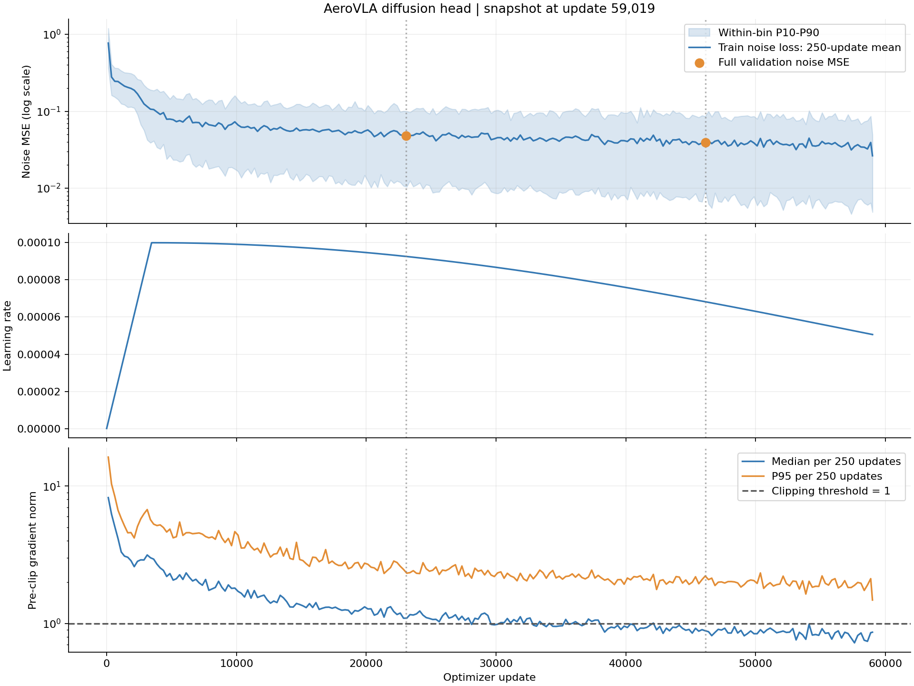
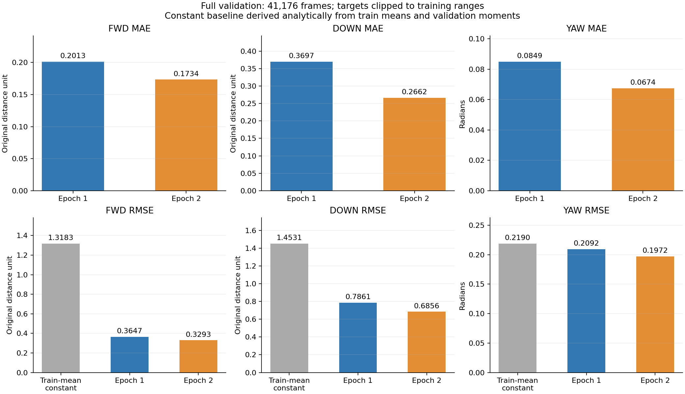
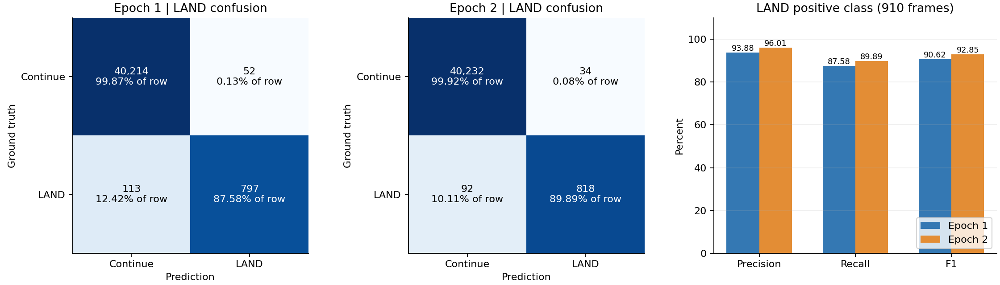

# AeroVLA 动作扩散头项目周报

[返回文档首页](../README.md)

> **历史周报：固定于 step 59,019。** 本文的“当前”“尚未评测”和耗时估计均对应原统计时点。后续[第三轮验证与更新曲线](full_training_20261010.md#epoch3)、[NYC 闭环及对比](nyc10_evaluation_20261011.md)另有记录；本周报指标、图表及快照保持原统计范围。

**周报周期：2026-10-05—2026-10-11。统计截止：2026-10-11 17:44:31，北京时间。**

本报告汇总本周有记录的开发、数据检查、训练和评估工作；现存实施记录主要集中于 10 月 10—11 日，不补写此前日期的工作。正式训练仍在进行，以下数字固定于 **step 59,019**，不会随后台日志更新而变化。原始快照、统计脚本及图表保存在 [本周报告附件](../reports/weekly_20261011/)。

## 一、本周成果与当前结论

已完成 AeroVLA 从语言动作输出头到连续动作扩散头的改造，建立了“数据划分 → 仅训练扩散头 → 全量验证 → 保存权重 → 独立重载评估”的运行流程，并在物理 GPU 1 开展全量训练。视觉骨干、projector、Llama 和原 AeroVLA adapter 均冻结，仅优化 **5,265,668 个扩散头参数**。

截至统计时点，训练完成 **59,019 / 115,400 次参数更新，进度 51.14%**，第 3 轮进行中。前两轮各完成一次 **41,176 帧全量验证**。第二轮相对第一轮：验证噪声 MSE 下降 **18.15%**，连续动作归一化 MSE 下降 **16.91%**，LAND F1 从 **90.62% 提升至 92.85%**。现有证据支持“扩散头已学到有效的离线动作预测能力，且前两轮验证持续改善”；尚不足以判定最终收敛或闭环导航效果。

当前主要短板是 **yaw 相对常量基线的改善较小，以及 LAND 正例仍有约 10.11% 漏检**。后续需导出逐样本预测并分层分析。原 LMHead 的同协议对照及 AirSim 闭环评估尚未完成，因此本周不作“优于旧架构”或“导航性能提升”的结论。

## 二、已完成工作汇总

| 工作项 | 完成内容 | 状态与依据 |
| --- | --- | --- |
| 架构改造 | 删除新模型路径中的 LMHead；直接读取多模态 Llama 最终层 token 特征，接入 Transformer 动作扩散头 | 已完成；[架构报告](../design/diffusion_action_head.md) |
| NavDP 方法适配 | 采用时间编码、条件 Transformer 去噪、epsilon 预测与 DDPM 采样；保留 AeroVLA 动作定义 | 已完成；[扩散头记录](../development/changelog.md#head) |
| 严格冻结 | 上游 `requires_grad=False`、`eval()`、`no_grad()`；优化器仅包含头参数；训练中检查上游无梯度 | 已完成；[模型记录](../development/changelog.md#model) |
| 原 adapter 兼容 | 合并 LoRA 并保留 projector；保存头权重、配置、处理器及基座/adapter 引用 | 已完成；[模型实现](../../src/model_wrapper/aerovla_diffusion.py) |
| 连续动作数据 | 复用前视/下视拼图；取消原 99 桶动作量化；裁剪并归一化动作；输入文本不含动作答案 | 已完成；[数据记录](../development/changelog.md#dataset) |
| train/val 划分 | 按轨迹严格隔离，校验完整覆盖、重复项及文件/轨迹/索引哈希；支持固定种子子集 | 已完成；[划分记录](../development/changelog.md#split) |
| 训练脚本 | 支持累积梯度、尾批次正确归一化、warmup/cosine、周期保存、每轮验证及 best 选择 | 已完成并运行；[训练评估记录](../development/changelog.md#train-eval) |
| 离线评估 | 实现噪声 MSE、连续动作 MSE、逐轴 MAE/RMSE、LAND 混淆矩阵与 P/R/F1；独立随机数控制 | 已完成；[评估记录](../development/changelog.md#eval) |
| 闭环入口 | wrapper 自动识别扩散检查点；模型 GPU、模拟器 GPU 与端口独立配置；修正 DDP 端口 | 入口与参数测试完成，真实闭环待运行；[闭环记录](../development/changelog.md#closed-loop) |
| GPU 1 正式训练 | 全量 train、5 轮、每 1,000 步保存，tmux 持久运行，退出状态和最终权重核验 | 运行中；[正式训练记录](full_training_20261010.md#launch) |
| 监督数据整理 | 全量合法性/分布/裁剪审计，139 个可追溯抽查样本，逐地图与轨迹统计 | 已完成；[监督审计记录](../development/changelog.md#supervision) |
| 持续监控 | CPU 每 60 秒导出 CSV、曲线、Markdown、告警与权重清单；处理未写完日志及终态竞态 | 已启用；[监控记录](../development/changelog.md#monitor) |

当前推理路径为：

```text
前视/下视图 + 导航指令
        ↓
冻结视觉骨干 → 冻结 projector → 冻结多模态 Llama
                                      ↓ 条件 token 特征
高斯动作噪声 + 扩散时间步 → 可训练 Transformer 动作头
                                      ↓ 多步去噪
                          [fwd, down, yaw, LAND]
```

本次参考 NavDP 的扩散建模方式，但未移植其 critic、候选轨迹排序或 xyz 路径累加。当前标注仅提供一步动作，训练 horizon 固定为 1；不将其描述为已实现多步轨迹生成。原 LM/LoRA 训练入口仍保留，扩散头使用专门的新入口。

## 三、监督数据与划分质量

| 项目 | train | val | 合计 |
| --- | ---: | ---: | ---: |
| 帧数 | 369,274 | 41,176 | 410,450 |
| 轨迹数 | 6,850 | 761 | 7,611 |
| 地图数 | 11 | 11 | 同一组 11 张地图 |
| LAND 正例 | 8,203 | 910 | 9,113 |
| LAND 正例占比 | 2.2214% | 2.2100% | 约 2.22% |
| 任一轴需要裁剪的帧数 | 9,605 | 1,051 | 10,656 |
| 任一轴裁剪比例 | 2.6010% | 2.5525% | 2.5962% |

轨迹划分无交叉、覆盖完整，来源与正式运行的 `run_config.json` 哈希一致。历史检查确认 **820,900 个图像路径全部存在**，另对 32 条样本实际解码并执行 tokenizer/processor；文件存在性检查不等于全量像素解码验证。监督标签审计覆盖全部 410,450 帧，无缺失或非有限动作标签。

动作规则如下：

| 维度 | 裁剪后的物理范围 | 扩散目标 |
| --- | --- | --- |
| fwd | [0, 5] | 映射至 [-1, 1] |
| down | [-5, 5] | 映射至 [-1, 1] |
| yaw | [-1.1, 1.1] 弧度 | 映射至 [-1, 1] |
| LAND | `is_last_step OR is_penultimate`，0/1 | -1/+1 |

train/val 的 fwd 裁剪数分别为 **4,669/532**，down 为 **807/72**，yaw 为 **8,308/896**。同一帧可能在多个轴被裁剪，不能把逐轴数量相加作为独立帧数。当前所有动作评估均针对裁剪后的监督目标，不衡量超出动作范围部分的原始误差。

LAND 规则忠实保留原字段：train 中 last/penultimate 分别为 6,850/1,353，val 为 761/149，并非每条轨迹都有 penultimate 标记。本轮未重写标记。139 个固定检查样本覆盖各 split/map 的 LAND 正负和越界类别，保留原清单索引、指令、图片路径、原始/裁剪/归一化动作；这些是静态抽查样本，不是实际训练 batch，也不包含预测值。[检查样本与完整统计](../../checkpoints/aero_vla_diffusion_full_20261010_200045/supervision/README.md)

该划分是**同地图内的轨迹留出**。能够确认扩散头训练不使用 val 轨迹，但冻结旧 adapter 是否在此前训练中接触过这些轨迹未知，因此结果称为“扩散头留出验证”，不称为 unseen-map 测试或整个模型从未见过的数据测试。

## 四、正式训练配置、进度与耗时

| 配置项 | 本次运行 |
| --- | --- |
| 运行标识 | `aero_vla_diffusion_full_20261010_200045` |
| 开始时间 | 2026-10-10 20:02:35，北京时间 |
| 设备 | 物理 GPU 1，NVIDIA GeForce RTX 4090；进程内 cuda:0 |
| 基座/adapter | 本地 `openvla-7b` / `checkpoints/aero_vla` |
| 冻结/训练参数 | 7,409,644,992 / 5,265,668；可训练部分约 0.071% |
| 精度 | 冻结骨干 BF16，扩散头 FP32 |
| 扩散头 | hidden 256、4 层、8 heads、dropout 0 |
| 扩散配置 | DDPM cosine noise schedule；100 训练时间步、10 推理步 |
| 优化器 | AdamW，初始计划峰值 LR 1e-4，weight decay 0.01 |
| 调度/梯度 | 3% warmup + cosine；max grad norm 1.0 |
| batch/累积 | 2 / 8，通常有效 batch 16；每轮尾部实际累积 10 帧 |
| 数据/轮数 | 全部 369,274 train 帧，5 轮；无样本或 step 限量 |
| 验证 | 每轮全部 41,176 val 帧；batch 2，seed 42，10 步采样 |
| 权重选择 | 每 1,000 次更新保存；best 按最低 val noise MSE 选择 |
| 复现参数 | train seed 42；完整配置见[固定配置快照](../reports/weekly_20261011/snapshot/run_config.json) |

截止时已运行 **21.70 小时**，完成两轮训练和两轮验证，第三轮完成 12,859/23,080 次更新，约 55.72%。累计训练样本访问次数为 **944,292**，含跨 epoch 重复访问，不等于新增独立样本数。最近记录的学习率为 **5.05795×10⁻⁵**，处于 cosine 下降阶段。

本次采集时 GPU 1 显存约 **15,115 MiB**，瞬时利用率约 57%；该利用率仅为一次设备观测，不能作为长期平均或性能瓶颈结论。训练与监控都继续在后台运行，本次周报未占用 GPU 做额外评估，也未重启训练。

监控在第三轮观测到约 **0.8302 次更新/秒，即 1.204 秒/更新**。两次 epoch 末停步区间约为 **61.41—63.45 分钟**和 **61.83—63.89 分钟**，主要对应全量验证，同时包含保存/切换与轮询误差；原始指标没有逐步时间戳，因此不将其写成精确验证计时。

剩余 **56,381 次更新**按当前速度约需 **18.86 小时**，加剩余 3 次全量验证约 3.1 小时，合计约 **22 小时**。在吞吐保持相近且无中断时，预计 **10 月 12 日下午**完成。按当前观测直接外推约为 15:40—15:48，但这不是置信区间或完成承诺，对外计划应采用“下午、约 22 小时剩余”的粒度。[计算与停步观测](../reports/weekly_20261011/analysis.json)

## 五、训练过程分析

训练 loss 是四维 epsilon 噪声预测 MSE，包含 LAND 坐标，不是物理动作 MAE。按每次更新实际样本数加权后：

| 阶段 | 更新范围 | 更新数 | 样本访问次数 | 平均训练 loss |
| --- | --- | ---: | ---: | ---: |
| 第 1 轮 | 1—23,080 | 23,080 | 369,274 | 0.087957 |
| 第 2 轮 | 23,081—46,160 | 23,080 | 369,274 | 0.044117 |
| 第 3 轮，尚未结束 | 46,161—59,019 | 12,859 | 205,744 | 0.037552 |
| 最近 1,000 次更新 | 58,020—59,019 | 1,000 | 16,000 | 0.034941 |

首 1,000 次更新平均 loss 为 0.384398，近期平均值明显降低；第二轮整体平均约为第一轮的一半。训练过程呈现初期快速下降、后续缓慢改善的形态。第三轮尚未完成，不能将其部分轮次均值当作完整第三轮结果。



图中 loss 与梯度按 250 次更新分组，阴影表示组内 loss 的 P10—P90，最后一组可能不足 250 次；阴影不是统计置信区间。竖线为轮次边界，橙点为两次全量验证。loss 与梯度使用对数纵轴，原始训练记录全部保存在快照中。[可导出 PDF](../reports/weekly_20261011/training_trend.pdf)

全部 **59,019 条记录 step 连续、无重复，loss/LR/梯度范数等数值均有限**。最近 1,000 步裁剪前梯度范数中位数为 **0.8238**、P95 为 **1.9465**、最大值为 **4.4935**，有 356 步超过裁剪阈值 1.0。这里记录的是 `clip_grad_norm_` 返回的**裁剪前**范数，超过阈值表示需要裁剪，不表示裁剪失效。

全程最大裁剪前范数为 **60.2784**，出现在 step 48,856；该步 loss 为 0.154511，之后指标恢复。现有记录未显示持续发散，但确实存在偶发尖峰，不能把监控“0 告警”理解为毫无波动。监控告警主要覆盖非有限值、坏日志行和导出异常。

训练与验证使用不同的 batch、随机噪声和扩散时间步，不能直接以一个训练 step 与全量 val 的差值判断过拟合。当前只有两次完整验证且均改善，支持继续完成本轮计划；是否进入平台期、是否出现过拟合，仍需后续三轮验证观察。

## 六、两轮全量验证结果与解释

两次评估均使用同一 val 集、相同 batch/seed/采样步数和同一实现，可作轮次间对比。每次含 41,176 帧、164,704 个噪声坐标以及 123,528 个连续动作坐标；连续动作 MSE 只计算 fwd/down/yaw，不包含 LAND。[固定原始验证记录](../reports/weekly_20261011/snapshot/validation_metrics.jsonl)

### 6.1 噪声与连续动作

| 指标，越低越好 | 第 1 轮，step 23,080 | 第 2 轮，step 46,160 | 相对下降 |
| --- | ---: | ---: | ---: |
| Noise MSE | 0.04784514 | **0.03915988** | 18.15% |
| 连续动作归一化 MSE | 0.02739339 | **0.02276242** | 16.91% |
| fwd MAE | 0.201304 | **0.173408** | 13.86% |
| fwd RMSE | 0.364652 | **0.329270** | 9.70% |
| down MAE | 0.369699 | **0.266231** | 27.99% |
| down RMSE | 0.786135 | **0.685596** | 12.79% |
| yaw MAE，弧度 | 0.084928 | **0.067373** | 20.67% |
| yaw RMSE，弧度 | 0.209244 | **0.197200** | 5.76% |

fwd/down 沿用数据定义的 `original_distance_unit`，本周未进一步确认其物理标定，不自行写成米。yaw 的第二轮 MAE/RMSE 分别约 **3.86°/11.30°**，仅作弧度换算帮助理解。

所有已记录误差均较第一轮改善，其中 down 的 MAE 降幅最大。yaw 的 MAE 明显改善，但 RMSE 仅下降 5.76%，说明较大的误差仍对平方误差有较强影响；需要查看误差分位数和具体样本，现有汇总不能定位是哪张地图或哪种转弯失败。

### 6.2 与训练集平均动作的常量基线比较

为避免只看绝对 loss 而忽视动作分布集中，本周补充一个无需占用 GPU 的简单参照：始终预测**训练集裁剪后目标的均值**。fwd/down/yaw 常量分别约为 `4.258975/-0.016613/-0.000126`。

该参照仅从 train 拟合常量，使用已审计的 val 总体方差与均值解析计算：

`MSE_val = Var_val(target) + (Mean_val(target) − Mean_train(target))²`。

这不是额外模型评估实跑，也没有用 val 均值训练预测器；归一化 MSE 使用归一化空间的对应均值和方差，物理 RMSE 使用裁剪后物理空间的统计量。统计中的 float32 表示差异可能带来微小舍入误差。

| 指标 | 训练均值常量基线 | 第 2 轮扩散头 | 相对下降 |
| --- | ---: | ---: | ---: |
| 连续动作归一化 MSE | 0.13404774 | **0.02276242** | 83.02% |
| fwd RMSE | 1.318301 | **0.329270** | 75.02% |
| down RMSE | 1.453075 | **0.685596** | 52.82% |
| yaw RMSE，弧度 | 0.218950 | **0.197200** | 9.93% |



结果说明整体预测优于简单常量输出，尤其 fwd/down；但 yaw 的收益较小。按动作归一化尺度还原，第二轮每轴归一化 MSE 约为 fwd **0.017347**、down **0.018802**、yaw **0.032139**，yaw 当前最高，应作为后续分析重点。整体 MSE 的大幅优势不能掩盖单轴短板；这一基线也不能代替旧 LMHead 或视觉条件消融实验。[可导出 PDF](../reports/weekly_20261011/validation_actions.pdf)

### 6.3 LAND 分类能力

| 指标 | 第 1 轮 | 第 2 轮 | 变化 |
| --- | ---: | ---: | ---: |
| Precision | 93.875% | **96.009%** | +2.134 个百分点 |
| Recall | 87.582% | **89.890%** | +2.308 个百分点 |
| F1 | 90.620% | **92.849%** | +2.229 个百分点 |
| Accuracy | 99.599% | **99.694%** | +0.095 个百分点 |
| TP，正确判 LAND | 797 | 818 | +21 |
| TN，正确判继续 | 40,214 | 40,232 | +18 |
| FP，误判 LAND | 52 | 34 | −18 |
| FN，漏判 LAND | 113 | 92 | −21 |

验证集正例仅 910 帧，占 2.210%。若始终预测“不降落”，accuracy 已达 **97.790%**，但正例 recall/F1 为 0。因此第二轮 99.694% accuracy 必须与 **89.890% recall、92.849% F1**一起解释，不能单凭准确率声称降落问题已解决。



总错分数从 165 降至 126，减少 23.64%；正例漏检率仍有 **92/910=10.11%**，负例误报率为 **34/40,266=0.0844%**。这些是帧级指标，不能直接解释成 episode 级错过降落或提前终止的概率。下一步应分别核查 92 个漏检和 34 个误报的观测、目标位置、last/penultimate 标记及动作输出。[可导出 PDF](../reports/weekly_20261011/land_validation.pdf)

## 七、模型权重与本次实际核验

截止快照，已有 **59 个周期检查点**，从 `checkpoint-1000` 到 `checkpoint-59000`，另有 `best/`，合计 60 个被记录的检查点目录。当前 best 对应 **第 2 轮、step 46,160、val noise MSE 0.03915988**。第 3 轮尚未验证，不能将最新 `checkpoint-59000` 称为比 best 更好的模型。

| 权重 | 对应 step | 文件大小 | 本次核验 |
| --- | ---: | ---: | --- |
| [best/diffusion_head.pt](../../checkpoints/aero_vla_diffusion_full_20261010_200045/best/diffusion_head.pt) | 46,160 | 21,088,629 bytes，约 20.1 MiB | CPU 加载成功，81 个张量、5,265,668 个元素均有限 |
| [checkpoint-59000/diffusion_head.pt](../../checkpoints/aero_vla_diffusion_full_20261010_200045/checkpoint-59000/diffusion_head.pt) | 59,000 | 21,088,629 bytes | 同上 |
| 最终根目录 `diffusion_head.pt` | 计划 115,400 | 尚未产生 | 正常，训练仍在进行 |

本次另外核对训练、评估、数据、头实现和监控/审计脚本的 SHA256，均与启动记录一致。权重检查在 CPU 进行，记录了读取前后文件稳定性和 SHA256；它证明头文件可读取且张量有限，**不等于已对当前 best 重新加载完整 7B 并完成独立推理评测**。[权重核验明细与哈希](../reports/weekly_20261011/checkpoint_verification.json)

`best/` 会在后续验证改善时更新，因此本报告用 step 和 SHA256 固定当前结果。检查点只保存扩散头和重载所需配置，仍依赖原基座与 adapter；不含 optimizer/scheduler/RNG 状态，当前不支持精确断点续训。本周报告未改变这一训练行为。

## 八、测试证据与尚未覆盖的验证

| 层次 | 已有证据 | 时间与适用范围 |
| --- | --- | --- |
| 架构与初次集成 | 36 项测试通过：扩散调度、mask、冻结、LoRA 合并、保存重载、数据与累积梯度等 | 历史首次交付记录 |
| 完整训练/评估接入 | 扩展后全套 66 项通过 | 历史集成记录；包含前述 36 项，不能相加 |
| 监督审计与监控 | 新增审计 8 项、监控 13 项通过 | 历史专项验证；与 66 项合计覆盖 87 个测试项，非本次整套重跑 |
| 真实模型短程流程 | 真实 train 4 帧、val 8 帧、两次更新；独立重载评估与训练后验证一致 | 证明训练→保存→重载→评估可运行，不证明效果；[原始核验](../../checkpoints/diffusion_smoke_real/pipeline_check.json) |
| 正式训练验证 | 2 次 41,176 帧全量验证，全部有效 | 本周正式训练结果，见第六节 |
| 本次周报检查 | 固定日志哈希、step 连续性、数值有限、best 选择一致性、两份头权重 CPU 完整性、分析重算、三组图表核对 | 本次实际执行；未因文档工作重跑整套测试或占用 GPU |

当前没有旧 LMHead 同条件全量验证结果，没有多随机种子重复实验，也没有逐地图/动作区间误差、P95/P99 动作误差和真实 AirSim SR/SPL/NE。因此能够评价当前运行的离线改善趋势，但不能给出统计显著性、未见地图泛化、导航成功率或可部署性结论。

## 九、下阶段重点与验收条件

以下为建议工作计划，本次周报整理未额外启动新训练或闭环任务。

| 优先级 | 工作 | 目的与验收条件 |
| --- | --- | --- |
| P0 | 完成当前 5 轮训练 | 达到 115,400 次更新；检查 `status.json=completed`、最终与 best 权重以及 `completion_check.json`；汇总全部 5 次全量验证 |
| P0 | 对最终 best 做独立重载评估 | 固定数据、seed、batch、精度及采样步数；完整加载基座/adapter/头，核对指标与对应训练验证一致 |
| P1 | 导出逐样本预测和误差 | 保存原清单索引、地图/轨迹、指令、图像路径、原始/裁剪目标、预测动作和 LAND 分数；当前静态审计样本不能替代此产物 |
| P1 | yaw 与 LAND 专项排查 | 按原始转角、是否裁剪、地图/轨迹分层，报告样本数、MAE/RMSE、P95/P99；人工检查大 yaw 误差及 LAND 的 FP/FN |
| P1 | 与原 LMHead 做同协议对照 | 使用相同图像处理、指令、val 划分和动作评价口径，报告逐轴及 LAND 指标；避免仅与短程 smoke 或常量基线比较 |
| P1 | 开展 AirSim 闭环评估 | 选定 episode 清单及可用模拟器服务，明确 seen/unseen 条件，记录 SR/SPL/NE、停止行为和失败案例；与离线结果分开汇报 |
| P2 | 增强训练工程与稳健性 | 后续实验支持 optimizer/scheduler/RNG 断点恢复；根据分层证据再决定是否调整 LAND 权重、采样、扩散步数或 horizon |

不宜在本轮进行中仅凭汇总指标改动动作范围、LAND 标签或训练策略，否则会改变实验定义，影响前后轮次可比性。需要多步动作、类别重加权或其他结构改进时，应在当前基准完成后单独记录新实验配置。

## 十、交付文件、复现方式与本次记录

| 产物 | 入口 |
| --- | --- |
| 本周报 | `docs/experiments/weekly_report_20261011.md` |
| 固定证据快照 | [snapshot/manifest.json](../reports/weekly_20261011/snapshot/manifest.json)，包含采集时间、截止 step、源路径与每份快照 SHA256 |
| 机器可读统计 | [analysis.json](../reports/weekly_20261011/analysis.json) |
| 统计与绘图脚本 | [build_analysis.py](../reports/weekly_20261011/build_analysis.py) |
| 训练趋势 PNG/PDF | [PNG](../reports/weekly_20261011/training_trend.png) / [PDF](../reports/weekly_20261011/training_trend.pdf) |
| 动作误差 PNG/PDF | [PNG](../reports/weekly_20261011/validation_actions.png) / [PDF](../reports/weekly_20261011/validation_actions.pdf) |
| LAND 分析 PNG/PDF | [PNG](../reports/weekly_20261011/land_validation.png) / [PDF](../reports/weekly_20261011/land_validation.pdf) |
| 实时监控，内容继续变化 | [monitoring/status.md](../../checkpoints/aero_vla_diffusion_full_20261010_200045/monitoring/status.md) |
| 运行与历史改动说明 | [训练评估指南](../guides/training_and_evaluation.md)、[全量训练记录](full_training_20261010.md#launch) |

在项目根目录重建本周分析与图表：

```bash
CUDA_VISIBLE_DEVICES='' OMP_NUM_THREADS=1 OPENBLAS_NUM_THREADS=1 \
  /data/xiyang/.conda/envs/aero_vla/bin/python \
  docs/reports/weekly_20261011/build_analysis.py
```

脚本只读固定快照，先验证快照哈希，再计算统计与图表，不读取后续实时训练数据。归一化/物理基线使用总体标准差（ddof=0）；P95 使用 NumPy 默认线性分位数插值；误差相对下降为 `(第1轮−第2轮)/第1轮`，分类变化以百分点表示。

本次记录：①核对历史设计、数据、测试与运行记录；②冻结 step 59,019 的日志及配置快照；③独立复核两轮验证、训练趋势、LAND 混淆矩阵与训练均值常量基线；④在 CPU 核验 best 与 checkpoint-59000；⑤生成三组 PNG/PDF 及可重建分析脚本；⑥形成本周报并链接历史记录；⑦更新训练指南和全量训练记录中的最新状态提示，保留历史启动快照。本次没有修改正式训练实现或监督数据，也没有创建 git commit。

周报交付检查：39 个本地链接均有效，快照哈希、样本访问次数和 LAND 混淆统计一致；三组图像已经实际查看，数值与结论经独立复核。交付检查及报告/分析脚本哈希保存在同级附件目录的 `report_verification.json`。
