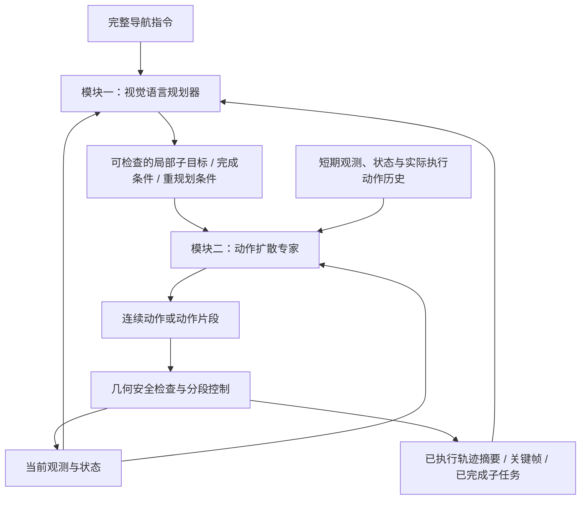

# AeroVLA 两阶段规划与动作专家：可行性及中间数据方案

日期：2026-10-12。本文回应“LLM 显式规划 → action expert 生成动作，并向两者提供历史轨迹和当前状态”的建议。状态：完成代码/数据抽样核查和文献调研，尚未实现新架构或生成训练数据。

**判断：建议有针对性，值得作为下一阶段模型改进路线。** 它可以让任务进度、局部子目标及恢复意图成为可检查的监督，便于独立扩充动作专家的数据。不过，收益取决于子目标的视觉落地、状态覆盖和执行反馈；不能仅靠增加一段推理文字来保证避障。

## 1. 当前 AeroVLA 是否使用历史和状态？

以下结论针对正在运行的本地 AeroVLA 实现，不泛指所有同名论文或版本。

| 信息 | 当前模型实际使用情况 | 证据 |
|---|---|---|
| 当前图像 | 前视、下视 RGB 拼接 | `src/model_wrapper/aerovla_wrapper_ui.py:99–105,151–159` |
| 历史图像/轨迹 | 未输入；虽然接口收到 `episodes`，只取 `ep[-1]` | 同文件 `:99–101` |
| 当前位置、姿态 | 程序用它与目标坐标计算方向提示，数值本身未输入模型 | 同文件 `:62–92,107–109,162–165` |
| 速度、历史执行动作、深度 | 没有对应模型输入分支 | `src/model_wrapper/aerovla_diffusion.py:155–210` |
| 显式计划 | 没有，直接从图像及指令条件生成动作 | 同文件 `:212–252` |
| 文本生成能力 | 当前扩散模型加载时删除 `lm_head` | 同文件 `:89–94` |

训练也只提供当前图像、指令和单步动作，见 `src/diffusion_dataset.py:100–125`。环境能够采集更多状态，不等于这些状态已经被模型利用。

现有提示词是每步更新的“Fly straight ahead / forward-left … and find the target + 目标描述”。这是程序生成的方向提示，不是 LLM 自主规划。现有评估会使用真实目标坐标生成该提示；新方案必须说明是否沿用这一输入协议，不能把额外精确目标坐标或全局地图隐蔽地加入 planner。

## 2. 推荐的两阶段接口



如果第一模块需要判断“到了哪个路口”“xxx 在哪里”，它必须具备视觉输入，或接收有图像证据的感知结果。只给纯文本 LLM 一条导航指令，不能可靠确定地标是否可见、当前是否已经到达。

建议第一模块输出简短的**状态依据、任务阶段、局部子目标、完成条件、异常重规划条件**。例如，下列仅为接口示意，不是现有任务的真实标注：

```json
{
  "plan_id": "plan_12",
  "observation_cutoff_step": 120,
  "stage": "approach_intersection",
  "evidence": "当前前视可见待接近的路口，历史记录尚未进入该路口",
  "local_goal": "沿当前可见通道接近路口，保持安全净空",
  "completion_condition": "感知和几何模块确认进入指定路口区域",
  "next_stage": "确认左侧通道后执行左转",
  "replan_when": ["路径受阻", "地标丢失", "子目标完成", "计划过期"]
}
```

正式数据应为地标和证据添加可追溯的帧编号、目标区域/检测引用，并把完成条件变成可执行谓词。未知信息允许标为未知；精确局部航点若存在，应由有标定的几何模块落地，不能让 LLM 随意填写米制距离。

不必每次重新生成整条长路线。上层维护任务进度，按事件或较低频率更新局部目标；下层始终结合最新观测执行。两个模块共享 `plan_id`、观测截止时间和计划年龄，防止把较早生成的“左转”应用到已经越过路口的新状态。

### 历史和状态应如何分配？

| 模块 | 推荐历史 | 推荐当前状态 |
|---|---|---|
| 规划器 | 已完成/待完成子任务、关键地标帧、真实走过路径的摘要、近期转向/升降趋势 | 相对位姿、当前运动趋势、可见地标、局部通路与障碍摘要 |
| 动作专家 | 短期连续观测、相对位姿序列、实际执行动作和安全层干预 | 当前 RGB-D、姿态、速度、局部子目标及其有效性 |

首轮可比较规划器最近 8/16 个真实决策点加少量地标关键帧、专家最近 2/4 个真实观测的设置；这些是待验证方案，不是论文结论或固定最优值。应记录采样时间和缺失 mask。位置宜使用相对位移及统一局部坐标，朝向可用 sin/cos 表示；全局 NED 的 z 不等于离地高度。

历史应来自**实际执行**，不能用未来参考轨迹或未经执行的模型提议替代。当前闭环客户端每个动作后把同一末态复制 5 次（`AirVLNSimulatorClientTool_AeroVLA.py:386–389`），不能当作 5 个真实历史时刻。

## 3. 现有数据可以支持到哪一步？

`data/aerovla_train_dataset.json` 的样本字段为 `traj_rel_dir`、`img_name`、`instruction`、`label{fwd,down,yaw}`、`is_last_step`、`is_penultimate`，没有显式子目标或推理标签。抽样中的指令主要描述动态目标方向和目标物体，原 `merged_data.json.conversations` 也不是完整的多阶段路线。

只读抽样的原始轨迹：

- `dataset_raw/Carla_Town01/00c9b2a9-eaa8-4b18-86ad-9f402e5cbb51`：83 个图像时间点，409 条详细位姿。
- `dataset_raw/NYCEnvironmentMegapa/4e0be454-730c-428b-84b5-f8cf2fe188c8`：95 个图像时间点，470 条详细位姿。

两者存在五方向 RGB/深度，`merged_data.json` 包含 `index`、`trajectory_raw` 和 `trajectory_raw_detailed`，可用来核对图像与位姿。原专家 `log/*.json` 抽样只有 frame、position、orientation，没有速度和时间戳；不能把“每帧位移”直接当作 m/s。已有某些 `dagger/0` 日志含速度、时间戳等，可以继续审计覆盖度，但目录名称不证明其中有有效专家纠正标签。原深度 PNG 为 uint8，其量化和标定也需验证。

因此，可以先离线生成位移/转向/升降历史摘要和几何阶段标签，复用已有专家动作；地标名称、可见性和语义切换条件需要图像核验。要证明多阶段指令能力，还需要补充真正包含多个子任务的指令及其对齐标注。

## 4. 如何构造中间数据与大量动作专家数据

### 两套监督应明确分开

**规划监督：** `(完整指令, 截至当前的图像/状态/历史) → (任务阶段, 子目标, 完成与重规划条件)`。

**动作监督：** `(当前有效子目标, 当前观测/状态, 短历史) → (未来专家动作片段, 有效 mask, STOP/阶段完成标签)`。

生产记录还应包含 `trajectory_id`、split、frame/timestamp、坐标系和单位、`plan_id`、计划产生时刻、证据引用、标签来源/版本、实际执行动作与质量核验结果。输入字段和监督目标分别存放，避免加载时无意泄漏。

### 推荐的数据生产顺序

1. **对齐和切段。** 先按原轨迹划分 train/val/test，再按图像索引对齐位姿、动作；依据转向、升降、目标接近和人工/视觉确认的地标事件切分阶段。所有派生滑窗和改写跟随原轨迹分组。
2. **生成中间标签。** 程序计算可验证的运动事实，VLM 辅助把事实与当前/历史图像中的地标对应，生成短子目标描述；抽样人工复核。不能仅把 `[fwd,down,yaw]` 翻译成文字就称为多阶段规划监督。
3. **构造专家训练窗口。** 同一阶段内按真实时序建立观测历史及未来动作，正确处理阶段结束、终止和 padding。原数据只支持 H=1 的现状见 `src/diffusion_dataset.py:78–82`；H=4/8 需要新序列构造和 batch 接口。
4. **增加真实状态覆盖。** 在训练场景中改变起点、朝向、高度、障碍相对位置，重新渲染观测，并由经过验证的规划器/专家生成可执行动作。偏离专家路线后的纠正、近障恢复和安全制动样本优先于大量同义改写。
5. **闭环筛选与增量回收。** 检查计划是否有证据、动作是否符合计划、轨迹是否可执行，以及接触/近障事件。记录失败供诊断或风险训练；不能把失败动作直接作为应模仿的专家标签。

LLM 适合辅助生成语义、子任务和语言变化；连续飞行动作应来自有效示范或经过仿真/几何验证的专家。改变状态后必须重新获得匹配观测和动作，不能只改 JSON 里的位置、却保留原图像及标签。同一条飞行轨迹生成十种说法主要增加语言覆盖，不等于十条独立飞行经验。

### 因果性与上下层误差

未来专家轨迹可以用于切分训练阶段、制作监督目标；planner 的在线输入只能使用当前及过去信息。凡需未来真值才能得到的计划，应明确作为教师标签，而不是声称在线已经观测到的事实。

动作专家可以先用人工/规则验证的子目标训练，但必须进一步在**模型预测的子目标**条件下评估和适配。可在训练集内部做交叉预测以构造更接近部署的计划条件；对错误计划应标注拒绝/重规划或提供相应纠正，不能将矛盾计划与原专家动作强行配对。异步训练还应模拟计划延迟，并提供最新观测及相对运动补偿。

可读的计划文本不自动证明动作模型使用了它。需要在可比观测下改变合法子目标、移除计划等实验，检查动作和任务行为是否随之改变。

## 5. 与当前冻结训练方式如何兼容？

当前扩散版已经删除 LMHead，不能直接调用其文本生成来输出计划。首个可行版本可采用**独立、冻结的规划 VLM**，现有骨干继续冻结，只训练动作专家及其新增的计划/状态/历史投影层。新增层应明确纳入动作模块并审计参数名单；它们会使模型配置区别于现有 checkpoint。

将中间文本或其编码、状态 token 和历史特征作为 diffusion cross-attention 的条件，需要重新训练/适配专家；仅在推理时把很长的新提示词塞给 checkpoint-70000，不能假定它能理解并正确执行。

第一阶段先验证数据和接口，可保持 H=1，之后再比较 H=4/8、执行 E=1。两模块也不自动等于高频控制：当前专家每次还会运行大型骨干。若要明显提高频率，需要缓存较慢更新的语义特征，并设计能接收最新观测的轻量动作侧编码器；不能只缓存旧视觉特征后宣称使用了实时观测。

动作专家仍可先使用现有条件去噪 MSE，只扩充条件和监督数据。上层若以后需要领域微调，再单独训练子目标文本监督；不必在首轮同时改变上层模型、扩散目标、多步长度和控制器。

## 6. 文献依据及其对本任务的意义

- **FLIGHT VLA / Think Like a Pilot（2026-06 预印本）**与本建议直接相关：较低频率的视觉语言模块维护任务状态和可读计划，动作模块使用实时观测、状态及最近可用语义特征；论文还处理异步条件延迟。其动作部分采用 flow matching，不能直接当作本项目 DDPM 权重的替换件。[原文](https://arxiv.org/html/2606.06836v1)
- **π0.5（2025）**采用先预测语义子任务、再条件化生成动作的组织方式，说明中间子目标可作为训练与推理接口；其机器人操作实验不能直接证明 AeroVLA 会提升多少。[原文](https://arxiv.org/html/2504.16054v1)
- **DAgger（2011）**支持在策略实际访问到的状态上收集专家纠正，有助于设计偏离路线后的恢复数据。[原文](https://proceedings.mlr.press/v15/ross11a.html)

因此“两阶段 + 显式子目标”已有直接相关先例。若面向研究贡献，应进一步明确无人机三维几何约束、数据生成质量、历史表示或恢复学习上的具体创新，并在相同输入与安全机制下做消融。

## 7. 对碰撞问题的作用与实验顺序

历史能帮助识别已飞过的地标、重复绕圈、持续爬升及之前出现的障碍；当前速度与深度有助于动作选择和制动；恢复数据能覆盖当前示范不足的偏离状态。这些都是有针对性的改进方向。

但较慢的语义规划器不能替代动作途中的几何检查。即使文字计划正确，低层动作仍可能在执行中碰撞。因此应继续保留[碰撞改进方案](diffusion_collision_mitigation_plan_20261012.md)中的独立安全层和可中断执行。

建议按顺序比较：

| 版本 | 新增内容 | 用于区分的因素 |
|---|---|---|
| B0 | 现有模型，统一评估/安全协议 | 可比基线 |
| B1 | 当前状态、深度及历史，不生成显式计划 | 更多感知与记忆的收益 |
| B2 | B1 + 人工/规则核验的子目标 | 动作专家是否能有效利用子目标；属于教师条件诊断 |
| B3 | B1 + 在线 VLM 预测子目标 | 完整两阶段系统实际收益及上下层误差 |
| B4 | B3 + 恢复/扰动数据，再单独研究多步输出 | 数据与动作时域的额外收益 |

还需比较相同数据、状态和历史下“有/无显式计划”，避免把更多数据或更丰富传感器的收益全部归因于推理。记录子任务完成率、计划落地正确率、错误/过期计划比例、SR/SPL、接触与近障、干预/死锁、延迟和额外推理成本。现有 10 个任务只做回归诊断，最终评估使用保留轨迹/场景。

**建议先交付一个小规模、经过核验的中间数据集，以及能读入计划/状态/历史的专家训练接口，再扩大合成数据。** 数据量扩大应以新的有效状态—动作覆盖为依据，而不是以生成文字条数为依据。

## 8. 本次工作记录

- 2026-10-12：核查当前训练、推理及冻结模型接口，确认未使用历史/数值状态输入，且扩散版已移除文本输出头。
- 2026-10-12：只读抽样两条原始轨迹和部分日志，记录可复用的图像/位姿以及速度、时间戳和专家纠正标签的核验缺口；抽样结论不冒充全量统计。
- 2026-10-12：查阅上述原始资料，新增本方案，说明数据接口、训练范围、因果边界与验证设计。
- 本次未修改运行代码、未改变现有权重、未生成训练标签或启动训练。
