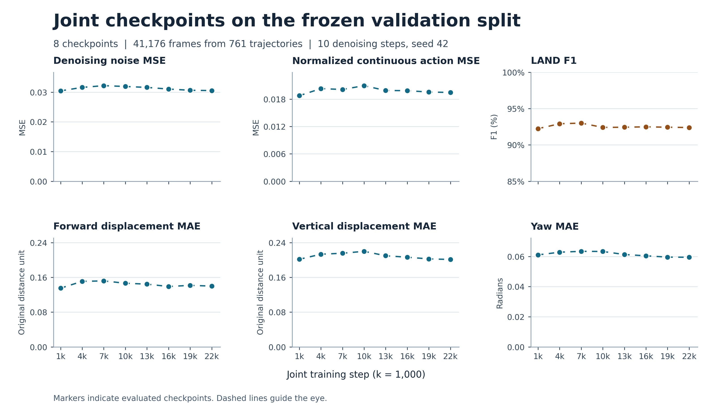

# CS280 成员 A 离线补跑与验收报告

2026 年 11 月 27 日核验。**成员 A 的 8 个正式离线检查点全部完成。** 本轮补跑 5 个，复用此前已验收的 3 个。两段补跑作业共用 **6 小时 35 分钟单卡时**，比 8 小时硬上限少用 **1 小时 25 分钟**。BME 的 Slurm 账单和活动队列均已复查，GPU 已释放。

## 1. 八个检查点的评估结果

| Step | 噪声 MSE ↓ | 归一化动作 MSE ↓ | 前向 MAE ↓ | 垂向 MAE ↓ | 偏航 MAE（rad）↓ | LAND Precision ↑ | LAND Recall ↑ | LAND F1 ↑ | FP | FN |
| ---: | ---: | ---: | ---: | ---: | ---: | ---: | ---: | ---: | ---: | ---: |
| 1,000 | 0.03042 | 0.01876 | 0.13514 | 0.20162 | 0.06103 | 93.76% | 90.77% | 92.24% | 55 | 84 |
| 4,000 | 0.03159 | 0.02031 | 0.15089 | 0.21331 | 0.06281 | 95.16% | 90.77% | 92.91% | 42 | 84 |
| 7,000 | 0.03218 | 0.02012 | 0.15191 | 0.21553 | 0.06340 | 96.35% | 89.89% | 93.01% | 31 | 92 |
| 10,000 | 0.03190 | 0.02096 | 0.14655 | 0.21998 | 0.06330 | 93.18% | 91.65% | 92.41% | 61 | 76 |
| 13,000 | 0.03159 | 0.01990 | 0.14446 | 0.20979 | 0.06128 | 95.76% | 89.34% | 92.44% | 36 | 97 |
| 16,000 | 0.03103 | 0.01987 | 0.13905 | 0.20638 | 0.06043 | 95.12% | 90.00% | 92.49% | 42 | 91 |
| 19,000 | 0.03063 | 0.01956 | 0.14160 | 0.20254 | 0.05955 | 95.76% | 89.34% | 92.44% | 36 | 97 |
| 22,000 | 0.03052 | 0.01947 | 0.13998 | 0.20125 | 0.05946 | 95.54% | 89.45% | 92.40% | 38 | 96 |

动作误差按仓库定义计算。归一化动作 MSE 只含前向、垂向和偏航；前向与垂向 MAE 沿用原始距离单位，偏航 MAE 用弧度。LAND 阈值为归一化输出 ≥0，正例为轨迹最后一帧或倒数第二帧。每次评估的混淆计数合计 41,176 帧，含 910 个正例和 40,266 个负例。 [完整指标 CSV](a-offline-full-metrics.csv)

- **step 1,000** 的噪声 MSE（0.03042）、归一化动作 MSE（0.01876）和前向 MAE（0.13514）均为八点最低。
- **step 7,000** 的 LAND F1 最高（93.01%）。八个点的 F1 介于 92.24% 和 93.01%，相差约 0.77 个百分点。
- **从 step 10,000 到 22,000**，每个后续已测点的归一化动作 MSE 都低于前一个已测点，从 0.02096 降到 0.01947。step 22,000 的垂向 MAE（0.20125）和偏航 MAE（0.05946 rad）在八点中最低。

这些比较来自同一轮训练的不同检查点，采用一次固定策略的离线推理。验证划分确认覆盖扩散动作头的按轨迹训练／验证隔离，冻结 adapter 的预训练数据重叠情况尚未核实。闭环导航成绩需要 AirSim 的实测结果。

圆点为已测检查点。图中的连线用于示意相邻已测点的变化。 [矢量图](a-offline-trends.svg)

## 2. 实际补跑和 GPU 释放

| Slurm 作业 | 硬时限 | 实际开始（北京时间） | 实际结束（北京时间） | 单卡占用 | 最终状态 |
| --- | ---: | --- | --- | ---: | --- |
| 4364399 | 6 小时 | 11-26 20:45:56 | 11-27 02:01:59 | 5:16:03 | COMPLETED（0:0） |
| 4364410 | 2 小时 | 11-27 02:02:16 | 11-27 03:21:13 | 1:18:57 | COMPLETED（0:0） |

两段各申请一张 A100 PCIe 40 GB，串行衔接。首段完成 4 个检查点后退出，step 19,000 由第二段接续。第二段核对了首段的完成记录，跳过已验收的 4 项。两段均正常退出，Slurm 未触发超时回收。11 月 27 日 09:19:38 的复查中，两段主作业、batch 和 extern 均为 `COMPLETED 0:0`，活动队列无这两段作业。

| 本轮补跑检查点 | 作业 | 逐项耗时（含准备与校验） |
| ---: | --- | ---: |
| 4,000 | 4364399 | 1:19:22 |
| 7,000 | 4364399 | 1:18:56 |
| 13,000 | 4364399 | 1:18:44 |
| 16,000 | 4364399 | 1:18:58 |
| 19,000 | 4364410 | 1:18:56 |

作业实际卡时以 Slurm 账单的分配时长为准。逐项耗时来自作业内台账。 [首段台账](4364399-ledger.tsv) · [第二段台账](4364410-ledger.tsv) · [队列和 SHA-256 核验记录](slurm-release-proof.txt)

## 3. 数据、命令和验收口径

使用 BME 已验证的环境和冻结验证集。每个正式结果均覆盖 **41,176 帧、761 条轨迹**，有效坐标为 164,704 项，其中连续动作坐标为 123,528 项。八份 JSON 的标注、划分、轨迹、验证轨迹和所选帧索引哈希均一致。

统一配置为 seed 42、batch size 2、4 个数据加载 worker、max length 2048、10 步去噪和 BF16 基座。每次先校验权重与环境，再在获配的计算节点执行同一个仓库评估入口。登录节点用于提交、查队列和读取小文件。新增五份 BME 原始 JSON 均已逐一核对 SHA-256。公开版 JSON 仅将服务器绝对路径改为项目相对路径，保留完整评估指标和划分校验值。释放凭据中的文件哈希对应 BME 原始文件。每条正式记录均附原始输出、评估命令及日志路径。64 帧离线预检已单独归档。

运行入口使用项目提交 `85d0e44df2d775256778d9454ea5c11d04d25d1b` 的 `scripts/eval_diffusion_head.sh`。逐次命令见结果索引中 `run_record` 指向的记录。 [八份评估 JSON 和逐次运行记录的索引](a-offline-full-record.json) · [离线预检记录](run-records/offline-smoke64.json)

## 4. 闭环交接与全组交付

成员 A 的离线评估已达 8/8。闭环部分已准备交接表，核验六份正式输入清单的 SHA-256，并对齐 30 个正式运行包及 5,010 个预期模型—任务对。截至本次核查，GitHub 主分支和 BME 已检查目录里暂无可验收的闭环预检或正式轨迹，表中的闭环完成数和指标仍待负责人交接确认。 [闭环交接表](a-closed-loop-handoff.json) · [冻结输入核查](a-closed-loop-input-checks.json)

接收闭环结果后，按场景和模型核对 15 条预检与正式 UUID 的覆盖，再验收 SR、OSR、SPL、NE 和对应的场景案例。V06／V07 需要轨迹和关键帧证据；全组 V01 需要 A、B、C 的闭环数据，全组 V04 还需要 B、C 的正式离线结果。 [成员 A 任务单](https://github.com/skd-cs280-final-project/diffusion-action-head/blob/cf78d73fc16c523b0055adddad327d7c69eb0931/docs/team/member_a.md)
