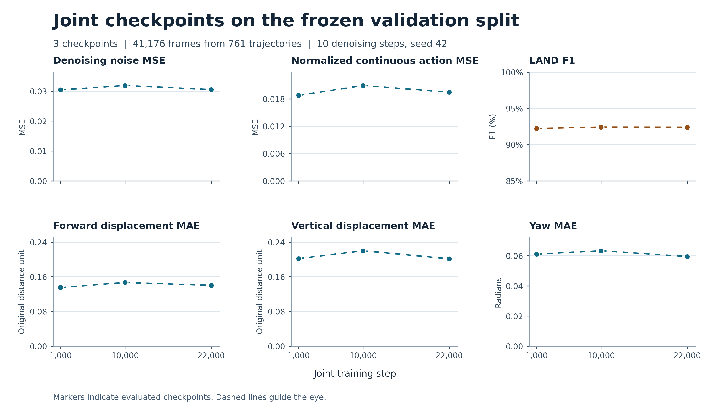

# CS280 成员 A 三个联合检查点的离线评估

本次比较同一轮联合训练的 step 1,000、10,000 和 22,000。每个模型都评估了冻结验证集的完整 41,176 帧，覆盖 761 条轨迹。本次范围是成员 A 的三个代表性离线检查点；课程任务单共列出八个，闭环 AirSim 指标需通过对应的闭环运行评估。

五项误差指标在这三个检查点上均先升后降。step 1,000 的噪声 MSE、归一化动作 MSE 和前向 MAE 最低。step 22,000 的归一化动作 MSE 比 step 10,000 低 7.1%，垂向和偏航 MAE 在三个检查点中最低。二者对应的垂向与偏航 MAE 分别由 0.21998 降至 0.20125、由 0.06330 降至 0.05946 rad。

三组 LAND F1 在 92.24%–92.41% 之间，相差 0.17 个百分点。step 22,000 相比 step 10,000 把误报从 61 帧减到 38 帧，漏报从 76 帧增到 96 帧。它的 LAND precision 最高（95.54%），recall 最低（89.45%）。

## 离线结果

| Step | 噪声 MSE ↓ | 归一化动作 MSE ↓ | 前向 MAE ↓ | 垂向 MAE ↓ | Yaw MAE（rad）↓ | LAND Precision ↑ | LAND Recall ↑ | LAND F1 ↑ | FP | FN |
| ---: | ---: | ---: | ---: | ---: | ---: | ---: | ---: | ---: | ---: | ---: |
| 1,000 | 0.03042 | 0.01876 | 0.13514 | 0.20162 | 0.06103 | 93.76% | 90.77% | 92.24% | 55 | 84 |
| 10,000 | 0.03190 | 0.02096 | 0.14655 | 0.21998 | 0.06330 | 93.18% | 91.65% | 92.41% | 61 | 76 |
| 22,000 | 0.03052 | 0.01947 | 0.13998 | 0.20125 | 0.05946 | 95.54% | 89.45% | 92.40% | 38 | 96 |

误差指标越低越好，LAND 的 precision、recall 和 F1 越高越好。前向和垂向 MAE 使用数据的原始距离单位，yaw 使用弧度。LAND 使用归一化输出阈值 0，正例为轨迹末帧或倒数第二帧，共 910 帧。FP 是误报 LAND，FN 是漏报 LAND。[未舍入的汇总 CSV](offline-metrics.csv)



每个圆点对应一次已完成的评估，虚线连接已测检查点。前向与垂向 MAE 共用纵轴刻度。同一训练轨迹仅评估一次固定策略，图中使用单次观测值。[矢量趋势图](offline-trends.svg)

## 划分和可复现命令

三份输出中的标注文件、划分文件、轨迹清单、验证轨迹和所选帧索引哈希一致。动作头的 checkpoint 元数据确认采用按轨迹分组的训练／验证切分。冻结 adapter 的预训练数据和验证集有无重叠尚未核实。这里的指标只反映离线动作预测。

评估入口、Python 评估器和 split 文件与项目提交 `85d0e44df2d775256778d9454ea5c11d04d25d1b` 核对一致。本次运行使用预置的 BME 项目环境，每次一张 A100 PCIe 40 GB，PyTorch 2.1.2+cu121，基座 BF16。实际 `transformers` 为 4.42.4，模型加载器提示参考版本为 4.40.1。三次评估沿用同一环境和配置。完整输入使用 `data/continuous_split_seed42.json`，推理 seed 42、batch size 2、worker 4、max length 2048、10 步去噪。

在已分配的 Slurm GPU 计算节点内运行。以下示例复现 step 22,000，模型 ID 可改为 `joint_step_001000` 或 `joint_step_010000`。

```bash
cd "$HOME/CS280 final project"
: "${SLURM_JOB_ID:?请在 Slurm GPU 计算节点内运行}"
: "${SLURMD_NODENAME:?请从分配到的计算节点运行}"
export PYTHON="$PWD/.venv/bin/python" HF_HUB_OFFLINE=1 TRANSFORMERS_OFFLINE=1
export OMP_NUM_THREADS=4 OPENBLAS_NUM_THREADS=4
model=joint_step_022000
out="$(mktemp -d "$PWD/eval_results/course_inference/a/offline/reproduction.XXXXXXXX")"
bash scripts/eval_diffusion_head.sh \
  --checkpoint "$PWD/eval_results/course_inference/resources/models/$model" \
  --data-root "$PWD/.setup/offline-val-data" \
  --data-json "$PWD/.setup/offline-annotations-inspect/data/aerovla_train_dataset.json" \
  --split-json "$PWD/data/continuous_split_seed42.json" \
  --split val --device cuda --batch-size 2 --num-workers 4 \
  --max-length 2048 --seed 42 --num-inference-steps 10 --backbone-dtype bfloat16 \
  --output "$out/${model}_full_val_seed42.json"
```

## 作业与评估输出

| Step | Slurm 作业 | 运行起止（BME 本地时间） | 单卡占用 | 评估 JSON |
| ---: | --- | --- | ---: | --- |
| 1,000 | 4352757 | 2026-11-19 14:49:15 → 2026-11-19 16:11:26 | 01:22:11 | [JSON](raw/joint_step_001000_full_val_seed42.json) |
| 10,000 | 4353667 | 2026-11-19 20:49:39 → 2026-11-19 22:06:55 | 01:17:16 | [JSON](raw/joint_step_010000_full_val_seed42.json) |
| 22,000 | 4357506 | 2026-11-20 23:39:21 → 2026-11-21 00:59:25 | 01:20:04 | [JSON](raw/joint_step_022000_full_val_seed42.json) |

三次正式离线评估合计 **3 小时 59 分 31 秒** 单卡占用。step 1,000 作业的占用包含一轮 64 帧预检。占用时长来自 Slurm `sacct`，包括各次作业内的准备和退出时间。作业日志在 BME 项目的 `logs/course_inference/a/slurm-offline-<作业 ID>.out`。

BME 时间 2026-11-21 01:00:20 复查时，Slurm sacct 显示作业 4357506 为 COMPLETED（0:0），squeue 中上述三项均无活动记录。GPU 分配已释放。

公开版 JSON 将服务器绝对路径改为项目相对路径，保留评估指标和数据划分校验值。表和图使用这三次评估的指标。LAND 图中 F1 转为百分数，CSV 保留原始比例。Matplotlib 3.10.8 导出 300 dpi PNG 与 SVG；两者来自同一张图。
